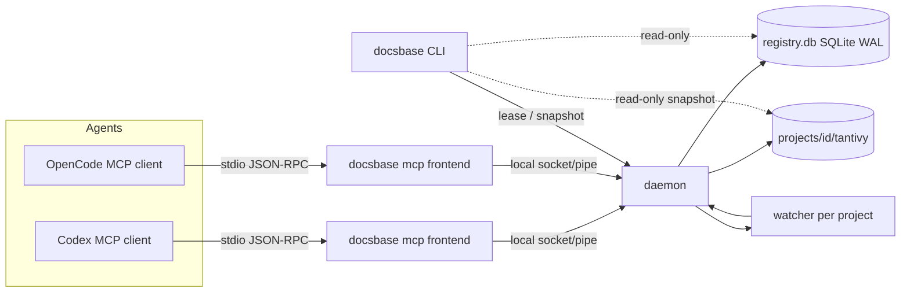

# Architecture

Short operator's view. Full spec: `specs/docsbase-memory-mcp/design.md`.

## Roles

One binary, three roles:

- **CLI** (`docsbase <cmd>`) — parses args and prefers the daemon. Search falls
  back to local snapshots only if its initial connection cannot be established;
  connected errors and an incompatible daemon are reported (FR-30).
- **MCP frontend** (`docsbase mcp`) — thin stdio proxy: ensures the daemon,
  binds the session, forwards tool calls (FR-7).
- **Daemon** (`docsbase serve`, supervised) — owns registry, indexes,
  watchers, sync jobs; single writer per index (WAL + lock recovery).



## Concurrent search ownership

The daemon prepares a bounded operational read-only SQLite pool after startup
migration. Search acquires readers only for short metadata phases and captures
bounded owned candidate/citation/filter/text payloads. Providers, vector CPU,
singleflight followers and rendering retain no global DB mutex, SQL transaction
or metadata reader. A slow hybrid search therefore leaves independent lexical,
status and list requests able to progress.

Project read barriers and config/stages revisions coordinate preparation with
sync/rebuild/reload. Generation, pending updates and payload identities are
checked; an incomplete index or obsolete view produces an explicit retry/index
instruction. A request may finish with its already captured payload or refuse,
rather than combine new text with old candidates. SQLite and Tantivy commits
are independent, not an atomic multi-store publication.

Identical query embedding misses and cold dense initialization share work.
Errors/unwinds wake followers, cancelled callers stop participating and live
followers can continue. Large vector materialization happens after flight
admission. Background refresh uses the same prepared metadata pool.

## Scoped search IPC

Protocol version remains `1`. `Hello` replies add `data.capabilities`, including
`search-context-v1`; an absent list means legacy support only. Canonical MCP
and CLI search require this capability and report restart guidance when it is
missing, without falling back to an unscoped call or local search.

Scoped requests use this existing tagged JSON shape (illustrative durations):

```json
{"method":"Search","params":{"args":{"query":"widgets"},"context":{"remaining_ms":29988,"elapsed_ms":12,"queue_ms":3}}}
```

All three context fields are required unsigned milliseconds. The caller derives
them from one configuration-owned original operation, never a new per-exchange
budget; remaining time must be positive and queue time cannot exceed elapsed.
The server checks clock range and clamps to its own original policy deadline.
Responses retain the existing `kind`/`data` envelope and default search array.
Explain adds `queue_ms` and retains original `stage_ms.total`.

There is one outstanding scoped request per connection. EOF or session/request
cancellation abandons that caller; another complete frame during work is a
protocol refusal, while a partial next frame survives if the current work wins.
The same original deadline bounds reply writes, without a fresh error-delivery
budget. Clients discard interrupted/partial connections before reuse. Actual
synchronous jobs retain activity and connection capacity until they complete;
graceful shutdown drains that real work, not only waiting client futures.

Legacy `CallTool` remains available to compatibility clients and retains its
half-close/reply semantics. It does not provide the new EOF cancellation or
upstream timing contract. CLI search creates an async runtime bridge on a plain
thread (or a multithread runtime's blocking context); synchronous invocation from
an existing current-thread runtime returns explicit Admission. Async consumers
can use the internal `AsyncClient` API, whose stability remains unpublished.

## Runtime layout

```text
$CACHE (0700; DOCSBASE_CACHE_DIR override)
├── state/daemon.json        # pid, endpoint, build_id, schema_version
├── state/daemon.sock        # Unix socket (0600) — Windows: named pipe instead
├── state/*.lock             # start/admission flock
├── registry.db              # SQLite WAL: projects/docs/chunks/sync_jobs
├── projects/<id>/tantivy/   # per-project FTS index (derivable, rebuildable)
├── projects/<id>/.writer.lock
└── logs/{daemon.log, conflicts.ndjson}

$CONFIG — config.toml (global)
$DATA   — bin/docsbase + install.json (owned manifest)
Project — .docsbase.toml, .docsbaseignore
```

Indexes are derived data: they can always be rebuilt from the `.md` sources.

## Platform seam (ADR-9/ADR-10)

All OS-dependent code lives in `src/platform/` behind a small facade:
transport (`Endpoint`: Unix path vs `\\.\pipe\docsbase-<blake3>`),
signals, process liveness (`/proc` on Linux, `proc_pidinfo` on macOS,
`OpenProcess` on Windows), permissions
(`0600`/`0700` vs best-effort ACLs), path semantics (case, separators,
verbatim `\\?\`, system roots). Everything else is platform-agnostic and
selected by `#[cfg]` only inside the seam. `platform_boundary` tests pin it.

## Contracts & versioning

Versioned: `protocol_version` (socket), `schema_version` (DB),
MCP tool shapes, CLI surface, config format. Breaking changes require a
major version; wire/DB mismatches fail with an actionable `Admission` error
(`docsbase install` is the remedy for stale state).

## Supply chain

`Cargo.lock` committed, `--locked` everywhere, crates.io
`min-publish-age = 14 days` (nightly-only feature, no `[unstable]` needed),
no network at runtime by default (hybrid stages are opt-in per project/request,
constitution 1.2.0), releases with sha256 + SBOM + SLSA provenance.


## Explicit query interpretation

`index::QueryMode` owns request spellings and the Syntax compatibility default.
CLI/MCP/IPC boundaries validate mode, then daemon `SearchArgs` passes the typed
value to `ReadIndex::search_with_mode`. Syntax retains Tantivy's parser; Literal
builds fieldless OR literals through its public AST builder using the same
analyzers/boosts. Existing index `search` APIs explicitly select Syntax. Provider
inputs and cache identities stay based on the original text. No tokenizer/schema
version or state invalidation is required.

`literal-query-v1` is an additive Hello capability under protocol1. Supported
blocking/async search helpers refuse literal before dispatch to an incapable
peer. Async scoped search also retains `search-context-v1` and the original
operation budget; connected refusal cannot trigger direct fallback or a new
request. Raw frame calls leave negotiation to the caller. See [MCP query
interpretation](MCP.md#query-interpretation).
