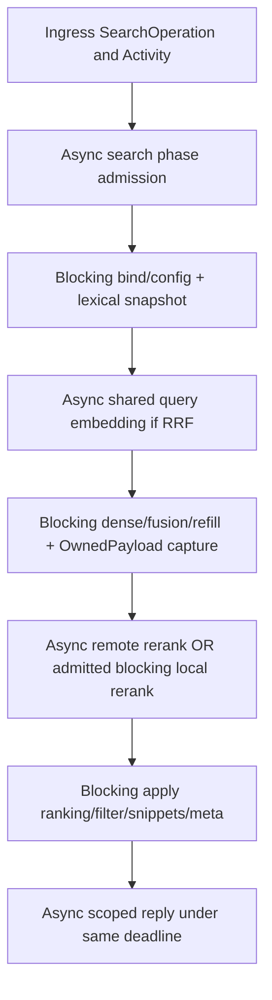

# Дизайн async remote orchestration и ADR-81

Дата: 2026-11-14. Architectural local blueprint на main
`61effaf34dc570b0a3ea9c5c5afec4748587bf6f`. MODIFIED 2026-11-14: fix1
architecture review PASS, A1 implemented for review; A2/B production pending.
Requirements: [requirements.md](requirements.md). Source/receipt ledger:
[progress.md](progress.md). D1–D9 ниже — **approved implementation plan**, существующие
интерфейсы в source inventory обозначены отдельно.

## D0. Проверенная исходная граница

| Реальный source | Сегодняшний owner/поведение | Изменение #81 |
|---|---|---|
| `daemon/server.rs::call_tool_in`, `request::spawn/run` | SearchOperation → WorkerAdmission search permit → одна blocking closure на весь search; Activity переживает drop waiter | Dispatch async search и отдельные admitted blocking phases; Activity остаётся тем же |
| `daemon/tools.rs::lexical_snapshot/in_read_phase/prepare_search/PreparedSearch` | Короткие read/config/project leases; owned bounded payload до rerank; query embedding ещё внутри sync dense phase | Разрезать до query network и до rerank; переиспользовать algorithms/capture/finalization |
| `hybrid/dense.rs::query_embedding`, `flight.rs::Flights` | Pure completed LRU + synchronous active-flight registry, mpsc wake | Async membership/Notify и owned leader в том же registry |
| `hybrid/work.rs::Cancellation` | Постоянный cancelled bit + blocking listeners + async Notify | Тот же token/async wait; отдельный request cancellation implementation не нужен |
| `hybrid/openrouter.rs::ReqwestTransport` | reqwest Client + fallback current-thread Runtime, sync Transport drives async through block_on | Reuse Client, async transport entry; operational consumers уходят от runtime bridge |
| `hybrid/wire.rs::post_with_retry` | Sync seam, thread::sleep, policy constants | Shared pure policy + cancellable async execution |
| `hybrid/rig_codec.rs::OpenRouterCodec` | Rig encode/validate/decode смешаны с sync send | Pure encode/decode reuse по обе стороны async send, тот же Rig 0.45.0 |
| `index/job.rs::finish_plan` | mark_pending → staged Tantivy changes → embed → Tantivy commit → SQL apply | Owned resumable plan на границе embed, тот же порядок публикации |
| `hybrid/jobs.rs`, `vector_cache.rs::embed_missing` | Sync lookup/provider/validate/write; full backfill читает все texts | Bounded batch capture/lookup, async provider, bounded validated write |
| `daemon/tools.rs::run_sync_job_in_with_vectors` | lexical outcome/Sync attribution фиксируются до backfill | Сохранить captured record, не выводить attribution из later generation |
| `watch/mod.rs::spawn_consumer/WatchRuntime` | Dedicated std consumer thread, prepared config/stages/source, sync retries | Production async consumer, bounded existing event transport, admitted CPU/job work |

### Consumer inventory и две поставки

| Consumer | PR1 | PR2/final |
|---|---|---|
| Shared daemon `search_docs`, legacy CallTool и scoped Search | Async query embedding/rerank; local/CPU admitted | Тот же путь, полная observability |
| MCP frontend / Node SDK / CLI daemon route | Получают async search через тот же native server; wire semantics сохранены | Native cancellation/restart/shutdown matrix |
| Website profile | Прежний lexical-only path, disabled watcher/ANN/provider | Без изменения product scope |
| Direct CLI search | Legacy sanctioned sync path, честно outside PR1 guarantee | Один runtime boundary → тот же async search phases |
| Explicit Sync / open-time coverage backfill | Legacy sync-over-async background; #81 не закрыт | Bounded async job coordinator и remote background lane |
| Direct index/full/recovery/incremental/watcher | Legacy sync provider, прежние markers/outcome | Resumable owned index job и async remote between CPU phases |
| Public sync Embedder/Reranker/index/jobs helpers + fixture callers | Совместимость сохранена, operational async caller их не выбирает для remote | Explicit compatibility adapters; production inventory не использует их для remote jobs |
| Connect key/model probes / ORT/model provisioning | Прежний single-shot sync command boundary | Тот же contract, не redesign provisioning и не additional calls |

## D1. ADR-81 — MODIFIED 2026-11-14: ADR-7/I3 execution boundary

**Контекст.** `hybrid-providers` FR-10, A4, design §2/§5/I3/§8 и исторический
ADR-7 требуют blocking context для каждого provider вызова. Server #79 теперь
имеет original deadlines/physical permits; remote ожидание занимает этот permit.
Thread-local execution flag не может быть guard через await/migration task.

**Решение.** Async orchestrator управляет remote embedding/rerank, provider
admission и retries. CPU/SQLite/local inference продолжают выполняться в
санкционированных blocking closures. I3 теперь означает: **sync compatibility
provider call требует `blocking::enter`; async remote call требует явный
operation/admission owner и не использует thread-local guard**. `blocking::enter`
остаётся RAII только на синхронном стеке, никогда вокруг future.

Это датированная delta перечисленным старым blocking assumptions, не изменение
ranking/offline/allowlist/no-fallback и не отмена ADR-RIG1. В функциональном PR1
добавляются cross-links/delta в hybrid-providers requirements/design и текущий
source module comment; старый текст не переписывается как будто всегда был async.

**Альтернативы.** (1) Один `spawn_blocking` с `.block_on` сохраняет occupied
worker, отвергнут. (2) Rig async driver одновременно меняет transport/retry
ownership и риск nested runtimes; отвергнут для #81. (3) Boxed object-safe futures
в существующих stage adapters — выбран, без нового executor/SDK/registry.

**Следствия.** Async and blocking execution различаются явной capability stage;
remote fallback на sync запрещён в production async orchestration. Публичные
sync APIs остаются compatibility adapters; их отдельный вызов embedder из
current-thread Tokio context отклоняется, а не создаёт nested runtime panic.

## D2. Typed owners и узкая CF13 delta (FR-81-03/05/08/09)

MODIFIED 2026-11-14, fix1/I3: owner-first launch classification ниже обязательна
также для legacy Shared; одной ConfigSpec delegation недостаточно.

Создать ungated `hybrid/remote_settings.rs::{RemoteSpec,RemoteSettings,RemotePatch}`
по существующему SettingsSpec/Resolution. Global-only `[remote]`; project key
отклоняется так же, как `[daemon]`/`[search]`. ConfigSpec импортирует owner и
делегирует fields/defaults/overlay/validate/view/impact, без remote rules в parser.
Global launch snapshot уже читает один captured config: повторный parser не нужен.

`config/resolve.rs::launch_resolution` после единственного parse TOML document
извлекает **обе** owner sections `daemon` и `remote` до decode legacy fields.
RemoteSpec предоставляет `decode_patch(toml::Value) -> Result<RemotePatch>` и
owner validation; Resolution применяет patch с исходным SourceId::Global и
теми же once-computed defaults/provenance. После owner patches выполняется pure
`DaemonSpec::validate_execution_capacity` (включая checked helper pending count
из RemoteSpec), **до** legacy decoding и runtime/DB/client/listener/state effects.
Никаких remote чисел/validation rules в parser нет: только owner routing.

Сохранить `LaunchFailure::{Legacy,Daemon}`, добавить `LaunchFailure::Remote(Error)`.
Remote decode/type/unknown-key/validation/derived-count errors классифицируются
Remote; daemon-owned capacity error — Daemon. `daemon/launch.rs::LaunchSnapshot::legacy`
возвращает Err для Daemon **или** Remote, даже при Shared и даже если остальная
legacy часть содержит другую ошибку. Только unrelated legacy errors после
успешного owner validation сохраняют warning/default/error-stamp adapter;
recognized Website остаётся strict. Если весь документ синтаксически не
разбирается, section не считается recognized: прежняя Legacy classification
сохраняется, без отдельного regexp parser.

`GlobalFileConfig`/ConfigDefaults/ConfigSpec/value view/source-preview records
получают RemoteSpec; `ProjectFileConfig` structural exclusion даёт global-only
error для `remote` key. Legacy v1 serialization/projection и source migration
roundtrip сохраняют глобальную section/provenance; generic TOML read-modify-write
`cli/connect.rs::write_global_provider_locked` сохраняет remote значения при
записи provider record. Эти actual boundary tests входят в A1, а не только unit
validate. Feature-off section не включает provider; невалидная recognized policy
всё равно fatal до construction.

| Complete field в `[remote]` | Default / unit | Реальный consumer / последствия |
|---|---|---|
| `interactive_active`, `interactive_pending` | 4,32 / count | Async provider lane для interactive work; 0 pending означает immediate-only |
| `background_active`, `background_pending` | 1,8 / count | Async provider lane для job batches; вводится/потребляется в PR2, не flags-only PR1 |
| `attempt_timeout_ms` | 30000 / ms | HTTP send + complete bounded body; ordinary original remaining / shared hard-cap remaining, D5 fix1 |
| `retry_attempts` | 4 / count | Total attempts, не retries+first |
| `retry_initial_ms`, `retry_max_ms` | 250,4000 / ms | Exponential delay; multiplier2 — существующая policy, настраиваемый scalar `retry_multiplier=2` |
| `retry_multiplier` | 2 / count | Delay evolution, checked/saturating arithmetic |
| `max_retry_after_ms`, `jitter_max_ms` | 30000,50 / ms | Retry-After clamp; jitter `[0,max)`; 0 jitter разрешён |
| `embed_batch_texts`, `embed_batch_bytes` | 128,524288 / count,bytes | Existing ordered embed batching; oversized-single-text exception сохраняется |
| `max_response_bytes` | 33554432 / bytes | Actual response chunks before String/JSON; malicious Content-Length не управляет allocation |
| `background_timeout_ms` | 600000 / ms | Whole admitted index/backfill attempt, включая CPU/provider/write; PR2 owner, не search deadline reset |

У DaemonSpec добавить только `background_active=1`, `background_pending=8` и
`helper_active=1` для WorkerAdmission CPU/job/DNS lanes. Background fields входят
только с PR2 consumers. Helper field входит в PR1 с bounded DNS. Helper pending
capacity вычисляется checked sum `remote.interactive_active +
remote.background_active` (в PR1 только interactive). Это фактический semaphore
cap, а не предположение, что reqwest уничтожит всю connector work при drop HTTP.
Отдельный operator setting для этой производной очереди не нужен.

MODIFIED 2026-11-14, fix1/C1: PR2 `daemon.background_active=J` задаёт physical
phase capacity; logical job bound `L=J` — отдельный semaphore с вычисленным
значением. Fixed one terminal dispatcher даёт derived `T=1`, отдельную physical
lane. DaemonSpec проверяет `S+C+J+H+T<=B` до resources и показывает derived L/T/
sum в policy view/formula; это bounded implementation invariants без новых knobs.

Validation: positive active/count/byte/attempt/timeouts, zero pending/jitter
allowed, initial<=max, multiplier>=1; actual Tokio permit limits, checked sums,
`Instant::checked_add`, durations и allocation arithmetic. `retry_attempts` и
durations остаются конечны даже при большом operator override. Unsupported feature
отображается capability metadata; отсутствие `hybrid-remote` не создаёт HTTP
resources. Remote section сама по себе не включает hybrid/provider access.

Изменение scalar policy требует restart captured daemon policy; stale file
reload не перестраивает semaphore. `RemoteSpec::assess_change` возвращает runtime
impact/restart requirement, **не** vector/index/ANN rebuild. Credentials по-прежнему
отдельный secret handle; fingerprint их не содержит. I38/I39/I40 adopted; I24–I26,
I36/I37, provisioning I51/I59–I64 и retained local manager I67 остаются прежними,
если их consumer не меняется. Новая on-disk/config v2 migration не нужна.

PR1 ship subset: interactive/attempt/retry/batch/response/helper settings имеют
реальный consumer. PR2 добавляет background settings вместе с jobs. Constants
sync compatibility seams ссылаются на один owner catalog через boundary resolver,
не второй `Default` runtime path. Source settings-inventory/state-dependencies
получают датированную adoption/deferred delta в каждом функциональном PR.

## D3. Stage/transport interfaces (FR-81-01/03/07/10/13)

Используем `std::future::Future`, `Pin<Box<...>>`, Tokio, существующий reqwest.
Object-safe explicit capability на существующих traits сохраняет sync fixtures
и локальные implementations; новой provider таблицы нет:

```rust,ignore
type StageFuture<'a, T> = Pin<Box<dyn Future<Output = Result<T>> + Send + 'a>>;
trait AsyncEmbedder: Send + Sync {
    fn embed<'a>(&'a self, texts: &'a [String], call: &'a RemoteCall)
        -> StageFuture<'a, Vec<Vec<f32>>>;
    fn embed_query<'a>(&'a self, text: &'a str, call: &'a RemoteCall)
        -> StageFuture<'a, Vec<f32>>;
}
trait AsyncReranker: Send + Sync {
    fn rerank<'a>(&'a self, query: &'a str, docs: &'a [String], top_n: usize,
                  call: &'a RemoteCall) -> StageFuture<'a, Vec<(usize, f32)>>;
}
// Existing Embedder/Reranker gain `async_remote() -> Option<&dyn Async...>`.
// Default None means blocking/local adapter. OpenRouter returns Some(self).
// Operational remote stage with missing async capability is explicit error.
struct RemoteCall {
    operation: SearchOperation,
    class: WorkClass, // Interactive / Background
    interest: Option<FlightInterest>, // owned view for shared query work
}
trait AsyncTransport: Send + Sync {
    fn post_json<'a>(&'a self, request: &'a WireRequest, timeout: Duration)
        -> StageFuture<'a, TransportResponse>;
}
```

MODIFIED 2026-11-14, fix1/I1: **operational `ReqwestTransport` не содержит
`tokio::runtime::Runtime`, fallback runtime или runtime-owning Arc/Drop bridge**.
Он владеет reused reqwest Client/resolver и explicit execution dependencies.
`RemoteExecution` — один captured per-daemon owner HTTP client/admission/
counters/shutdown dependency, shared всеми model revisions. Existing stage Arc
содержит model config/ApiKey, но не отдельный HTTP runtime для каждого query.
`from_config_with_execution` и `Provider::build_stages_with_execution` получают этот
explicit dependency. Default factory method делегирует existing blocking/local
build; OpenRouter override создаёт async-capable adapter. Существующий
`from_config` — compatibility composition resolver.
Пустые lists и rerank top_n clamp остаются прежними.

Split `rig_codec` на pure request encoding и response validation/decoding +
общий send adapter. Sync и async используют **один** codec implementation:
query/document roles, dimensions, indexed/missing-index projection, finite f32,
normalization, rerank duplicate/range validation, attribution headers сохранены.
Rig не получает driver/runtime/retries. Большая bounded encode/decode/normalize
работа идёт в admitted CPU phase, а не на Tokio worker; HTTP await остаётся async.

`ReqwestTransport` async entry использует прежний Client; timeout передаётся явно.
Ordinary call получает min(attempt setting, original remaining); shared flight
получает min(attempt setting, **hard-cap** remaining), не current member maximum
(D5 fix1/I2). Body читается `Response::chunk` до actual cap, не `.text`
с неограниченным накоплением. Счётчик attempt увеличивается только перед реальным
send после admission/deadline checks. Retry waits `tokio::time::sleep_until` с
select того же Cancellation/shutdown/deadline, без blocking sleep. Error mapping
не логирует payload/credentials. Final guard при success проверяет operation;
expiry/cancel не превращаются в retryable transport failure.

Один provider active permit удерживает всю remote logical stage, включая retries,
backoff и чтение body. Поэтому retry нельзя использовать для обхода очереди;
новый request не создаёт параллельные attempts. Batch stage выполняет запросы
последовательно с тем же permit/budget. Wait admission имеет отдельный pending
charge; FIFO active semaphore, immediate-only pending0 как в WorkerAdmission.

### D3a. MODIFIED 2026-11-14 — runtime construction/destruction (fix1/I1)

`daemon/remote.rs::with_command_runtime` — единственный sync composition wrapper
для direct CLI и real sync/probe compatibility consumers. Его сигнатура принимает
builder closure `FnOnce(CommandExecution) -> Future<Output=Result<T>>`; Runtime —
local variable wrapper, **не поле CommandExecution/client/stage/flight**. Порядок:
проверить ambient flavor → создать complete settings/Runtime → `runtime.block_on`
build+run+cancel-on-error+physical-drain → вернуться из block_on → Drop runtime.
Runtime не передаётся в async future и не уничтожается его partial cleanup.

| Caller context | Construction / calls / destruction |
|---|---|
| No ambient runtime | Wrapper создаёт один current-thread Runtime local; block_on драйвит I/O; после success/error/drain Drop в исходном sync stack |
| Ambient multithread runtime | Весь wrapper, включая Runtime construction **и Drop после block_on**, внутри одного `block_in_place`; не только сам вызов block_on |
| Ambient current-thread runtime | Admission error **до** Runtime/HTTP client/stage/DB construction; нет partially built fallback для уничтожения |
| Operational async factory | Получает существующий execution/client; Runtime не создаёт/не хранит/не уничтожает, независимо от ambient flavor |

Sync `Transport` seam сохраняется для fixtures. Real sync counterpart —
`SyncTransportAdapter{async_transport:Arc<ReqwestTransport>,handle:Handle,
bridge_liveness:Arc<BridgeState>}`. Он не владеет Runtime; принимает Handle явно
от command execution либо текущего daemon multithread runtime при санкционированной
blocking construction. Sync send требует `blocking::enter` и live bridge; внутри
admitted blocking closure `Handle::block_on` допустим, owner block_on продолжает
драйвить current-thread I/O. Операционный async factory никогда не создаёт adapter.
Plain-thread real remote compatibility caller входит через documented wrapper;
попытка построить real sync adapter без explicit/ambient live execution даёт
Admission, а не implicit per-call Runtime. Existing fake Transport не требует runtime.

Command wrapper запускает старые sync direct/probe consumers через одну admitted
blocking closure; A1 wiring обеспечивает сохранность этих legacy consumers до
их async phase migration в PR2. Existing sync public helper signatures можно
сохранить wrapper-ами на **composition** boundary, не на каждом POST/retry.
BridgeState помечается retired после завершения work/drain, до Runtime Drop;
оставшийся Handle/client Arc может безопасно drop-нуться в любом async task,
дальнейший sync вызов retired bridge даёт явную ошибку. Daemon adapter не продлевает
жизнь Runtime и не переживает daemon physical drain как работающий consumer.

Root execution owner (`CommandExecution`/daemon-owned equivalent) удерживается
**в sync wrapper вне work future**, как и Runtime. Construct complete execution
через initial block_on до consumers; partial construction допускает ноль accepted
jobs/helper requests. Затем `catch_unwind` вокруг work block_on; при Ok/Err/unwind
root вызывает cancel/close-new и второй block_on physical drain/join terminal
service, и лишь после этого уничтожает execution/runtime. Panic payload не
логируется. Work-future unwind не уничтожает terminal receiver с queued native
resources на Tokio. Daemon `run_with_launch` также сохраняет этот root handle
вне `serve/accept_loop` future. Existing second-signal abandons request/reply wait;
он не разрешает drop native IndexState на Tokio: physical retirement остаётся
root shutdown обязанностью, как already-running spawn_blocking не исчезал раньше.

Client build error/stale construction/cancellation дропают только runtime-free
objects; wrapper всё равно завершает physical drain перед уничтожением runtime.
Не использовать `shutdown_background`, leak Runtime или новую runtime thread как
замену ownership. A1/A2/B3 проверяют last-Arc drop в async task, stale flight как
последнего owner, failed construction, early error/cancel, direct command teardown
и все три ambient cases; assertion включает destruction и absence of panic.

## D4. Phased interactive search (FR-81-02/04/07/13)



Не перекрывать lexical и embedding: сначала сохранить текущие data dependencies
и stage timing, без необоснованного speed claim. Preflight даёт retained
`SearchSession` (Arc<Shared>, Project, Arc<Config>, Arc<HybridStages>, args,
operation, activity) и `LexicalSnapshot` со generation, hits, bounded scope.
Ни borrowed DB, ни mutex/read guard в возвращаемом owned типе нет.

Предлагаемые внутренние методы `tools::{start_search,prepare_with_query_vector,
finish_with_rerank}` выделяют существующие алгоритмы, а не копируют search.
`SearchSession::run` в новом `daemon/search_async.rs` вызывает их через helper
`run_search_phase`: `workers.search(operation).await` → `request::spawn` c
permit + cloned Activity → original-deadline await. Spawn admission delay и
actual executor start delay добавляются к существующему queue_ms.

Remote query вектор получается **до** blocking dense phase и передаётся как
`Arc<[f32]>` в existing dense/scoped candidates; второй `query_embedding` внутри
них запрещён. Local query inference выполняет owned leader в admitted local
phase; все operational waiters, включая local followers, используют async join
тех же query flights и не занимают CPU worker ожиданием другого inference.
Dense rows/ANN/fallback/scoped metadata и refill
остаются blocking, с существующими generation/config read checks. Если mutation
произошла между lexical и payload capture, вернуть retry, не смешивать новые SQL
rows со старыми hits и не держать WAL snapshot на network timeout.

`PreparedSearch` сохраняет charged OwnedPayload. До remote rerank подготовить
charged bounded `RerankInput` в CPU phase: query/documents/index mapping. Не
удваивать retained document bytes незачтённым `.clone`; учитывать encoded body
и per-request allowance. После remote только список scores; ordering/filter/
snippet/meta выполняются существующим кодом в CPU phase. Уже захваченный payload
полностью self-contained, его final response может завершиться после reload.

Search permit — **physical CPU phase**, не whole request slot. Ретained requests
ограничивают existing max_connections/max_sessions, PayloadBudget и remote
pending limits. Много network waits не создают unbounded CPU spawn queue:
каждый следующий phase заново проходит WorkerAdmission. Control/status имеют
свою lane. Existing request `CancelOnDrop`/scoped select/reply deadline сохраняются.

## D5. Async singleflight в существующем registry (FR-81-02/06/11)

Расширить `flight.rs::Flights` async join/wait/completion; `FlightState` получает
Notify и membership metadata. Один registry в existing QueryCache обслуживает
sync compatibility/local и async remote path; cold dense flights остаются теми
же отдельными **типами работ**, второй query registry не создаётся.

Flight key: `(model_id, blake3(query), RuntimeRevision)`. RuntimeRevision владеет
retained Arc config/stages, сравнение identity process-local; это не новый
persistent recipe. Direct composition имеет retained runtime instance identity.
Completed query LRU остаётся pure `(model_id,query_hash)`: менять vector identity
или существующее `sharing_query_cache` поведение не нужно. Успех obsolete flight
может обслужить его live captured peers, но не записывается в current-runtime
LRU после failed revision admission. Pre-existing pure-cache hit того же model
допустим: config-independent operational budgets не меняют embedding function.

Первый waiter выбирает flight под кратким registry lock; cache recheck обязателен.
Все waiters, включая инициатора, владеют membership и ожидают async Notify либо
свой cancellation/deadline. Leader — **отдельная owned Tokio task**: drop initiating
future не отменяет peers. Work closure владеет stage/input/registry/Activity,
никаких borrowed `Interest<'_>` через await. Completion RAII снимает только
matching flight и будит async/blocking subscribers при normal/failure/unwind/drop.
Failure category/source сохраняются existing SharedFailure, failure не кладётся
в completed LRU. Нет живых members → abandon/cancel shared async work; late join
не оживляет terminal flight, повторяет admission как current Abandoned protocol.

Budget ownership:

1. Каждый member хранит собственный unchanged operation deadline и token.
2. Shared hard deadline = `flight_created_at + resolved search.request_timeout_ms`.
   Это derived cap существующего SearchSpec, не новый скрытый timeout default.
3. Перед provider admission/attempt/backoff shared effective deadline равен
   `min(hard_deadline, max(deadline живых members))`. Membership Notify заставляет
   async wait пересмотреть интерес и дедлайн; departure последнего отменяет
   shared token. Поздний waiter не продлевает hard cap бесконечной цепочкой.
4. MODIFIED 2026-11-14, fix1/I2: **фиксированный transport attempt timeout** равен
   min(attempt setting, **hard-operation remaining**), независимо от personal
   deadlines. Live-interest максимум применяется внешним resettable timer,
   который сохраняет **тот же pinned HTTP future** при membership change.
   Ранний caller возвращает expiry, не отравляя внутренний reqwest timer peer.
5. Caller отменяется только своим SearchOperation. Shared cancellation state —
   тот же `Cancellation` primitive с owned interest controller; не alias первого
   waiter. Logical provider charge и Activity принадлежат leader до завершения.

`RemoteCall::attempt_timeout` для обычного запроса делегирует original remaining;
для flight берёт **только** hard remaining и attempt policy. Отдельный
`RemoteCall::interest_deadline/check` учитывает live members. `await_attempt`
создаёт HTTP future и attempt deadline **один раз**, pin-ит future вне select loop;
loop регистрирует membership Notify до чтения permanent state и select-ит тот же
future, unchanged attempt/hard timers, cancellation и live-interest Sleep.
Membership wake перечитывает state и reset-ит **только outer interest Sleep**.
Если Sleep готов, сначала reread state: присоединившийся live peer может сдвинуть
его вперёд без resend; если live maximum действительно истёк, terminal abandon.
Last member departure terminal-cancel-ит shared operation, нельзя воскресить его
late join. Ни pinned HTTP future, ни fixed attempt clock не пересоздаются.

Admission использует такой же resettable interest wait вокруг **одного** active
semaphore acquire future: FIFO position не сбрасывается при новом member. Backoff
сохраняет один absolute wake=`previous_attempt_finished+pause+jitter`; membership
меняет только outer-interest timer, не jitter sampling/backoff start/attempt count.
После фактического retryable transport failure новый attempt разрешён только
remaining policy count и повторными hard/live-interest checks. Hard expiry всегда
terminal. Изменяемый interest не записывается в immutable operation первого caller.
Sync compatibility join использует явно созданную
compatibility revision того же key type; operational revision передаётся из
captured session, не угадывается внутри DenseCache.

MODIFIED 2026-11-14, fix1/M1: состояние flight — authority, Notify только будит.
Под краткими registry→flight locks publication terminal state и matching removal
атомарны. Waiter сначала создаёт/enables Notified, затем проверяет permanent state,
потом ждёт в loop; cancellation использует existing permanent Cancellation.
Выбранный до join terminal/retiring flight возвращает Abandoned/re-admission,
не зависает и не получает новое членство. Детерминированные seams покрывают
completion между selection/join, check/registration, last-departure/late-join и
publication/removal; все ранее live waiters просыпаются, последующий запрос
создаёт новый matching flight, retired state не копится.

Длинный хвост waiter может получить shared timeout раньше собственного deadline,
если присоединился близко к hard cap; это явный bounded shared-work failure,
не silent fallback/retry. Новый самостоятельный запрос после terminal может
создать новый flight в своём remaining request budget.

## D6. Физические ресурсы, hidden HTTP helpers, lifecycle (FR-81-05/07/11)

Проверены pinned sources reqwest0.12.28 `dns/gai.rs` и hyper-util0.1.21
`client/legacy/connect/dns.rs`: `GaiResolver::call` вызывает
`tokio::task::spawn_blocking(getaddrinfo)`; Drop GaiFuture abort-ит JoinHandle,
но running closure не прерывает. Async reqwest не даёт ноль blocking helpers.

Заменить default resolver через existing reqwest `ClientBuilder::dns_resolver`.
`daemon/remote.rs::BoundedResolver` использует тот же `WorkerAdmission::helper`
до spawn с реальными active/pending semaphores, затем
`request::spawn` с helper permit и Activity до фактического `ToSocketAddrs` finish.
Resolver future drop освобождает только pending waiter; started closure retained.
Custom Resolve API не имеет request context: helper queue имеет finite cap,
вычисленный из configured provider slots; собственный upper-bound wait равен
remote attempt timeout, enclosing HTTP attempt применяет меньший original
remaining deadline. Даже dependency connector, переживший HTTP drop, не обходит
реальную helper queue capacity.
Already started helper имеет отдельную Activity, независимую от drop HTTP stage.
No additional DNS crate, polling bridge, unbounded helper thread или runtime.

Для lifecycle источник Activity (`ActivitySource`) выделяется из уже имеющихся
counter/events, без второго physical counter. Production serve создаёт источник
до RemoteExecution и передаёт в Shared/accept loop; `Activity::new` delegates
к нему. Request activity сохраняет connection reference; DNS/background activity
не привязана к произвольному initiating socket. Existing test compatibility
handle_connection получает source из переданных counter/events. Hybrid codec
не импортирует daemon tracking: `ReqwestTransport::with_settings` получает
complete RemoteSettings и `Arc<dyn reqwest::dns::Resolve>`, existing HTTP seam.
Resolver хранит Arc<WorkerAdmission>/ActivitySource, а не capture произвольного
request. Direct composition использует тот же resolver и local ActivitySource;
новых независимых physical counters внутри hybrid нет.

| Resource | Bound / physical owner | Что держится на remote await |
|---|---|---|
| Search CPU closures | `S=daemon.search_active` + finite pending, WorkerAdmission/request::spawn | 0 search CPU permits/SQL read/config/read leases |
| Control/janitor/bind/register | `C=daemon.control_active` + finite pending; existing owner | Независимая control lane |
| Logical jobs (PR2) | `L=J` separate logical semaphore, finite daemon.background_pending; pre-reserved terminal ticket | Logical slot + transfer-only JobOwner, no physical J permit |
| Job CPU closures (PR2) | `J=daemon.background_active`, independent physical semaphore | 0 CPU permits on remote await; native state behind JobOwner |
| Terminal finalizers (PR2) | Fixed dispatcher, reserved physical `T=1`; <=L terminal envelopes | No idle blocking worker; queue retains Activity/lease/bytes |
| DNS closures | `H=daemon.helper_active`; actual pending cap=`Ri+Rb` | Физический DNS charge до closure finish даже если HTTP уже dropped |
| HTTP logical stages | Interactive `Ri`, background `Rb`, respective finite pending | Active provider permit + bounded request/response/state bytes |
| Query leaders | <= admitted search callers и provider active+pending; один на key | One owned leader + memberships + Activity; no blocking follower |
| Job coordinators | Existing Sync dedup + global active/pending job admission; watcher coalescing | Bounded retained plan + job Activity, no thread waiting network |
| Read handles/payload | Existing ReadPool and PayloadBudget independent caps | No metadata reader; bounded owned scope/payload может удерживаться |
| ANN build/refresh | Existing dense active_build_bytes/resident caps + retained Activity | Existing native/std/Rayon work, не Tokio network workers |
| Watch producers | Existing notify+debounce threads per live watcher `W`, bounded4096 event/batch channels | Не выполняют provider waits; `W` явно вне Tokio executor sum |

PR1 проверяет S+C+H+Website fixed-sync1<=B там, где fixed sync применим; Shared
legacy background до PR2 остаётся вне полного reserve claim. PR2 проверяет
application-owned Tokio bound `S+C+J+H+T<=B`, `T=1`, checked до resources,
переводит sync CPU на J и исключает `request::spawn(None,...)` production bypass.
Existing captured async worker count + B overflow check сохраняется. Process-wide
native/Tantivy/Rayon/IPC thread/fd retirement этим не обещается. ANN raw worker
и post-sync refresh получают retained Activity до фактического finish; их existing
byte reservation освобождается только existing RAII owner.

MODIFIED 2026-11-14, fix1/C1: shutdown closes **new ordinary admission**, stops new
jobs/watch batches, cancels queued and async work, then drains pre-admitted
terminal service D7a. `WorkerAdmission::shutdown` не закрывает terminal lane для
уже выданных tickets; terminal receive task живёт до физического drain. Cleanup
не reacquire-ит удерживаемый logical semaphore и не проходит закрытую ordinary
CPU queue. Existing second-signal
escalation остаётся способом abandon wedged native work; provider cancel не
обещает прекращения принятого вычисления/оплаты. PR1 tracks new interactive/DNS
work; PR2 includes background/ANN-refresh integration before issue closure.

## D7. Index/backfill/watch/direct composition (FR-81-09/10/11/13)

PR2 не превращает SQLite/Tantivy в async. `index/job.rs` получает внутренний
`PreparedIndexJob` state machine, full/incremental/recovery используют общий
existing planner/apply. Stages:

1. Async global job admission до allocation/mutation; retained config/stages/
   source/operation. Whole attempt deadline берётся из RemoteSpec background
   timeout, через явный deadline constructor того же SearchOperation (без
   повторного search30s clamp). Pending queue входит в этот budget.
2. Bounded blocking prepare получает **owned** existing project writer lease.
   Budgeted capture/preflight D7b заканчивается до project status/attempt/markers
   или IndexHandle mutation. Затем job-owned Db/IndexHandle/attempt и markers
   устанавливаются только внутри unique JobOwner D7a.
3. Transfer-only JobOwner переходит в async coordinator; native IndexState не
   может быть dropped на Tokio. Global DB/config mutex/
   SQL transaction не удерживаются. Короткий cache lookup/unique hash batch
   возвращает missing texts/hashes, затем connection освобождается.
4. Remote background stage await (или admitted blocking local inference),
   decode/whole batch count/dim/finite validation, short admitted cache write.
   Частичный failing HTTP batch не пишет полуответ. Предыдущие валидные
   content-addressed batches допустимо сохранить для retry, как сегодня.
5. Blocking resume выполняет existing Tantivy commit → SQL apply, generation/
   outcome publication и **captured** Sync record association под тем же writer
   lease. Remote failure/cancel сохраняет markers и non-success outcome;
   не повторять later generation sampling после release. Terminal publication
   и native resource destruction выполняет только D7a finalizer, writer lease
   освобождается **после** IndexHandle retirement; async Drop только transfer.
6. Backfill отдельными ordered batches читает chunk id/hash/text pages в коротких
   read phases; recheck project/config/generation перед публикацией/ANN warming.
   Existing VectorCacheSource owner и pin policy/TTL продлеваются на успешных
   batch boundaries. Failure/cancel снимает принадлежащие job pin leases.

Owned writer lease использует existing `fd_lock::RwLock<File>` и guard в
self-referencing owner на уже принятом `ouroboros`; сохраняется тот же `.writer.lock`
и cross-process read/write coordination. Нового native lock mechanism не нужно.
Компиляционная Send-проверка и native writer/read refusal tests обязательны.
Writer lease/idle Db/IndexHandle находятся внутри transfer-only JobOwner через
remote await: jobs bounded, same-project mutation уже явно отклоняет search.
Native fields не попадают в naked async state/JoinHandle result. Metadata
transaction и CPU worker permit через await запрещены. No CF11 shadow generation.

MODIFIED 2026-11-14, fix1/I4: plan capture использует reserve-before-allocation
interface D7b existing PayloadBudget, включая temporary/encoding peak. «Собрать
plan, потом reserve» недопустимо. Oversized plan отклоняется **до project
status/attempt/markers/IndexHandle mutation**; bounded capture не объявляет
streaming всего corpus или process RSS. Backfill batch count/bytes
берутся из RemoteSettings; oversized-single-text exception допускается только
если text проходит existing charged payload budget, не отменяет общий cap.

Watcher production consumer становится async Tokio task на daemon-owned runtime.
Existing notify/debounce thread передаёт bounded batch через Tokio mpsc
`blocking_send`; это event backpressure, не ожидание provider в worker. Общая
producer implementation получает sink callback; публичный SyncSender adapter
остаётся для existing library/test callers. Existing path coalescing/retry
classification/lease-conflict semantics сохраняются; retry sleep становится
async cancellable. Один watcher coordinator на live watcher, одна накопленная
batch, CPU/remote job admission общие. По cancel/shutdown неприменённая batch
не считается индексированной; durable markers/next full survey обеспечивают
прежний crash recovery, без скрытого live replay mutation.

Direct CLI search/index/sync используют runtime ownership D3a: один explicit
command Runtime local **вне** block_on, затем complete drain, затем Runtime Drop
в том же sync/block_in_place scope. Provider waits async, CPU phases admitted.
Current-thread nesting отклоняется до construction; MCP proxy не создаёт runtime.

### D7a. MODIFIED 2026-11-14 — unique job/finalizer ownership (fix1/C1)

Проверено: `IndexHandle::drop` (`index/tantivy_index.rs:157`) вызывает
`wait_merging_threads`; pinned Tantivy IndexWriter Drop joins workers. Поэтому
native IndexState никогда не является обычным полем async coordinator с native
Drop. Единственный переход ownership — transfer-only wrapper; native destruction
допустим только внутри физически charged blocking closure.

```rust,ignore
struct IndexState { /* private, !Clone; only blocking phase/finalizer can access */
    index: Option<IndexHandle>, db: Option<Db>,
    attribution: CapturedSyncRecord, effects: MutationState,
    capture: JobCapture, // owns all plan/workspace data, then PayloadPermit
    lease: Option<OwnedWriterLease>,
}
enum MutationState { Untouched, Started, LexicalCommitted }
// CapturedSyncRecord is a proposed bounded Option of exact existing stats/
// SyncAttribution, not a new generation or a later DB observation.
struct JobOwner { // !Clone; async-safe Drop transfers, never drops IndexState
    state: Option<Box<IndexState>>,
    accepted: Option<AcceptedJob>, // logical slot, Activity, pre-reserved ticket
    terminal: TerminalReason,
}
struct AcceptedJob {
    logical: OwnedSemaphorePermit, // L, distinct from physical J
    ticket: mpsc::OwnedPermit<FinalizationEnvelope>, // obtained before native state
    activity: Arc<Activity>,
}
struct FinalizationEnvelope {
    state: Option<Box<IndexState>>, reason: TerminalReason,
    logical: OwnedSemaphorePermit, activity: Arc<Activity>,
} // send consumes the ticket; envelope contains no second ticket
struct JobPhaseResult<T> { owner: JobOwner, result: Result<T> }
impl JobService {
    async fn admit(&self, operation: &SearchOperation) -> Result<JobOwner>;
    async fn phase<T>(&self, owner: JobOwner,
        work: impl FnOnce(&mut IndexState) -> Result<T> + Send + 'static)
        -> Result<JobPhaseResult<T>>; // Result/JoinError also retains transfer ownership
    fn close_new(&self); // no new logical jobs/ordinary phases; tickets stay valid
    async fn drain(&self) -> Result<()>;
}
```

`phase` signature выше обозначает owned result, но transport/join failure **не
может** вернуть Err, который drops naked IndexState. Реальный envelope всегда
содержит JobOwner либо уже передал его в finalizer; handle observer владеет только
operation token/completion receiver. `JobService::phase` получает **physical**
J permit независимо от accepted L; передаёт owner в `request::spawn`. Рабочий
closure — единственный owner во время prepare/resume. Нормальный результат
возвращается как JobPhaseResult; receiver dropped/unwind/JoinHandle output drop
вызывает только JobOwner transfer. Ни один Async Drop не читает SQL, не ждёт
merge, не берёт J permit и не запускает новый blocking task.

До capture/native construction `admit` получает logical slot L=J из **отдельного**
semaphore и terminal ticket. Для pending jobs действует daemon.background_pending;
logical slot остаётся до finalization, physical J возвращается после каждой
closure. Даже при L=J=1 следующий phase не ждёт удерживаемый им physical permit.
Terminal queue — `mpsc::channel(L)`; каждый AcceptedJob до mutation резервирует
slot (`try_reserve_owned`, отсутствие slot — отказ до effects). Пока ticket жив,
slot не может быть отдан другому job. Количество queued+reserved+finalizing jobs
<=L благодаря logical slot, а не только размеру mpsc. FinalizationEnvelope storage
и Box header preallocated/charged до IndexState capture; `JobOwner::drop` делает
только `take` и synchronous `OwnedPermit::send`, не allocation/await/lock/native
destruction. `owner.finish(reason)` использует тот же exactly-once transfer.

Один async terminal dispatcher создан при JobService construction до accepted
jobs. Он ждёт mpsc без blocking worker, затем получает **reserved terminal
physical T=1** и вызывает `request::spawn` с permit и cloned job Activity.
T — fixed single-dispatcher implementation invariant, отдельная lane в том же
WorkerAdmission, отображённая derived formula; не private workload default.
У terminal нет новой ordinary admission/pending queue: доказательство допуска —
ранее выданный ticket, очередь уже зарезервирована. WorkerAdmission.shutdown
закрывает S/C/J/helper new admission, но terminal lane допускает только valid
AcceptedJob ticket до конца drain. Нет unpermitted spawn или `spawn(None,...)`.

Shared/command root владеет JobService и dispatcher lifetime. Close-new отменяет
pending/new admission и producing tasks, **не** закрывает terminal receiver.
Receiver нельзя уничтожить/abort-ить до возврата всех issued tickets и JobOwner;
dispatcher не хранит Arc<JobService> с циклом sender/JoinHandle. После завершения
Activity drain owner закрывает base sender и joins dispatcher. Поломка receiver
не трактуется как «можно drop native state на Tokio»; его lifetime конструктивно
зафиксирован private owner, tests не получают raw receiver/abort handle.

В finalizer IndexState перемещается в `RetiringJob`, который существует только
внутри T closure. Порядок normal/error/unwind retirement:

1. Завершить/rollback краткую текущую SQL transaction; сохранить terminal
   outcome/non-success и Sync Error либо законный success, используя **captured
   lexical attempt/attribution**, не sampling later generation. Success только
   после commit/apply; cancelled/failed uncommitted work не становится Ready.
   Publication failure сохраняет durable nonterminal/markers и явный error;
   никакого синтетического Done. Finalizer не требует новой admission для SQL.
   `MutationState::Untouched` (например budget refusal до effects) запрещает
   менять project status/attempt/outcome/markers. Уже queued Sync можно завершить
   Error без lexical attribution, но нельзя приписать ему прежний чужой outcome.
   Started устанавливается непосредственно перед первым project effect;
   LexicalCommitted получает только captured own attempt record после apply.
2. Destroy IndexHandle и дождаться merges/worker retirement **под writer lease**.
3. Drop idle Db, затем plan/workspace данные, затем их PayloadPermit.
4. Drop writer lease; только теперь другой writer может пройти. Drop logical L.
5. Вернуться из closure: existing request::spawn освобождает physical T permit,
   затем последнюю Activity reference/physical-completion event. Drain не видит
   completion раньше terminal publication attempt и native destruction.

Native fields RetiringJob объявлены в том же resource-before-guard порядке;
unwind guard выполняет retirement в T closure. Phase/publication unwind переводит
reason в Error; catch_unwind на blocking boundary сохраняет single ownership и
error context. Если сам native destructor unwinds, оставшиеся поля/lease drops
тоже выполняются на T worker, Activity живёт до конца closure unwind. Нельзя
передавать второй aliased IndexState, unlock lease в coordinator или переносить
IndexHandle в отдельный untracked task. Early constructor failure держит local
resources внутри charged blocking phase, где допустим их blocking Drop.

Обязательные races: remote cancel/abort; cancel while prepare/resume running;
panic/unwind; delivery receiver dropped before/after phase completion; shutdown
закрыл ordinary admission до terminal transfer. Fake/native destructor и terminal
SQL gates доказывают: Tokio control task продолжает работать, writer admission
отказана, retained bytes/logical/physical/Activity сохраняются; release позволяет
exactly one finalizer завершить captured Sync/outcome до drain. Проверить J=L=T=1
и >1 jobs, чтобы отсутствие self-deadlock и queue bound были причинно наблюдаемы.

### D7b. MODIFIED 2026-11-14 — reserve before capture/copy (fix1/I4)

Расширить **existing** `search/budget.rs::PayloadPermit`, не создавать отдельный
unlimited index budget. `grow_to(total:u64)->Result<()>` под retained mutex сначала
checked-вычисляет per-owner delta и aggregate next, проверяет existing SearchSpec
per-request/aggregate caps, затем атомарно увеличивает оба счётчика. Refusal не
меняет charge. `shrink_to` доступен только owning capture code **после** уничтожения
соответствующих allocations; permit не Clone. `reserve(0)` создаёт job account.
`JobCapture` объявляет data/workspaces перед permit, поэтому partial/unwind data
retire до charge. Direct/daemon/watcher получают одну композиционную PayloadBudget;
captured job не создаёт свой private unlimited fallback.

`CaptureBudget` adapter получает `&mut PayloadPermit`; helpers reserve vec/string/
map capacity и UTF-8 bytes **до** `try_reserve`, `.clone`, `.to_owned`, `.push` с
ростом. На reallocation учитывается transient old+new requested storage, затем
charge можно уменьшить после освобождения old storage. Структурный accounting
отражает logical record bytes/capacity/string payload, **не allocator RSS**;
никакой claim о точном размере native/Tantivy/internal allocator pools.
Maps/sets включают ключ/value/bucket/control overhead по conservative preflight;
предпочесть sorted vector+binary search для planner metadata/dedup там, где это
устраняет трудно предсказуемую map capacity, сохранив исходный path/input order.
Default public chunking/parser wrappers сохраняют результаты; internal budgeted
builders вызывают adapter до retained allocation, а не после готового Vec.

До первого project status/attempt/marker/index mutation под owned writer lease:

- SQL metadata сначала получает bounded count/byte-length scalar preflight,
  резервирует doc-state/path/hash/index records до materialized row/map capture;
  cursor reads charge следующую строку до string copy. Полный `repo::doc_states`
  или `.collect()` без pre-reservation не допускается.
- Walk capture резервирует path byte/PathBuf record, relative path, files/walked
  membership и warning storage до сохранения. Borrowed/current-entry OS path —
  один transient, не второй uncharged retained path list. Actual arrays/maps/
  hash strings/chunks/title/frontmatter/heading breadcrumbs считаются отдельно.
- Одна current-file transient ограничена **actual read** `max_file_size+1`,
  checked against available job account до роста buffer; metadata.len не задаёт
  allocation. Бounded reader + budget-aware frontmatter/chunk builders резервируют
  transient/retained strings/ranges/records **до** copies, включая heading clones.
  Oversize source сохраняет прежний file-size warning/error semantics; byte-budget
  refusal — explicit admission до project effects, не молчаливый partial index.
- После capture вычислить все batch shapes и зарезервировать **peak input
  encoding workspace до mutation**: original retained text + missing-batch Vec/
  hash/order maps + Rig input clones + JSON body/header/model strings. Для JSON
  безопасный checked upper bound включает до6 bytes на input UTF-8 byte и все
  delimiters/record metadata; считать exact через bounded counting writer можно
  только без предварительного uncharged Rig input clone. Все required copies
  до provider send укладываются в уже reserved peak, не новый grow после markers.
- Нужный full recovery определяется read-only index health/schema observation
  до `IndexHandle::open_or_create`; если incremental требует full rebuild, сначала
  budgeted full capture, затем recreating open. Отказ не меняет status/attempt/
  markers/index. Existing root coordination lease file не является index outcome.

Provider response buffers отдельно ограничены actual RemoteSpec cap и active
remote slots (D3/D6); они не называются нулевой памятью и не обходят свой owner.
Prepared input/encoding peak и current-file transient входят в job account.
После success/cancel/unwind workspace/plan charge живёт до actual destruction в
D7a finalizer; previous validated cache batches сохраняют прежний recovery contract.

Обязательный instrumented low-budget test: много individually legal файлов,
reservation/capture events на **следующей** retained allocation. После denied
grow событие copy/allocate отсутствует; peak logical charged/live captured bytes
<=configured cap, refused grow оставляет aggregate unchanged, project status/
attempt/markers/index прежние. Отдельно JSON escaping expansion и simultaneous
Rig/source clones, current-file growth после metadata check, cancellation/unwind
release и direct/daemon/watcher sharing. Одного final error/unchanged markers
assertion без порядка reservation-before-copy недостаточно.

## D8. Ошибки, observability, dependencies и testing

Errors сохраняют thiserror taxonomy/source chain, Admission для bounds/cancel/
deadline, Project retry для stale revision/generation, explicit provider failures
без lexical fallback. Shutdown/cancel failures не повторяются как HTTP failures.
Проверить redaction на secrets/input/raw body в errors/view/status/test messages;
не расширять существующую provider error projection несекретными assumptions.

Metrics: existing SearchOperation queue_ms и SearchMeta stages/total_ms сохраняют
контракт. Additive `meta.execution` с `execution_version=1`: cpu_ms, network_ms,
backoff_ms, provider_attempts; queue_ms/total_ms прежние. Active/pending snapshots
в additive status `remote_execution` содержат interactive/background/helper/CPU
counts и aggregate attempts/cancellations, без model/query labels. Shared-flight
network time наблюдается как фактическое время ожидания конкретного waiter;
provider attempts counted once globally, request projection отмечает shared work,
не удваивает биллинг. Durations суммируются saturating; overlap/shared work означает,
что это не арифметическое разбиение wall-clock. All counters release on unwind/drop.

| Dependency | Применение / rationale | Изменение |
|---|---|---|
| std Future/Pin/Arc/Instant/RAII | Object safety, ownership/deadline | Нет crate |
| Existing Tokio | Async timers/semaphores/Notify/spawn/owned tasks | Нет нового runtime crate/features |
| Existing optional reqwest0.12.28 | HTTP client/reuse/custom DNS/bounded chunks | Только hybrid-remote, existing feature set достаточен |
| Existing rig-core0.45.0 | Shared codecs ADR-RIG1 | Версия/driver не меняются |
| Existing fd-lock/ouroboros | Owned existing project lease | Нет нового native lock/unsafe |
| Existing serde/rusqlite | Pure config/metadata/cache phases | Default remains offline |

Required: exact Rust/Node/pnpm pins,14-day deny supply-chain, official cli-full
assets before Cargo, fresh RED/GREEN/review/native CI. Forbidden: async-trait/
futures/network crates без нового ADR, fallback network worker, unbounded spawn,
runtime per request, production unwrap/expect/panic, paid calls/downloads,
baseline/golden/ignores/timing-threshold changes и version/release publishing.

Tests use gate-driven AsyncTransport, fake DNS/ONNX/CPU phase and actual WAL/
files/native IPC. Tokio test-only virtual-time feature допустим только если нужен
для deterministic policy tests; preferred explicit clock/sleep seam без extra
dependency/features. Watchdog ограничивает hang, не служит latency assertion.
Actual-source seam и tests перечислены в tasks; each FR maps requirements SC.

## D9. Риски, red-team и критерии выхода

| Severity / vector | Challenge | Решение/default |
|---|---|---|
| Important / unstated | Hidden GAI surviving cancellation exhausts blocking pool | Custom bounded resolver, retained Activity, actual closure gate |
| Important / incentive | PR1 назван полным #81 при legacy jobs | Явная inventory PR1/PR2, issue closure только после B tasks |
| Important / adversarial | Huge provider body/queue/plan allocates before cap | Actual chunk cap, checked allocation/charged payload before clone/markers |
| Important / scale-break | Dropped leaders/ONNX/DNS free logical charges early | Owned task/membership + closure-held permit/Activity, closure finish/unwind tests |
| Important / scale-break | Global background overload starves CPU/control | Separate remote + WorkerAdmission background/helper lanes, checked executor sum, finite pending |
| Important / sunset | New trait path bypasses Rig codecs or duplicate query registry | Existing stage capability and shared encode/decode/Flights implementation, source inventory scan |
| Important / consistency | Reload between phases mixes SQL generation/config | Retained revision, per-phase admission/generation recheck, self-contained final payload |
| Minor / trade-off | Shared hard deadline может завершить позднего waiter раньше | Explicit failure bounded by existing SearchSpec cap; no automatic extra attempts |
| Minor / trade-off | Owned writer lease remains through slow network | Сохраняет нынешний mutation refusal/crash contract; no old-generation availability claim |

Не использовать этот подход для async CPU/SQLite rewrite, orchestration генерации,
live provider quality evaluation, full configuration publication или resource
claims на native pools. Красные флаги: thread-local across await, shared DB guard,
`spawn_blocking` без owned permit, runtime per call, sync fallback для remote,
new independent Flights/Cancel/DB pool, merged unwired setting, uncharged clone.

Design exit: fresh challenge resolves Critical/Important, requirements ↔ D0–D9 ↔
tasks A/B согласованы; затем actual RED перед каждым production change. Delivery
exit: PR1 функционален и reviewed при явно legacy consumers; PR2 закрывает все
FR/SC с code/tests/source scan/native checks. Ни одна architecture запись не
является implementation/pass/performance evidence сама по себе.
