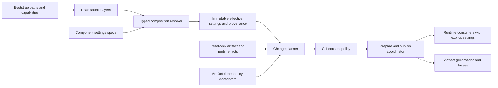

# Дизайн компонентной конфигурации

2026-11-09, CF0 / [requirements](requirements.md). Это целевые интерфейсы,
не существующий API. Runtime внедряется задачами [tasks.md](tasks.md).

## Ограничения и архитектура

- Rust 1.88; Linux/macOS/Windows; поставка cli-full, Cargo default offline.
- Новых crates нет; serde/toml, blake3, rusqlite, Tokio уже используются.
- Production `unwrap/expect/panic!` запрещены; baseline не перегенерируется.
- Публичные v1 CLI/config/IPC contracts сохраняются; breaking change требует major.
- Мержит человек; CF0 не меняет runtime, defaults, файлы конфигурации или индексы.



Resolver и planner — чистые относительно состояния операции (FR-2/3/9/12).
Сборка provider/model, eviction, opening/migrating DB и downloads принадлежат
prepare/apply, а не `defaults`, `validate` или `impact`.

## ADR-CFG-1: typed composition вместо универсального dynamic registry

| Вариант | Выигрыш | Цена / решение |
|---|---|---|
| Один большой `Config` с алгоритмическими ветками | Мало wiring | Центр знает правила каждого cache; отвергнут |
| Typed component specs + явная composition | Проверяемые типы, locality, feature gating | Один список секций в root; выбран |
| Type-erased `dyn ConfigSpec` / derive-codegen | Динамическое расширение | Any/downcasts или macro machinery без текущего consumer; отложен |

Composition root **может** импортировать типы секций и регистрировать descriptors.
Он **не может** проверять ANN M/eviction, рассчитывать provider defaults или
вызывать специальные `invalidate_ann` по имени ключа. Такие правила у owner.

Проспективная структура:

| Файл | Ответственность |
|---|---|
| `src/config/schema.rs` | SourceId, FieldOrigin, PatchValue, shared spec contract и neutral ArtifactId/ArtifactFacts/ComponentImpact DTO (CF1) |
| `src/config/resolve.rs` | Загрузка слоёв, typed composition, effective view |
| `src/config/bootstrap.rs` | Явные paths, legacy env overrides, capabilities |
| `src/config/change.rs` | Planner/action graph, ChangePlan, grants и coordinator interfaces (CF4); использует shared DTO из schema |
| `src/store/settings.rs` | DB/pool settings и validation |
| `src/hybrid/dense_settings.rs` | Dense/query-cache resource policy |
| `src/hybrid/ann_settings.rs` | Construction/search policies и graph identity |
| `src/hybrid/local_settings.rs` | Ungated scalar settings локального provider |
| `src/watch/settings.rs`, `src/index/settings.rs` | Watch/index владельцы правил |
| `src/daemon/settings.rs`, `src/ipc/settings.rs` | Daemon resources и transport |

Локальные settings ungated, даже если `local.rs` feature-gated. Их описание не
импортирует fastembed/ORT. Существующий registry `hybrid::provider::Provider`
остаётся владельцем provider records; второй независимый registry не создаётся.

### Контракт (FR-2/3/7/9)

Эскиз фиксирует границу, а не обязательные derive/macro реализации:

```rust,ignore
trait SettingsSpec {
    type Patch;
    type Settings; // complete, no absence-as-default, no runtime handles
    type Defaults; // immutable owner catalog, including explicit legacy templates
    fn defaults(ctx: &DefaultsContext) -> Self::Defaults;
    fn initial(defaults: &Self::Defaults) -> Self::Settings;
    fn overlay(base: &mut Self::Settings, patch: Self::Patch,
               defaults: &Self::Defaults, origins: &mut Provenance) -> Result<()>;
    fn validate(settings: &Self::Settings, caps: &Capabilities) -> Result<()>;
    fn impact(old: Option<&Self::Settings>, next: &Self::Settings,
              facts: &ArtifactFacts) -> Result<ComponentImpact>;
}
```

`PatchValue<T> = Inherit | Set(T) | Disable` для семантически optional секций;
scalar patch использует отсутствие/Set. TOML не имеет null: отключение — явный
`enabled=false`, никогда `None` после десериализации как неоднозначный reset.
Списки заменяются целиком, если конкретный owner не объявил другую операцию.
`Settings` не реализует implicit construction через `Default`; defaults остаются
у spec и вызываются только resolver-ом. `ArtifactId`, `ArtifactFacts` и
`ComponentImpact` — neutral data-only DTO из `config/schema.rs`, вводятся вместе
с trait в CF1. Они не открывают storage и не выполняют планирование; получение
facts, построение action graph и `ChangePlan` появляются в CF4. `impact` возвращает
локальные требования пригодности/действия; coordinator объединяет их с artifact edges.

`DefaultsContext` содержит capabilities/доступные CPU и OS facts, но не env reads,
filesystem I/O или provider credentials. `defaults` каждого spec вызывается один
раз на resolution; результат — immutable owner catalog. `initial` выбирает обычный
baseline, а каждый `overlay` получает тот же каталог для явных legacy resets.
Например, HybridDefaults содержит отдельные disabled, enabled-shortcut и table-base
шаблоны, а не одну конфигурацию, у которой меняют только `enabled`.
Runtime constructors требуют `&ResolvedSettings` и явные dependencies. Старые
публичные constructors сохраняются deprecated adapters к общему standalone
resolver; все production callsites переводятся на explicit-settings путь.
В adapter нет второй реализации defaults или чтения TOML. Пока adapter используется
в рабочем пути, adoption соответствующего компонента не считается завершённым.

## Bootstrap, layering и scopes (FR-3–FR-8)

1. Управляющая граница разрешает config/cache/data roots по явным аргументам,
   `DOCSBASE_*_DIR`, затем OS directories. Файл внутри config root не выбирает
   root, необходимый для собственного чтения. Смена canonical cache root требует
   остановленного daemon, как сейчас.
2. Читаются bounded raw global/project sources; legacy env overrides перечислены
   в [inventory](settings-inventory.md), не применяется общий env-to-any-key mapper.
3. Resolver получает defaults владельцев и складывает typed patches по precedence.
   `ORT_DYLIB_PATH` сохраняет существующую provider-specific precedence; это
   явный bootstrap override с provenance, не env read внутри inference.
4. Полная validation и capability check предшествуют construction. Проверка наличия
   secret/модели с I/O — отдельный admission/prepare, не pure schema validation.
5. Разделяются `ResolvedDaemon`, `ResolvedProject`, `ResolvedProvider`; runtime
   получает только нужную секцию. Provenance хранит source/path/key, секретное
   значение заменяется credential handle. В fingerprints не входит даже secret hash.

Dependency env `TOKIO_WORKER_THREADS`, `RAYON_NUM_THREADS`/`RAYON_RS_NUM_CPUS` и
`TOKENIZERS_PARALLELISM` захватываются bootstrap до workers. Не выполняется
`set_var` при запросах/reload. Tokio получает explicit builder values; Rayon —
owned pool, когда adapter это поддерживает; process-global tokenizer setting
применяется один раз. Его изменение требует restart, а не per-project override.
Invalid legacy env диагностируется до вызова dependency, которая иначе может panic.

Проектная секция с новым daemon-scoped ключом — ошибка, а не ignore. Один pool,
semaphore, query-cache budget и счётчик живых builds принадлежат daemon/model owner,
не создаются заново на каждый проект или запрос. Project может выбрать model,
ranking, chunking/ANN policy и разрешённую квоту с отдельной семантикой.

### ADR-CFG-2: версия конфигурации и legacy vector budget

Отсутствующий `config_version` означает **v1**; `config_version=2` вводится только
в owning implementation task. Версия задаётся в каждом файле независимо.
V1-слой переводится в legacy whole-value `hybrid` replace-patch, v2 — в field-wise
patch. Поэтому global-v1 + project-v2 сохраняет неуказанные global поля, а
project-v1 намеренно заменяет `hybrid` целиком даже поверх global-v2. Owner один раз
разрешает три immutable hybrid templates: disabled (`enabled=false`, embedding/reranker
отсутствуют), enabled-shortcut (`enabled=true`, обе default stages), table-base
(`enabled=true`, stages отсутствуют до явно присутствующих sections). Во всех трёх
ranking/cache имеют прежние defaults. Bool shorthand в обеих версиях сбрасывает
всю hybrid-секцию к соответствующему disabled или enabled-shortcut шаблону;
это не переключение одного bool в прежнем или disabled baseline. V1 table replace
начинается с table-base; v2 field-wise table patch наследует отсутствующие поля.
Неуказанные настройки остальных секций наследуются. Неизвестная версия отклоняется.

| Входной слой | Результат после resolution |
|---|---|
| `hybrid = true` в v1 или v2 | Обе default stages включены; прежние model/window/cache не наследуются |
| `hybrid = false` в v1 или v2 | Hybrid выключен, обе stage sections отсутствуют, прочие hybrid defaults сброшены |
| V1 project содержит только `[hybrid.cache] max_bytes=K` | Table-base: enabled=true, обе stages отсутствуют, cache=K |
| Global задаёт stages A/B, v2 project меняет только cache=K | Stages A/B и остальные неуказанные поля наследуются, cache=K |

CF3 производит только pure `MigrationDraft`: source-to-source diff и конфликты
scope/версий, без `ChangePlan` и записи файлов. `config migrate --to 2` как
read-only CLI с объединёнными source diff и state plan вводится в CF4 после planner;
запись принятой migration через consent/apply — CF5. Обычный startup файлы не
переписывает. Для v1 project с
legacy `[hybrid.cache].max_bytes` нельзя автоматически выбрать global cap:
одна физическая `vectors.db` содержит общие content-addressed entries, а текущая
eviction policy прикладывается разными callers. Это **не** готовая project quota.

Решение: v1 resource behavior сохраняется в помеченном legacy adapter до explicit
migration; новые строгие shared-resource guarantees к нему не приписываются.
V2 global `vector_cache.max_bytes` принадлежит одному store owner; project quotas
не входят в первую v2. Migration всех зарегистрированных legacy projects формирует
список значений/конфликтов; оператор явно задаёт global cap либо принимает показанное
предложение `max(legacy budgets)` с влиянием на диск. Непринятый конфликт блокирует
только migration, не меняет работоспособный v1. Неактивные/внешние проектные конфиги
не считаются автоматически обследованными; при первом открытии старого проекта
обнаруживается legacy scope, не перенастраивается уже работающий v2 store.

Нельзя запускать один общий vector store одновременно через strict-v2 и старый
v1-evictor: переход storage owner является daemon-wide, под exclusive admission.
Совместимость v1 обеспечивается legacy mode всего store; v2 migration включает
явное разрешение registry conflicts. Автоматический dual-mode здесь отвергнут.

## План, policy и ошибки (FR-9–FR-14)

`ArtifactId` включает kind/project/model/generation; runtime resources имеют
отдельные IDs. `ComponentImpact` содержит `requires`, `produces`, action kind,
reasons, relevant fingerprints и cost classes. Action DAG строится по
[state-dependencies](state-dependencies.md); циклы/неподдерживаемые комбинации
дают error до apply. Нельзя объединить `Evict` и `DeleteStore` только по имени cache.

`ChangePlan` включает `plan_version=1`, источник input revisions, observed artifact
IDs/provenance, intended outputs, действия в topological order, reuse, peak-space
оценку и permissions. `plan_id` — digest canonical non-secret payload; не токен
авторизации. Канонизация: stable field names/order, integer durations/bytes,
помеченные enum values и domain-separated blake3. Старые/unknown fingerprint
versions не сравниваются как одинаковые.

| Интерфейс CF4/CF5 | Поведение |
|---|---|
| `docsbase config` | Прежний effective v1 output |
| `docsbase config effective --format=json` | Новый versioned view с origins/units/scope/capability |
| `docsbase config plan [--format=json] [--check]` | Read-only plan; --check даёт code3 при нужном изменении |
| `docsbase config migrate --to 2` | CF4: read-only source diff + state plan из MigrationDraft; запись только через CF5 apply/consent |
| `docsbase serve --on-invalidation=prompt\|apply\|fail` | CLI policy до запуска service loop |
| `--allow-remote`, `--allow-downloads`, `--allow-destructive` | Отдельные opt-in grants для нового apply path |

Коды нового policy path: **0** success/no changes, **3** required change при fail,
**4** stale plan, **5** missing consent/grant или недоступный online apply. Обычные
legacy errors остаются **1**. Старые scripts не получают новые коды без нового
command/flag/schema contract. Если нужно требующее consent изменение, explicit
`prompt` без TTY даёт code5 до применения; с TTY показывает план и запрашивает
необходимые grants. Bare `apply` разрешает локальную пересборку производных данных,
не remote calls/downloads/необратимые миграции.

Default выбирается явно на управляющей границе. V1 без новых policy flags сохраняет
legacy startup behavior и code1 для обычных ошибок. На новом v2/policy path
отсутствующая policy означает `Auto`: resolver один раз использует переданные
`EntrypointFacts { mode, is_tty }`. Direct interactive CLI с TTY получает `prompt`;
non-TTY CLI, service, MCP и autostart получают `fail`, даже если service унаследовал
TTY. Explicit `--on-invalidation` заменяет Auto; runtime получает уже resolved policy.
При required change resolved fail возвращает code3, explicit prompt без TTY — code5.
Если нужны только разрешённая runtime/cache initialization и нет consent-requiring
действий, результат — code0 для всех этих путей. Service/MCP loop не спрашивает:
даже explicit prompt исполняется только управляющим CLI до service startup;
неинтерактивная граница без такого CLI при нужном consent возвращает code5.

На новом v2/policy path первый runtime/cache creation без потери данных — обычная
инициализация, не prompt. Для отсутствующего обязательного индекса возвращается
существующий index-needed hint; явный `index` остаётся управляющей операцией. Autostart/MCP допускает только
runtime init и создание disposable caches; reindex/re-embed/миграция требует
управляющего CLI. В daemon/MCP stdin вопросы никогда не появляются. Существующая
явная opt-in hybrid search/index policy не получает новый prompt на каждый запрос.

Dry-run не вызывает `Db::open` (там WAL/migrations) или operational
`Db::open_readonly` / `Db::open_readonly_with_settings`: нынешний read-only helper
при schema mismatch вызывает `conflict::record` и пишет conflict log. CF2 вводит
отдельный `Db::inspect_readonly(cache, settings) -> Result<ArtifactFacts>` без
диагностического writer/sink. Missing/schema mismatch возвращаются как facts;
обычные operational readers сохраняют прежнюю диагностику/admission behavior.
Inspector не создаёт DB/directories, WAL/SHM sidecars, markers, locks или conflict
logs. Если получить достоверные facts без записи нельзя, возвращает Unknown/blocked,
а не включает immutable=1 поверх active/WAL-bearing DB с потерей committed WAL. CF4 использует
только этот inspector и аналогичные no-write artifact readers, не model constructors,
`ensure_daemon`, project-open/backfill или mutating cache convenience helpers.
Regression `plan_schema_mismatch_does_not_write_conflict` сравнивает полный filesystem
snapshot до/после plan, включая conflict log и sidecars; отдельный WAL/missing-sidecar
case доказывает no-write или явный inspection-unavailable без игнорирования committed
WAL. Missing state → Missing facts.
Первый offline apply требует остановленного daemon. Online facts/apply вводятся
отдельно: read-only inspection без project-open side effects, negotiated IPC
extension, revision tokens. Unsupported daemon → Unknown/blocked-online, не
предположение, что active config равен TOML. Startup fail проверяется до создания
admission/state files; apply повторно проверяет inputs после взятия writer lease.

## Публикация, ресурсы и минимальный путь к #66 (FR-15–FR-17)

#76 уже даёт immutable config/stages pair и rejection stale lazy work. Его Arc
identity — только process-local runtime revision, не persisted fingerprint.
`PreparedChange` дополнительно несёт ожидаемые artifact/generation revisions.
Изменившийся writer/config revision делает plan stale (code4); новый worker
не переименовывает старый результат поверх нового pointer.

CF1/CF2 дают #66 typed bootstrap/store settings и явное read-connection ownership.
Начальный новый `store.read_pool_max_connections=4` — консервативный bounded default,
а не throughput/SLA обещание; control resources резервируются в дизайне #66/#79.
Сохраняются metadata busy timeouts: write-open30s, read-only5s (нынешний
rusqlite default5000ms, который CF2 передаёт явно). Acquisition ограничивается
переданным request deadline, а не ещё одним скрытым wait default. Остальная #78
не является условием устранения общего DB guard.

#66 определяет короткие prepare/read phases и bounded materialized candidate data;
ни DB guard, ни metadata transaction не переживают provider wait. До полноценного
generation publication можно явно reject/retry search проекта во время mutating
index phase. Это ограничение записывается в #66/#79, не маскируется как serving
старого snapshot: нынешние mark_pending/Tantivy commit/SQLite commit раздельны.
Control/другие проекты не сериализуются глобальным DB mutex из-за remote stage.

Полная FR-15/16 требует shadow artifacts и versioned metadata вместе с generation
pointer. Её storage design — CF10, generation apply/recovery — CF11: descriptor
manifest сам по себе не делает живые SQLite rows immutable. Prepared generations
строятся вне publish lock; короткая атомарная pointer publication выполняется лишь
после durable готовности всех required artifacts. Если in-place migration неизбежна,
plan требует maintenance/exclusive mode и recovery journal/backup; `apply` без
destructive grant её не выполняет. Эта ветка не обещает concurrent readers.

После публикации old generations/ANN/model handles живут по leases/Arc до последнего
reader; их bytes и builds продолжают учитываться. При shrink admission новых работ
ограничивается сразу, существующие drain; если нельзя уложиться без потери пригодного
state или превышения peak budget — prepare отклоняется, старое состояние остаётся.
Abort ожидания `spawn_blocking` не означает, что worker остановлен.

## Тестирование, риски и альтернативы

Матрица в [tasks](tasks.md): default/override → настоящий consumer; v1/v2 mixed
merge; global/project conflicts; secret redaction; no-write plan; fail/no-TTY/grants;
relevant/irrelevant fingerprints; interrupted apply; stale worker; active-reader
reclaim/accounting на трёх ОС. Golden baseline не меняется от переноса settings.
Windows `BlockingStream::set_*_timeout` сейчас no-op: новое effective capability
не заявляет enforcement до реального adapter/deadline теста (#79/#81).

Отвергнуты: whole-config hash (лишние rebuild + secret coupling), неограниченный
`on_change` callback (нет transitive order), prompt внутри daemon (зависание MCP),
`Db::open` в plan/per-query (writes/migrations), один новый async mutex на весь
search (сохраняет сериализацию), массовый первый refactor (пересечения #61/#67/#68).
Риски: v1/v2 coexistence усложняет adapters; staging требует peak disk/RAM; local
instance maps пока process-wide и могут удерживать старые модели. Owning tasks
покрывают reclamation; одна смена cache key не объявляется освобождением памяти.
