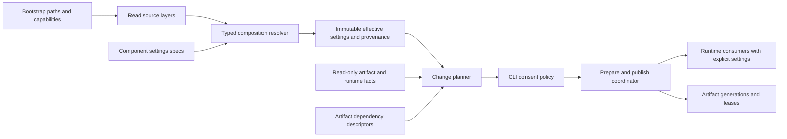

# Дизайн компонентной конфигурации

2026-11-09, CF0 / [requirements](requirements.md). Это целевые интерфейсы,
не существующий API. Runtime внедряется задачами [tasks.md](tasks.md).

## Ограничения и архитектура

- Rust 1.88; Linux/macOS/Windows; поставка cli-full, Cargo default offline.
- Новых crates нет; serde/toml, blake3, rusqlite, Tokio уже используются.
- Production `unwrap/expect/panic!` запрещены; baseline не перегенерируется.
- Публичные v1 CLI/config/IPC contracts сохраняются; breaking change требует major.
- Мержит человек; CF0 не меняет runtime, defaults, файлы конфигурации или индексы.



Resolver и planner — чистые относительно состояния операции (FR-2/3/9/12).
Сборка provider/model, eviction, opening/migrating DB и downloads принадлежат
prepare/apply, а не `defaults`, `validate` или `impact`.

## ADR-CFG-1: typed composition вместо универсального dynamic registry

| Вариант | Выигрыш | Цена / решение |
|---|---|---|
| Один большой `Config` с алгоритмическими ветками | Мало wiring | Центр знает правила каждого cache; отвергнут |
| Typed component specs + явная composition | Проверяемые типы, locality, feature gating | Один список секций в root; выбран |
| Type-erased `dyn ConfigSpec` / derive-codegen | Динамическое расширение | Any/downcasts или macro machinery без текущего consumer; отложен |

Composition root **может** импортировать типы секций и регистрировать descriptors.
Он **не может** проверять ANN M/eviction, рассчитывать provider defaults или
вызывать специальные `invalidate_ann` по имени ключа. Такие правила у owner.

Проспективная структура:

| Файл | Ответственность |
|---|---|
| `src/config/schema.rs` | SourceId, FieldOrigin, PatchValue, shared spec contract и neutral ArtifactId/ArtifactFacts/ComponentImpact DTO (CF1) |
| `src/config/resolve.rs` | Загрузка слоёв, typed composition, effective view |
| `src/config/bootstrap.rs` | Явные paths, legacy env overrides, capabilities |
| `src/config/change.rs` | Planner/action graph, ChangePlan, grants и coordinator interfaces (CF4); использует shared DTO из schema |
| `src/store/settings.rs` | DB/pool settings и validation |
| `src/hybrid/dense_settings.rs` | Dense/query-cache resource policy |
| `src/hybrid/ann_settings.rs` | Construction/search policies и graph identity |
| `src/hybrid/local_settings.rs` | Ungated scalar settings локального provider |
| `src/watch/settings.rs`, `src/index/settings.rs` | Watch/index владельцы правил |
| `src/daemon/settings.rs`, `src/ipc/settings.rs` | Daemon resources и transport |

Локальные settings ungated, даже если `local.rs` feature-gated. Их описание не
импортирует fastembed/ORT. Существующий registry `hybrid::provider::Provider`
остаётся владельцем provider records; второй независимый registry не создаётся.

### Контракт (FR-2/3/7/9)

Эскиз фиксирует границу, а не обязательные derive/macro реализации:

```rust,ignore
trait SettingsSpec {
    type Patch;
    type Settings; // complete, no absence-as-default, no runtime handles
    type Defaults; // immutable owner catalog, including explicit legacy templates
    fn defaults(ctx: &DefaultsContext) -> Self::Defaults;
    fn initial(defaults: &Self::Defaults) -> Self::Settings;
    fn overlay(base: &mut Self::Settings, patch: Self::Patch,
               defaults: &Self::Defaults, origins: &mut Provenance) -> Result<()>;
    fn validate(settings: &Self::Settings, caps: &Capabilities) -> Result<()>;
    fn impact(old: Option<&Self::Settings>, next: &Self::Settings,
              facts: &ArtifactFacts) -> Result<ComponentImpact>;
}
```

`PatchValue<T> = Inherit | Set(T) | Disable` для семантически optional секций;
scalar patch использует отсутствие/Set. TOML не имеет null: отключение — явный
`enabled=false`, никогда `None` после десериализации как неоднозначный reset.
Списки заменяются целиком, если конкретный owner не объявил другую операцию.
`Settings` не реализует implicit construction через `Default`; defaults остаются
у spec и вызываются только resolver-ом. `ArtifactId`, `ArtifactFacts` и
`ComponentImpact` — neutral data-only DTO из `config/schema.rs`, вводятся вместе
с trait в CF1. Они не открывают storage и не выполняют планирование; получение
facts, построение action graph и `ChangePlan` появляются в CF4. `impact` возвращает
локальные требования пригодности/действия; coordinator объединяет их с artifact edges.

`DefaultsContext` содержит capabilities/доступные CPU и OS facts, но не env reads,
filesystem I/O или provider credentials. `defaults` каждого spec вызывается один
раз на resolution; результат — immutable owner catalog. `initial` выбирает обычный
baseline, а каждый `overlay` получает тот же каталог для явных legacy resets.
Например, HybridDefaults содержит отдельные disabled, enabled-shortcut и table-base
шаблоны, а не одну конфигурацию, у которой меняют только `enabled`.
Runtime constructors требуют `&ResolvedSettings` и явные dependencies. Старые
публичные constructors сохраняются deprecated adapters к общему standalone
resolver; все production callsites переводятся на explicit-settings путь.
В adapter нет второй реализации defaults или чтения TOML. Пока adapter используется
в рабочем пути, adoption соответствующего компонента не считается завершённым.

## Bootstrap, layering и scopes (FR-3–FR-8)

1. Управляющая граница разрешает config/cache/data roots по явным аргументам,
   `DOCSBASE_*_DIR`, затем OS directories. Файл внутри config root не выбирает
   root, необходимый для собственного чтения. Смена canonical cache root требует
   остановленного daemon, как сейчас.
2. Читаются bounded raw global/project sources; legacy env overrides перечислены
   в [inventory](settings-inventory.md), не применяется общий env-to-any-key mapper.
3. Resolver получает defaults владельцев и складывает typed patches по precedence.
   `ORT_DYLIB_PATH` сохраняет существующую provider-specific precedence; это
   явный bootstrap override с provenance, не env read внутри inference.
4. Полная validation и capability check предшествуют construction. Проверка наличия
   secret/модели с I/O — отдельный admission/prepare, не pure schema validation.
5. Разделяются `ResolvedDaemon`, `ResolvedProject`, `ResolvedProvider`; runtime
   получает только нужную секцию. Provenance хранит source/path/key, секретное
   значение заменяется credential handle. В fingerprints не входит даже secret hash.

Dependency env `TOKIO_WORKER_THREADS`, `RAYON_NUM_THREADS`/`RAYON_RS_NUM_CPUS` и
`TOKENIZERS_PARALLELISM` захватываются bootstrap до workers. Не выполняется
`set_var` при запросах/reload. Tokio получает explicit builder values; Rayon —
owned pool, когда adapter это поддерживает; process-global tokenizer setting
применяется один раз. Его изменение требует restart, а не per-project override.
Invalid legacy env диагностируется до вызова dependency, которая иначе может panic.

Проектная секция с новым daemon-scoped ключом — ошибка, а не ignore. Один pool,
semaphore, query-cache budget и счётчик живых builds принадлежат daemon/model owner,
не создаются заново на каждый проект или запрос. Project может выбрать model,
ranking, chunking/ANN policy и разрешённую квоту с отдельной семантикой.

### ADR-CFG-2: версия конфигурации и legacy vector budget

Отсутствующий `config_version` означает **v1**; `config_version=2` вводится только
в owning implementation task. Версия задаётся в каждом файле независимо.
V1-слой переводится в legacy whole-value `hybrid` replace-patch, v2 — в field-wise
patch. Поэтому global-v1 + project-v2 сохраняет неуказанные global поля, а
project-v1 намеренно заменяет `hybrid` целиком даже поверх global-v2. Owner один раз
разрешает три immutable hybrid templates: disabled (`enabled=false`, embedding/reranker
отсутствуют), enabled-shortcut (`enabled=true`, обе default stages), table-base
(`enabled=true`, stages отсутствуют до явно присутствующих sections). Во всех трёх
ranking/cache имеют прежние defaults. Bool shorthand в обеих версиях сбрасывает
всю hybrid-секцию к соответствующему disabled или enabled-shortcut шаблону;
это не переключение одного bool в прежнем или disabled baseline. V1 table replace
начинается с table-base; v2 field-wise table patch наследует отсутствующие поля.
Неуказанные настройки остальных секций наследуются. Неизвестная версия отклоняется.

| Входной слой | Результат после resolution |
|---|---|
| `hybrid = true` в v1 или v2 | Обе default stages включены; прежние model/window/cache не наследуются |
| `hybrid = false` в v1 или v2 | Hybrid выключен, обе stage sections отсутствуют, прочие hybrid defaults сброшены |
| V1 project содержит только `[hybrid.cache] max_bytes=K` | Table-base: enabled=true, обе stages отсутствуют, cache=K |
| Global задаёт stages A/B, v2 project меняет только cache=K | Stages A/B и остальные неуказанные поля наследуются, cache=K |

CF3 производит только pure `MigrationDraft`: source-to-source diff и конфликты
scope/версий, без `ChangePlan` и записи файлов. `config migrate --to 2` как
read-only CLI с объединёнными source diff и state plan вводится в CF4 после planner;
запись принятой migration через consent/apply — CF5. Обычный startup файлы не
переписывает. Для v1 project с
legacy `[hybrid.cache].max_bytes` нельзя автоматически выбрать global cap:
одна физическая `vectors.db` содержит общие content-addressed entries, а текущая
eviction policy прикладывается разными callers. Это **не** готовая project quota.

Решение: v1 resource behavior сохраняется в помеченном legacy adapter до explicit
migration; новые строгие shared-resource guarantees к нему не приписываются.
V2 global `vector_cache.max_bytes` принадлежит одному store owner; project quotas
не входят в первую v2. Migration всех зарегистрированных legacy projects формирует
список значений/конфликтов; оператор явно задаёт global cap либо принимает показанное
предложение `max(legacy budgets)` с влиянием на диск. Непринятый конфликт блокирует
только migration, не меняет работоспособный v1. Неактивные/внешние проектные конфиги
не считаются автоматически обследованными; при первом открытии старого проекта
обнаруживается legacy scope, не перенастраивается уже работающий v2 store.

Нельзя запускать один общий vector store одновременно через strict-v2 и старый
v1-evictor: переход storage owner является daemon-wide, под exclusive admission.
Совместимость v1 обеспечивается legacy mode всего store; v2 migration включает
явное разрешение registry conflicts. Автоматический dual-mode здесь отвергнут.

## План, policy и ошибки (FR-9–FR-14)

`ArtifactId` включает kind/project/model/generation; runtime resources имеют
отдельные IDs. `ComponentImpact` содержит `requires`, `produces`, action kind,
reasons, relevant fingerprints и cost classes. Action DAG строится по
[state-dependencies](state-dependencies.md); циклы/неподдерживаемые комбинации
дают error до apply. Нельзя объединить `Evict` и `DeleteStore` только по имени cache.

`ChangePlan` включает `plan_version=1`, источник input revisions, observed artifact
IDs/provenance, intended outputs, действия в topological order, reuse, peak-space
оценку и permissions. `plan_id` — digest canonical non-secret payload; не токен
авторизации. Канонизация: stable field names/order, integer durations/bytes,
помеченные enum values и domain-separated blake3. Старые/unknown fingerprint
versions не сравниваются как одинаковые.

| Интерфейс CF4/CF5 | Поведение |
|---|---|
| `docsbase config` | Прежний effective v1 output |
| `docsbase config effective --format=json` | Новый versioned view с origins/units/scope/capability |
| `docsbase config plan [--format=json] [--check]` | Read-only plan; --check даёт code3 при нужном изменении |
| `docsbase config migrate --to 2` | CF4: read-only source diff + state plan из MigrationDraft; запись только через CF5 apply/consent |
| `docsbase serve --on-invalidation=prompt\|apply\|fail` | CLI policy до запуска service loop |
| `--allow-remote`, `--allow-downloads`, `--allow-destructive` | Отдельные opt-in grants для нового apply path |

Коды нового policy path: **0** success/no changes, **3** required change при fail,
**4** stale plan, **5** missing consent/grant или недоступный online apply. Обычные
legacy errors остаются **1**. Старые scripts не получают новые коды без нового
command/flag/schema contract. Если нужно требующее consent изменение, explicit
`prompt` без TTY даёт code5 до применения; с TTY показывает план и запрашивает
необходимые grants. Bare `apply` разрешает локальную пересборку производных данных,
не remote calls/downloads/необратимые миграции.

Default выбирается явно на управляющей границе. V1 без новых policy flags сохраняет
legacy startup behavior и code1 для обычных ошибок. На новом v2/policy path
отсутствующая policy означает `Auto`: resolver один раз использует переданные
`EntrypointFacts { mode, is_tty }`. Direct interactive CLI с TTY получает `prompt`;
non-TTY CLI, service, MCP и autostart получают `fail`, даже если service унаследовал
TTY. Explicit `--on-invalidation` заменяет Auto; runtime получает уже resolved policy.
При required change resolved fail возвращает code3, explicit prompt без TTY — code5.
Если нужны только разрешённая runtime/cache initialization и нет consent-requiring
действий, результат — code0 для всех этих путей. Service/MCP loop не спрашивает:
даже explicit prompt исполняется только управляющим CLI до service startup;
неинтерактивная граница без такого CLI при нужном consent возвращает code5.

На новом v2/policy path первый runtime/cache creation без потери данных — обычная
инициализация, не prompt. Для отсутствующего обязательного индекса возвращается
существующий index-needed hint; явный `index` остаётся управляющей операцией. Autostart/MCP допускает только
runtime init и создание disposable caches; reindex/re-embed/миграция требует
управляющего CLI. В daemon/MCP stdin вопросы никогда не появляются. Существующая
явная opt-in hybrid search/index policy не получает новый prompt на каждый запрос.

Dry-run не вызывает `Db::open` (там WAL/migrations) или operational
`Db::open_readonly` / `Db::open_readonly_with_settings`: нынешний read-only helper
при schema mismatch вызывает `conflict::record` и пишет conflict log. CF2 вводит
отдельный `Db::inspect_readonly(cache, settings) -> Result<ArtifactFacts>` без
диагностического writer/sink. Missing/schema mismatch возвращаются как facts;
обычные operational readers сохраняют прежнюю диагностику/admission behavior.
Inspector не создаёт DB/directories, WAL/SHM sidecars, markers, locks или conflict
logs. Если получить достоверные facts без записи нельзя, возвращает Unknown/blocked,
а не включает immutable=1 поверх active/WAL-bearing DB с потерей committed WAL. CF4 использует
только этот inspector и аналогичные no-write artifact readers, не model constructors,
`ensure_daemon`, project-open/backfill или mutating cache convenience helpers.
Regression `plan_schema_mismatch_does_not_write_conflict` сравнивает полный filesystem
snapshot до/после plan, включая conflict log и sidecars; отдельный WAL/missing-sidecar
case доказывает no-write или явный inspection-unavailable без игнорирования committed
WAL. Missing state → Missing facts.
Первый offline apply требует остановленного daemon. Online facts/apply вводятся
отдельно: read-only inspection без project-open side effects, negotiated IPC
extension, revision tokens. Unsupported daemon → Unknown/blocked-online, не
предположение, что active config равен TOML. Startup fail проверяется до создания
admission/state files; apply повторно проверяет inputs после взятия writer lease.

## Публикация, ресурсы и минимальный путь к #66 (FR-15–FR-17)

#76 уже даёт immutable config/stages pair и rejection stale lazy work. Его Arc
identity — только process-local runtime revision, не persisted fingerprint.
`PreparedChange` дополнительно несёт ожидаемые artifact/generation revisions.
Изменившийся writer/config revision делает plan stale (code4); новый worker
не переименовывает старый результат поверх нового pointer.

CF1/CF2 дают #66 typed bootstrap/store settings и явное read-connection ownership.
Начальный новый `store.read_pool_max_connections=4` — консервативный bounded default,
а не throughput/SLA обещание; control resources резервируются в дизайне #66/#79.
Сохраняются metadata busy timeouts: write-open30s, read-only5s (нынешний
rusqlite default5000ms, который CF2 передаёт явно). Acquisition ограничивается
переданным request deadline, а не ещё одним скрытым wait default. Остальная #78
не является условием устранения общего DB guard.

#66 определяет короткие prepare/read phases и bounded materialized candidate data;
ни DB guard, ни metadata transaction не переживают provider wait. До полноценного
generation publication можно явно reject/retry search проекта во время mutating
index phase. Это ограничение записывается в #66/#79, не маскируется как serving
старого snapshot: нынешние mark_pending/Tantivy commit/SQLite commit раздельны.
Control/другие проекты не сериализуются глобальным DB mutex из-за remote stage.

Полная FR-15/16 требует shadow artifacts и versioned metadata вместе с generation
pointer. Её storage design — CF10, generation apply/recovery — CF11: descriptor
manifest сам по себе не делает живые SQLite rows immutable. Prepared generations
строятся вне publish lock; короткая атомарная pointer publication выполняется лишь
после durable готовности всех required artifacts. Если in-place migration неизбежна,
plan требует maintenance/exclusive mode и recovery journal/backup; `apply` без
destructive grant её не выполняет. Эта ветка не обещает concurrent readers.

После публикации old generations/ANN/model handles живут по leases/Arc до последнего
reader; их bytes и builds продолжают учитываться. При shrink admission новых работ
ограничивается сразу, существующие drain; если нельзя уложиться без потери пригодного
state или превышения peak budget — prepare отклоняется, старое состояние остаётся.
Abort ожидания `spawn_blocking` не означает, что worker остановлен.

## Тестирование, риски и альтернативы

Матрица в [tasks](tasks.md): default/override → настоящий consumer; v1/v2 mixed
merge; global/project conflicts; secret redaction; no-write plan; fail/no-TTY/grants;
relevant/irrelevant fingerprints; interrupted apply; stale worker; active-reader
reclaim/accounting на трёх ОС. Golden baseline не меняется от переноса settings.
Windows `BlockingStream::set_*_timeout` сейчас no-op: новое effective capability
не заявляет enforcement до реального adapter/deadline теста (#79/#81).

Отвергнуты: whole-config hash (лишние rebuild + secret coupling), неограниченный
`on_change` callback (нет transitive order), prompt внутри daemon (зависание MCP),
`Db::open` в plan/per-query (writes/migrations), один новый async mutex на весь
search (сохраняет сериализацию), массовый первый refactor (пересечения #61/#67/#68).
Риски: v1/v2 coexistence усложняет adapters; staging требует peak disk/RAM; local
instance maps пока process-wide и могут удерживать старые модели. Owning tasks
покрывают reclamation; одна смена cache key не объявляется освобождением памяти.

## Delta 2026-11-09 — CF1: typed foundation и v1 adapters

CF1 вводит pure `Resolution<S>` с одним owner catalog на resolution. Применение
patch выполняется на staging clone settings/provenance; ошибка не меняет builder.
`finish` проверяет полный результат и возвращает immutable `Resolved<T>`. Новый
`SettingsSpec::fields()` агрегирует owner descriptors без копирования их key names
в composition; `FIELDS` остаётся обычным каталогом одного owner. `impact` пока
возвращает только data-only local runtime comparison, без fallible inspection,
artifact invalidation, action graph или apply. Они остаются CF4 и owner adoption.

Legacy `HybridCfg` сохраняет `Default` как compatibility surface; новые
`DbSettings`, `ReadPoolSettings`, `DenseSettings` implicit `Default` не имеют.
Гибридный owner catalog и raw optional patches находятся в `hybrid/config.rs`,
рядом с существующими provider-aware resolver functions. Это расширение списка
файлов CF1 необходимо, чтобы parsing defaults не оставались у общего loader.
Три reset profiles отдельны: disabled, enabled-shortcut с обеими default stages,
и table-base enabled=true без stages. Ни deep merge, ни v2 merge не включены.
Provider-dependent model/dimension rules выполняются на resolution, без runtime,
credential lookup, проверки model files или provisioning. Сохранена конкретная v1
feature policy: ungated provider records разбираются независимо от build features.
Scalar resolution OpenRouter stages также возможен feature-off; их runtime
capability admission выполняется при construction. Fastembed stages уже на
resolution возвращают Admission при отсутствии `hybrid-local`, как в legacy path;
проверка наличия runtime/model files остаётся отдельной от pure resolution.

Typed explicit-path `resolve::{global_from,load_from,for_project}` сохраняет реальные
source paths. Global validation остаётся до project overlay: project не исправляет
невалидный global. `Config` методы возвращают legacy owned data из этого пути.
`Config::for_project(&Config, root)` помечает исходную часть `ProvidedSnapshot`,
поскольку plain `Config` не содержит происхождение; путь с `Resolved<Config>` его
сохраняет. Whole-value hybrid reset помечает всю заменённую группу источником reset,
включая template values и исчезнувшие stages. `Config::default` и `with_overrides`
остаются deterministic/infallible, без env/home lookup; CLI legacy overrides
проверяются только последующим explicit `validate`, как раньше.

Bootstrap использует injectable whitelist lookup и явные CPU/entrypoint facts.
Захватываются только `DOCSBASE_CACHE_DIR`, `DOCSBASE_CONFIG_DIR`, `DOCSBASE_DATA_DIR`,
`DOCSBASE_DAEMON_EXE`, `ORT_DYLIB_PATH`, `TOKIO_WORKER_THREADS`, `RAYON_NUM_THREADS`,
`RAYON_RS_NUM_CPUS`, `TOKENIZERS_PARALLELISM`. Неиспользуемый Rayon fallback не
читается. Tokio zero/invalid становится Admission без raw value до runtime;
Rayon zero выбирает CPU, invalid пробует deprecated fallback, tokenizer сохраняет
legacy false spellings и true для прочих значений. Credential env не запрашивается.
Этот новый capture API ещё не заменяет process/runtime bootstrap consumers (CF13).
Явные `Config::load_from` paths не начинают неявно читать process environment.

Db/read-pool/dense patches пока доступны только typed API. TOML `store`, `read_pool`,
`dense` по-прежнему отклоняются, пока CF2/CF6/#66 не дадут реальные consumers.
Db owner отклоняет busy timeout > SQLite signed-millisecond bound до panic внутри
rusqlite; zero timeout допустим. Dense values равны текущему `DenseCacheLimits` и
query-cache policy; zero disk budget/backoff и прочие legacy zero limits не получают
новых запретов. Scope daemon здесь описывает policy общего DenseCache instance;
`vector_cache_max_bytes` остаётся legacy fallback, а project hybrid cache policy
сохраняется. Это не вводит strict-v2 global vector-store quota или новую eviction
семантику. Runtime defaults пока остаются в старых consumers до CF2/CF6; CF1 не
объявляет эти budgets настраиваемыми для production процесса и не закрывает #78.

## Delta 2026-11-10 — CF2 implementation slice

1. `Db::open_with_settings` и `open_readonly_with_settings` принимают обязательный
   `&Resolved<DbSettings>`. До любого filesystem action выполняется pure DbSpec
   validation: generic `Resolved<T>` сам по себе не доказывает, что именно DbSpec
   проверял импортированный snapshot. Db хранит immutable policy для дальнейшей
   явной передачи. Writer задаёт свой busy timeout и WAL attempts/delay; prepared
   readonly задаёт отдельный timeout, не включает WAL и не мигрирует. Operational
   mismatch сохраняет прежние admission/conflict diagnostics.
2. Один standalone resolver в store/settings используется только composition
   boundaries и compatibility wrappers; в нём нет второй копии defaults. CLI run
   передаёт policy direct index/search/status/uninstall/serve, lifecycle — Shared,
   Shared — background jobs/ANN/watchers. Дополнительные with-settings входы
   сохраняют старые source signatures; production не вызывает старые adapters.
   Deprecation пока documentary: массовые Rust `#[deprecated]` warnings в старых
   fixtures не вводятся; финальный adapter audit остаётся CF14. TOML activation
   отложена явно, а не превращена в ignored section; прежние unknown-key errors
   сохраняются. Полный BootstrapContext/env adoption остаётся CF13.
3. WAL negotiation выделяет private wait seam: production передаёт thread::sleep,
   тест держит настоящий SQLite lock и освобождает его на заданном retry. Проверяются
   число attempts и переданная Duration; wall-clock latency не является контрактом.
4. `inspect_readonly` не вызывает никакой SQLite constructor или diagnostic sink.
   ArtifactId `metadata_db_schema` имеет opaque identity
   `sqlite-schema-v1:<user_version>:<schema_cookie>` только при стабильном валидном
   main header и отсутствии recovery sidecars до/после чтения. Это observed schema
   identity, не proof наличия таблиц/согласованности content rows. Header size100,
   magic и offsets user_version/schema_cookie — фиксированный SQLite file format,
   не resource defaults. Изменение/ошибка/неоднозначность → Unknown без identity;
   main absent + sidecars → NeedsRecovery, полностью absent → Missing. File-open
   остаётся read-only; inspector не создаёт cache/locks/logs/sidecars. Symlink main
   не обходится. Concurrent изменения после observation проверяет CF11; слабое
   наблюдение не объявляется full generation snapshot.

Challenge/rulings: operational readonly может создавать WAL/SHM, поэтому он не
подходит planner-у. Sidecar existence check перед SQLite open оставляет TOCTOU;
immutable=1 на active/WAL DB может скрыть committed WAL и запрещён. Custom VFS,
новый global lock protocol или копирование большой DB ради inspection расширяли
бы scope/unsafe/dependencies и не нужны для bounded schema facts. Консервативный
Unknown допустим, если стабильное наблюдение невозможно. Schema mismatch — facts,
а не вызов conflict::record; Query-ready проверка остаётся отдельной.

## Delta 2026-11-10 — #66 S1 prepared reader adoption

ReadPoolSpec теперь потребляется startup pool `store::read_pool::ReadPool`: ровно
resolved max_connections operational readonly handles, без query-time opens или
миграций. CLI передаёт DbSettings + ReadPoolSettings явно через lifecycle/Shared;
старые public signatures — compatibility adapters. Owner default4 не дублируется.
Acquire получает абсолютный deadline caller, собственного wait default нет.
S1 не меняет dispatcher/search concurrency: short phases/snapshot/singleflight
принадлежат оставшимся task #66. TOML activation остаётся CF3/CF5. Детали и
acceptance: `../search-concurrency/{requirements,design,tasks}.md`, S1/SC-1.

## Delta 2026-11-11 — CF3 source planning boundary

CF3 реализует pure SourceLayer/preview и MigrationDraft из caller-supplied
текстов и явной registry inventory. Обычный Config loader остаётся v1; preview
показывает, что operational v2 ждёт CF5/CF7. Это позволяет проверить mixed
version resolution/migration, не запускать legacy evictor под новым названием.

V2 hybrid table наследует поля, включая enabled. Stage table включает/обновляет
стадию; false отключает; true у stage отклоняется (empty table — явное включение).
У существующей стадии provider/model/dimensions наследуются по полям: смена
provider сама не подменяет model/dimensions. Новая стадия получает default в
owner resolution. Bool hybrid reset сохраняет CF1 templates и их provenance.

Пример ADR-CFG-2 с project-v2 hybrid.cache superseded: ресурс принадлежит global
vector_cache.max_bytes, поэтому пример partial merge теперь reranker.window.
V2 hybrid.cache запрещён. Legacy project override поверх global2 отражается
как scope conflict в preview; это не разрешение mixed runtime store modes.

Migration получает inspected loaded/missing состояния для явного списка
зарегистрированных config paths. Необследованные paths блокируют full draft.
max(legacy effective budgets) только предложен; UseBytes/AcceptSuggestedMaximum
передаются явно. Canonical TOML proposal показывает before/after/hash и потерю
comments/formatting; запись отсутствует. V1 table replacement materializes
текущие defaults/отсутствующие stages, bool остаётся bool, v2 patches сохраняются.
Все proposed sources повторно разрешаются с проверкой non-resource equivalence;
изменение shared budget показано отдельно. Migration не доказывает artifact
readiness или возможность apply, которыми владеют CF4/CF5/CF7/CF11.


CF3 budget survey clarification (2026-11-11): при global-v1 учитываются effective
legacy budgets всех обследованных проектов. При global-v2 уже выбранный global
cap действует для отсутствующих/v2/reset источников; explicit legacy project
cache override остаётся отдельным конфликтующим наблюдением. Неиспользуемый
legacy default не увеличивает suggested maximum. Ошибки preview сохраняют
категорию слоя (base/hybrid/effective), но не включают исходные значения; обычные
v1 runtime diagnostics не меняются.

CF3 review delta (2026-11-11): strict-v2 preview после legacy-compatible layering
переносит provenance с hybrid.cache.max_bytes на owner descriptor
vector_cache.max_bytes (Scope::Daemon, Unit::Bytes). V1 preview сохраняет прежние
key/scope. Значение пока проецируется в compatibility Config.hybrid_cfg.cache;
это source review DTO, а не новый operational loader. Descriptor живёт у
vector_cache, runtime ownership/evictor не меняются до CF7.

## Delta 2026-11-12 — CF4a source effective view

CF4 делится на проверяемые deliverables: первым поставляется effective view
по [cf4a-plan.md](cf4a-plan.md). Он принимает уже разрешённые данные и соединяет
owner-provided values с настоящим provenance; defaults не вычисляет повторно.
Provider registry даёт capability/safe configuration projection без runtime
construction или probing. Это сохраняет single-registry boundary для #128.

JSON version1 явно обозначает source_resolution и live_runtime_observed=false:
текущие файлы не доказывают snapshot работающего демона. Прежний bare config
output не меняется. CLI читает v1 как раньше; pure view может отображать CF3 v2
preview с его глобальным resource key, но не заявляет operational adoption.

Остальные части CF4 (action graph/state-plan/registry observations/migration CLI)
идут отдельно. Ограничения настоящего inspector и inventory перечислены в
[cf4-investigation.md](cf4-investigation.md); ни одна из них не маскируется
под готовность индекса или implicit recovery.

## Delta 2026-11-12 — CF4b compiler and owner boundaries

`ResourceId` разделяет Runtime/Artifact/Source. `Observation` различает Missing,
Unknown, NeedsRecovery, KnownIdentity и SuppliedSourceRevision. Последнее —
exact-byte stale token из CF3, не filesystem identity и не semantic fingerprint
provider/credentials. Canonical body включает plan_version=1, sorted observations,
DAG-ordered actions, unchanged_observations, required_grants и blockers. Plan ID:
BLAKE3 derive-key domain `docsbase.change-plan.v1` над serde JSON body; внешнее
поле plan_id исключено из digest, но входит в итоговый byte budget.

Compiler (`config/change/compile.rs`) не знает правил Search/Db/migration.
BTreeMap задаёт один action/observation на resource; reasons/dependencies union
и сортируются один раз после accumulation. Kahn traversal с ordered ready set
отклоняет cycles/missing dependencies без recursion. Конфликтующие core effects,
outputs, grants или observations отвергаются. Evict/DeleteStore/Rebuild не
схлопываются. Streaming input admission происходит до cloning/indexing; raw
limits учитывают duplicates. Output отдельно должен помещаться в тот же явно
переданный byte cap. Logical metadata size не является точной оценкой RSS.

SearchSpec и DbSpec владеют policy fingerprint/impact; compiler получает готовые
assessments. Db duration encoding сохраняет seconds+nanos. Runtime old policy
предоставлен caller: live daemon не опрашивается. `store/plan.rs` распознаёт только
canonical `sqlite-schema-v1:<version>:<cookie>` для `metadata_db_schema`:
current version → unchanged **header**, older → blocked MigrateSchema,
future/unknown format → blocker. Missing → InitializeStore, recovery evidence →
RecoverStore без обещания schema результата. Store initialization не требует
Destructive; schema migration/recovery требуют conservative Destructive grant.

MigrationDraft projection не переносит raw source values в plan. Public draft
проверяется на version/cap/source byte limits и exact-before hash. Все source
rewrites зависят от strict shared-store adoption; selected cap виден числом bytes.
Даже уже canonical v2 files не доказывают store adoption. Incomplete drafts
возвращают blockers без source actions; full source proposal остаётся в CF3 DTO.
`runtime_activation_available` не может включить отсутствующий executor.

В CF4b нет executor registry: каждое действие автоматически получает
ExecutorUnavailable. Предыдущие sketches `ComponentImpact` не заменяются огромным
trait: сохраняется локальный enum CF1 и добавлены конкретные owner assessments.
Расширение artifact IDs до model/generation, active revisions, CLI plan/migrate,
полный registry survey, risk/cost/space estimates и actual apply принадлежат
следующим slices. Нынешний формат нельзя подавать будущему executor без проверки
версии и свежести; plan_id сам по себе не authorization.

CF4b review correction: Source resource JSON представляет paths последовательностью
лексических components (включая parsed Windows prefix). Это совпадает с PathBuf
Eq/Ord: repeated separators/interior `.` не меняют ID при перестановке входов;
`..` и verbatim semantics сохраняются, filesystem canonicalization не вызывается.
Все occurrences (observations/actions/dependencies/blockers) используют один
serializer. Отдельно сумма raw encoded path bytes должна укладываться в
max_metadata_bytes до cloning: длинные последовательности separators не обходят
лимит через компактное canonical JSON. SourceId serialization вне plans не меняется.

## Delta 2026-11-12 — CF4c1: native lease and registry rows

Контракт и FFI rationale: [cf4c1-plan.md](cf4c1-plan.md),
[cf4c1-safety.md](cf4c1-safety.md); rejected alternatives и реальные probes —
[cf4c-investigation.md](cf4c-investigation.md).

`store::registry_inspect::inspect_registry` принимает Resolved<DbSettings> и
InspectionLimits. Metadata-only preflight отличает missing/nonregular/sidecars,
не открывая raw DB descriptor. Private immutable connection открывает native
READWRITE file без CREATE и берёт SHARED→EXCLUSIVE через его xLock до SQL.
NOFOLLOW, escaped URI (включая slash), recognized unix/win32, namespace/sidecar
rechecks ограничивают поддерживаемый путь. Connection drop освобождает partial
locks через SQLite bookkeeping; дополнительных handles/VFS registrations нет.

После lease: explicit LENGTH/cache limits, mmap off, user_version и
`SELECT id, canonical_root FROM projects ORDER BY rowid LIMIT ?1` (count+1).
Borrowed text проверяется до копирования; бюджет включает UTF-8 cache/root bytes,
4 bytes schema,8 bytes/id. revision-v1 domain binds context/schema/ordered rows.
Quiescence обязательна: live WAL и recovery не читаются main-only shortcut.
Native Windows file/parent rename guarantee проверяется его CI, не Unix mock.

Один same-process raw open/close может снять POSIX locks любой SQLite connection.
Поэтому прежний Db::inspect_readonly здесь не переиспользуется. Его независимый
дефект отслеживается в #133 и требует отдельного исправления; safety boundary предполагает cooperating
SQLite access, без raw writes/descriptor closes мимо native VFS bookkeeping.

CF4c1 review correction: `unix` проверяется также по pinned concrete methods
(iVersion>=2, non-null xShmMap: только posixIoMethods у bundled Unix tables).
Unsupported tables отвергаются до xLock, сам xShmMap не вызывается. Directory-only
canonicalization допускает symlink ancestors, final recheck связывает alias с
тем же каталогом; DB entry остаётся NOFOLLOW. Подробное source/test evidence —
в дополнении safety note.

CF4c1 final-review delta: Win32 HAS_MOVED=NOTFOUND теперь недостаточен. Borrowed
WIN32_GET_HANDLE сверяется через platform::fs::native_file_matches_path с ожидаемым
canonical directory/DB entry; normalized DOS filename должен совпасть, buffer
bounded expected path length. Нет дополнительного File handle/close/ownership
transfer. Это закрывает preflight→open symlink substitution до immutable SQL.
Windows native retries описаны в safety note; observer не меняет global AV_RETRY.

## Delta 2026-11-12 — I133 schema observation через native lease

Header inspector переиспользует store-private `registry_inspect::lease` без
дублирования FFI или переноса публичного API. `LockedConnection::header` вызывает
проверенный xRead на том же leased native file: writable buffer100bytes, offset0,
синхронный callback; raw pointer не покидает scope. SQLite SQL/schema parser не
вызывается. std metadata calls не открывают DB descriptor и безопасны для locks.

Два header reads и metadata size/mtime comparisons сохраняются; namespace/sidecar
checks и повторное разрешение cache directory выполняются до публикации facts.
Busy/unsupported/invalid observation даёт Unknown; missing/recovery logic прежняя.
Private lease требует достаточных прав для native exclusivity; отсутствие такой
возможности не запускает raw-file fallback. Mutation fixture в unit test пишет
header напрямую, поскольку cooperating SQL mutation теперь блокируется; отдельные
external-process tests доказывают настоящий lock protocol, включая CF4c1 lease.
План и acceptance: [issue133-plan.md](issue133-plan.md).

## Delta 2026-11-12 — CF4c2 observation boundary

`config::observe` owns bounded filesystem survey and a safe migration envelope;
CF3 remains pure and CF4b retains executor blocking. See [cf4c2-plan.md](cf4c2-plan.md)
for limits, source handling, output contract and deliberate alternatives. Missing
global defaults are synthetic only within CF3; actual precondition is Missing.
Observed states replace supplied-text preconditions only after matching the exact
source revision. All source inputs, registry and selected roots enter envelope
identity. Raw source edits are discarded after safe projection; no public raw
export/apply API. Future execution must revalidate complete inputs and serialize
publication; this read-only survey cannot authorize later writes.

## Delta 2026-11-13 — CF6a query-cache policy

Use the existing DenseSpec catalog and project QueryCacheSettings into the shared
QueryCache resource. Its immutable limits travel with entries, eviction order and
query singleflight across sharing_query_cache. CLI → direct search / lifecycle →
Shared passes explicit complete policy; checked constructors validate before
resource creation. Legacy signatures resolve owner defaults at compatibility
boundaries. No duplicate SettingsSpec or default source is introduced.
See [cf6a-plan.md](cf6a-plan.md). Vector payload bytes remain the cache accounting
unit, without claiming coverage of external Arc holders or allocator/key overhead.

## Delta 2026-11-13 — CF6b dense resource propagation

DenseCacheLimits projects DenseSettings; its compatibility Default reads only
DenseSpec. Daemon and direct CLI receive one owner-resolved dense/query policy.
Legacy Config vector budget is composed explicitly at the same boundary and still
overrides the dense-path fallback; project budgets retain their existing precedence.
Shared passes its actual immutable limits to sync/backfill helpers without another
settings lookup or lock. A common pure eligibility predicate gates both ANN builder
and backfill pins; live reservation/accounting remains the existing separate gate.
Unrepresentable graph-plus-row peak arithmetic rejects admission even with a
maximum explicit cap. Pin admission and renewal use chunk rows, including repeated hashes. This corrects
temporary pins for below-threshold corpora and premature unpinning of eligible
duplicate corpora. No live settings publication or strict-store semantics implied.
See [cf6b-plan.md](cf6b-plan.md).


## Delta 2026-11-13 — CF6c: владение сроками жизни

AnnLifetimes — проверенный immutable value в DenseSettings/DenseCacheLimits:
закрытые Duration-поля и fallible constructor сохраняют инварианты даже при
передаче raw limits в прежние infallible constructors. Defaults определены один
раз в DenseSpec. Partial typed patches создают новый value перед transactional
публикацией resolution; provenance остаётся отдельным для каждого поля. Второй
settings catalog и дополнительный lock не нужны.

Существующие CLI/lifecycle/Shared пути передают полный policy; production sync
уже использует реальные DenseCacheLimits. Jobs берут оттуда pin TTL для первого
pin и продления. Status передаёт outcome TTL в явную монотонную проверку AnnOutcome;
старый helper сохраняется как default adapter. Новый stale reason — описательный
текст, без смены state names/protocol. Домены времени прежние: wall-clock seconds
для сохранённых leases, Instant для наблюдений. Live revocation или изменение
artifact identities этой задачей не предоставляются.


## Delta 2026-11-13 — CF7a: policy owner и native lifetime

`vector_cache::settings` — единственный каталог VectorStoreSpec. CacheLimits::default
проецирует его прежние limits; descriptor source preview ссылается на того же owner.
Constructor принимает полный VectorStoreSettings и валидирует его перед I/O.
`VectorStore::acquire(root, settings)` возвращает cloneable Arc-owner;
`connect()` создаёт отдельную SQLite connection без per-connection overrides.
Политика и saturating atomic LRU clock живут в owner, а не process-global registry.
Начальный MAX(used_at) читается под exclusive mode lease. Между операциями owner
не удерживает SQL transaction; краткая immediate reservation упорядочивает touch/write
и выдачу recency. Пропуски clock при rollback допустимы; identities не меняются.

Постоянный `vectors.lock` использует stable std::fs::File locks без unsafe/new crate.
Каждый legacy constructor получает shared lease, strict acquire — exclusive; конфликт
даёт Admission до SQLite. Native guard создаётся только после успешного try-lock;
failed probes не вызывают unlock. Guard при Drop явно unlock-ит приобретённый lock,
затем закрывает file: transient fork-inherited descriptor иначе способен задержать
release до exec. SQLite field объявлен перед guard, поэтому закрывается первым.
Failed initialization освобождает lease. Root canonicalization объединяет aliases.
Не unlink/replace lockfile при release; его наличие само по себе не означает owner.

Strict put+evict и unpin+evict — одна immediate transaction; error откатывает весь
набор. Legacy mutation/zero-cap semantics остаются прежними. Pin identities и
временное превышение caps leased rows сохранены. Eviction учитывает vector BLOB bytes,
не физический SQLite/WAL size, allocator или resident copies. Shared policy не равна
жёсткой физической квоте. Нет одного mutex вокруг общей connection.

Это cooperative lifetime exclusion, не persisted mode/ACL. Старые binaries, raw SQL,
external cache/lock replacement не участвуют. Пока guard жив, strict/legacy не могут
сосуществовать; после последнего release mode не закреплён на диске. Будущие CF5/CF7
должны интегрировать owner во все daemon/dense/jobs/coverage/streaming consumers,
quiescence, recovery и migration consent до включения v2. Первый slice не снимает
strict_store_adoption_unavailable/executor_unavailable из migration plan.

## Delta 2026-11-13 — CF7b: source и consumer lifetime

VectorCacheSource хранит Legacy(CacheLimits) либо Owned(VectorStore). Owned root
проверяется canonicalize без создания другого каталога. Dense immutable owner
клонируется в worker snapshots и sharing_query_cache; strict cold keys/metadata
сравниваются canonical, legacy raw identity прежняя. Source-taking jobs не читают
config и используют те же embedding/pin/coverage core operations, что adapters.
Search full/scoped/streaming paths используют source и проверяют root до provider.
Project-budget setter становится fallible: Owned отказывает до runtime publication.
Library signature experimental; stable CLI/MCP/file/IPC не меняются. Startup factory,
sync/status composition и persisted adoption следуют отдельно по CF5/CF7.

## Delta 2026-11-13 — CF7c1: prepared index embedding

IndexEmbedding<'a> заимствует source и Option<&dyn Embedder>. Владелец composition
отвечает за соответствие embedder/config snapshot, как в explicit search adapters;
None — явное решение, не fallback после ошибки. Lifetime source удерживает strict
owner весь синхронный job. Новые run_full_with_embedding и
run_incremental_with_embedding проверяют root до чтения metadata/markers.
Crate-private checked variant передаёт тот же stale gate через recreated-index
full fallback. Существующие APIs выбирают configured callback jobs::embed_texts;
prepared APIs — jobs::embed_texts_from. Общие full/incremental/finish cores
принимают FnOnce(&Path,&[String])->Result<u64>; algorithm не дублируется и не
содержит optional legacy fallback. Marker/provider/commit порядок прежний.
Это additive embedded API adoption; production daemon/sync/watcher будут явно
собирать coherent context следующим slice. V2/migration activation отсутствует.

## Delta 2026-11-13 — CF7c2: captured sync context

Новые tools *_with_vectors принимают Config + HybridStages + VectorCacheSource
и explicit DB/dense policies; embedding decision authoritative в supplied stages.
Root проверяется для index cache и Db.cache_root до writes/lease/index open.
Private callback cores объединяют status/writer lease, child-connection setup и
persistent terminal jobs со старыми compatibility APIs. Реальный index body —
CF7c1 prepared path; полный backfill — jobs::embed_project_chunks_from с тем же
source/ANN policy и ranking. SQL не удерживается через provider work.
Shared::vector_source_for клонирует Owned либо проецирует complete legacy limits
из captured Config. Map нового reload не меняет budget старой job. Runtime stages
из project_runtime согласованы с Config Arc; spawn держит обе Arc и source до конца.
Sync_start освобождает shared Db guard до model construction; stage failure не
создаёт queued job. Auto-index после регистрации получает runtime через authority
и повторно проверяет auto_index, не меняет project budget вне slot mutex. Status,
panel_projects и schedule_backfill читают coverage через тот же source без model
construction. Direct CLI использует уже существующий startup from_config result.
Legacy wrappers сохраняют старый lazy resolve и errors; startup остаётся legacy.
Watcher dynamic config/retry и strict activation — отдельные последующие slices.

## Delta 2026-11-13 — CF7c3: watcher snapshot ownership

WatchRuntime содержит Config Arc, HybridStages Arc и VectorCacheSource; Prepared
variant WatchContext хранит одну Arc этого набора. Configured variant сохраняет
старую конфигурационную lazy path. Один slot принадлежит producer и consumer;
producer получает config через общий private spawn_watcher_using, consumer
клонирует целый context для каждой writer-lease attempt. Общий run_batch_using
сохраняет status/schema check, raw-path refilter и pre-marker stale gate. Prepared
path использует run_incremental_checked_with_embedding; same_revision сравнивает
runtime Arc целиком, а не только Config. Recovery не меняет source/stages.
ensure_with_runtime/revise_with_runtime проверяют cache affinity до ресурсов/
замены. Старый revise отказывает для prepared mode вместо сброса owner.
Consumer держит dependencies до конца batch, включая provider error/retry, без
slot guard/SQL transaction через provider. Уже admitted bytes остаются captured.
Shared::ensure_watcher готовит coherent runtime до reload mutex, затем проверяет
config revision под authority и при изменении повторяет capture. Создание watcher
сериализовано с reload без удержания state lock через provider. Reload проверяет
source до публикации и всегда заменяет весь watcher context, включая Config-equal
reopen с новым provider instance/credentials; native resource failure
остаётся warning. start_watchers сначала получает список и освобождает Db guard.
План: [cf7c3-plan.md](cf7c3-plan.md). Strict startup/adoption остаются CF5/CF7.

## Delta 2026-11-13 — CF5a consent boundary

`config::policy::resolve(PolicyMode, Option<InvalidationPolicy>, EntrypointFacts)`
returns Legacy or an immutable ResolvedPolicy. Auto disappears before consumption;
no ambient terminal/environment reads occur. Legacy is selected only for v1 with
no explicit new policy. Apply permits a non-TTY controlling CLI, while Prompt
requires its TTY. Non-CLI loops cannot consent to rebuilds under either policy.

ConsentReview::compile delegates to the bounded canonical compiler and privately
owns its ChangePlan. evaluate returns ConsentSatisfied, PromptRequired or Refused,
not Ready/Applied. Routine no-grant runtime init/reconfiguration requires matching
Runtime resource and Missing/KnownIdentity observation; InitializeStore requires
Artifact+Missing. All other actions require consent. Observation lookup uses the
compiler's sorted resources, O(actions×log observations), with no extra index.

Fail refuses required changes with3 before grants are considered. Apply requires
all declared permission classes. PromptRequest is constructible only by a direct
CLI+TTY decision; its answer binds the displayed plan ID, explicit acceptance and
union of separately supplied grants. Refusals use4 for stale identity and5 for
missing control/TTY/grants or a declined answer. Receipts expose only revalidation
against a newly compiled ConsentReview, not mutable plan access or execution.

This is the consent gate alone: canonical IDs are not authorization tokens and
receipt equality does not observe the filesystem. All planner blockers, including
ExecutorUnavailable and StrictStoreAdoptionUnavailable, stay intact even when
consent is satisfied. The future executor must reobserve actual state under its
own admission, check receipt identity, execution capability and blockers, and
follow recovery/publication rules. No CLI flags/apply/write or strict startup is
introduced. Detailed implementation boundary: [cf5a-plan.md](cf5a-plan.md).

## Delta 2026-11-13 — CF5b0 source-backed recovery direction

[Adoption/recovery investigation](adoption-recovery.md) selects stopped maintenance
and a separate private SQLite control journal for initial source/store adoption.
It inventories actual admission gaps and separates journal, source replacement,
strict mode publication and consumer startup. It records primary OS/SQLite sources,
unknown/corrupt-state refusals, sensitive before-image handling and native failure
cases. Exact SQL/control-state/namespace/lease/durability contract is the CF5b1 gate;
this investigation cannot authorize implementation or activate file-v2 on its own.
Data generation apply remains CF10/CF11; consent remains CF5a's separate gate.

## Delta 2026-11-13 — IO1 для серверной готовности

Последний outcome хранится в projects row с отдельным monotonic attempt ID.
Indexing cores инвалидируют proof до работы и атомарно публикуют outcome/status
по окончании, не удерживая SQL transaction через walk/provider/Tantivy. Existing
writer lease остаётся authority. Projection проверяет root/recipe/schema/attempt/
generation и crash markers; FullSurvey/errors0 — единственное initial completeness
evidence. Subset не наследует полноту. DB3 additive migration сохраняет project
stamp2→3 без rebuild; absent legacy outcome остаётся unknown. Детали и проверка:
[index-outcome-plan.md](index-outcome-plan.md). Это prerequisite #79, а не CF11.
