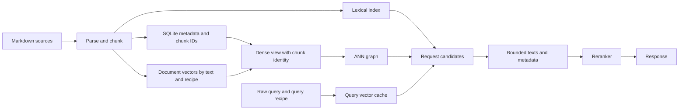

# Зависимости состояния и матрица изменений

CF0, 2026-11-09, source baseline `f51368e` как в [inventory](settings-inventory.md).
Связи ниже разделяют текущие факты и целевые artifact contracts; граф не означает,
что существующие storage уже поддерживают атомарную публикацию всего набора.

## Реальные входы и сохраняемое состояние

| Узел | Вход → выход; существующий код | Пригодность / целевой relevant fingerprint |
|---|---|---|
| Discovery | root/ignores/limits → список .md; `index/walk.rs` | source-set identity; root confinement неизменяем |
| Parse/Chunk | source bytes → frontmatter/body/line spans/chunks; `index/job.rs::prepare_doc`, `frontmatter.rs`, `chunk.rs` | parser/chunker algorithm + cap/overlap + source hash |
| Metadata | docs/chunks/ids/status; `store/repo.rs`, `job.rs::apply_plan` | parser/chunk recipe + source/chunk identities, schema version |
| Lexical | chunk text/heading/IDs → Tantivy; `tantivy_index.rs::add_chunks` | tokenizer/normalizer + indexed schema + chunk-set identity |
| Document vectors | chunk text → `vectors.db`; `jobs.rs`, `vector_cache.rs::chunk_hash` | document input recipe + model/revision/dim/normalization + text hash |
| Query vectors | raw query → bounded in-memory cache; `dense.rs::query_vector` | query input recipe + model identity + query hash; не lexical tokenizer |
| Dense view | current chunk IDs/hashes + vectors → exact/streaming rows | chunk-set + vector recipe/model; runtime generation binding |
| ANN | dense rows → persisted graph + READY/meta; `ann_store.rs::AnnKey/AnnMeta` | chunk IDs/hashes + vector recipe + construction recipe + format/library version |
| Stages | project config/providers → embedder/reranker; `server.rs::project_runtime` | process runtime revision + component settings identity, credentials отдельно |
| Watcher | root/filter/config + events → incremental jobs | resolved watcher settings + pending work; не identity vectors |
| Registry/lifecycle | canonical paths/PIDs/jobs → admission/session state | compatible schema/build/protocol; resource policy отдельно |

Все стрелки к request candidates — зависимости **исполнения**, не автоматическая
инвалидация всех downstream persisted artifacts. Reranker вызывается после
подготовки texts и не участвует в вычислении document vectors.

Проверенные тонкости:

- `chunk.rs` делит по собственным whitespace/punctuation boundaries, не вызывает
  `IdentifierTokenizer`. Поэтому MAX_TOKEN_CHARS/stemmer change → lexical rebuild,
  не rechunk/re-embed. Изменение самого splitter — другое ребро зависимости.
- `add_chunks` пишет lexical title из первого heading, а не `docs.title` frontmatter.
  Только изменение frontmatter title/tags без изменения body не обязано менять
  lexical/vector payload. Parser change, меняющий body/line shifts, анализируется отдельно.
- `finish_plan`: mark_pending в SQLite → embedding → Tantivy commit → SQLite apply/generation.
  Между этими шагами есть recovery markers, но нет общей snapshot transaction.
  В `prepare_doc` unchanged content_hash сейчас возвращает раньше повторного parsing;
  config/algorithm change нельзя определять одним source hash. PR #99 отдельно
  исправляет legacy frontmatter refresh; не заменяет общий artifact provenance.
- Query cache сейчас `(model_id, blake3(query))`; model instance key дополнительно
  содержит max_length/threads/runtime path. Future configurable truncation должна
  войти в vector recipe, а смена thread count/runtime location сама по себе — нет.
- ANN key уже включает generation/model/dim/count/chunk digest, meta содержит
  M/ef_construction. Future configurable layers/M/recipe требуют explicit key/format
  migration, а не проверки только прежнего `ANN_FORMAT_VERSION=1`.

## Матрица воздействия (целевой контракт FR-9–FR-11)

`—` означает отсутствие семантического invalidation edge; eviction/admission
или current coarse generation rebuild может временно оставаться до adoption.

| Изменение | Runtime | Metadata / chunks | Lexical | Vectors / query | ANN |
|---|---|---|---|---|---|
| HTTP timeout/retry/deadline | update/recreate transport | — | — | — | — |
| Cache byte/entry cap | evict/drain/admission | — | — | сохранить пригодные entries | сохранить пригодный graph, возможен eviction |
| Watch debounce/queue | revise/restart + drain | — | — | — | — |
| Watch on/off | stop/restart worker | explicit sync остаётся | — | — | — |
| Ignores/file/docs limits | enumerate/reconcile | удалить/добавить только scope delta по plan | scope delta | reuse одинакового text/recipe | только если изменился chunk-set |
| Chunk cap/overlap/splitter | новый chunk recipe | rechunk + ids/spans | rebuild affected | reuse неизменившихся content-addressed texts | rebuild при новом id/hash set |
| Lexical tokenizer/normalizer/token cap | reader/parser instance | — | rebuild | — | — |
| BM25 boosts/penalty/RRF K/weights | query policy | — | reader policy, не rebuild | — | — |
| Frontmatter title/tags only | filter/read metadata | refresh metadata | — при прежнем body/headings | — | — при прежнем chunk-set |
| Embedding model/dim/revision/normalization | stage instance | — | — | новая recipe namespace + query identity | rebuild под новую recipe |
| Document prefix/max_length/truncation | stage/recipe | — | — | document V; query Q только если изменён query recipe | rebuild document-vector graph |
| Query prefix/truncation only | stage/recipe | — | — | query Q, document V reused | — |
| Reranker model/input context/window | reranker | — | — | document/query vectors reused | — |
| ANN M/layers/ef_construction | construction settings | — | — | reuse cached vectors | новый graph recipe |
| ANN search ef/beam | search policy | — | — | — | graph reused |
| Runtime path / CPU thread count | reload local instance; retain old handles | — | — | reuse при той же verified semantic recipe | reuse |
| Parser/body interpretation change | по affected edges | refresh/rechunk as needed | по изменившимся chunks | reuse по text+recipe | по id/hash/recipe |
| Schema/format/algorithm incompatibility | explicit migration/admission | по owning migration | по owning migration | нет blanket delete | unknown provenance не считается ready |

Начальная реализация может сохранить общий embedding recipe вместо двух query/doc
recipes (тогда смена query-only prefix консервативно инвалидирует оба). Она обязана
отразить это в plan и тестах; обещание selective reuse даётся лишь после разделения
identities. Совместимый cache никогда не меняется только из-за timeout/quality query knobs.

## Планирование, публикация и recovery

1. Owners сравнивают desired settings с реальными facts каждого artifact, не только
   old/new TOML. Missing → Create, Unknown → AdoptIfProven либо Rebuild/Blocked,
   incompatible format → explicit migration; неизвестные fingerprints не равны.
2. Coordinator объединяет idempotent действия по ArtifactId и desired identity,
   строит topological order; conflicting outputs/cycle — ошибка plan.
3. Plan сохраняет expected input revisions и intended output recipes. Source/config
   digest не содержит credentials; при remote identity change используются versioned
   provider/model facts. Credentials rotation не маскируется cache invalidation.
4. Apply получает admission/writer lease и снова проверяет revision/facts. Missing
   grant либо stale plan → exit5/4 до destructive actions. Source mutation во время
   prepare требует rescan/replan, не публикации не соответствующего plan набора.
5. Shadow artifacts получают READY только после validation/durable write. Новый
   generation manifest публикуется атомарно после готовности metadata/index/vector
   bindings; `CURRENT` без versioned metadata не является таким manifest.
6. Failure до publication сохраняет прежнюю пригодную generation; после publication
   recovery читает committed pointer и завершает deferred cleanup. Orphan staging
   удаляется по ownership/journal, никогда по одному возрасту живой работы.
7. Old readers/builds/models остаются charged до release. Shrink может задержать
   новые задачи или дать bounded admission error, но не вычитать ещё живую память.

FR-15/16 полностью принимаются после CF10 storage ADR и CF11 generation
apply/recovery. Минимальный #66 может использовать publication lease + bounded prepare snapshot и явно reject/retry во время in-place
index mutation. Он обязан предотвращать смешение старых candidates и новых snippets,
но не объявляет нынешнюю SQLite/Tantivy пару immutable generations. Для будущего
server mode допустимость maintenance/503 при sync фиксируется в #79 и нагрузочной
приёмке; zero-downtime обновление не выводится из одного config snapshot.

## Delta 2026-11-11 — #68

`search.dedupe_max_candidates` — daemon request policy: global restart как
остальные SearchSpec fields. Меняет только ширину source/retained candidate
пула при opt-in cap. Никакой индекс/metadata/vector/query cache migration или
инвалидации не требуется; dense query identity остаётся model+query. Каждый
refill снова допускается под исходной generation/config/deadline.

## Delta 2026-11-13 — #79 S1a / #152

| Изменение / state | Runtime | Metadata / chunks | Lexical | Vectors / query | ANN |
|---|---|---|---|---|---|
| Daemon profile, Shared idle grace, connection/event/session caps | restart immutable DaemonSettings; S1b: Website фиксирует existing indexed ID/root, lexical-only, watcher-off, no idle deadline | — | — | — | — |
| Lifecycle poll/janitor/reply-drain/drain-poll intervals | restart timers; physical janitor ownership остаётся S1c | — | — | — | — |
| Search/control active/pending/timeout и blocking executor capacity | restart admission/runtime; physical lane consumers требуют S1c перед ship | — | — | — | — |
| One bounded launch capture и baseline digest | runtime policy из тех же captured bytes; no second startup read | — | — | — | — |
| Bounded restart stamp Missing/Loaded/Unavailable | diagnostic notice/restart-required, Unavailable никогда не приравнивается к Missing | — | — | — | — |
| I52 existing trusted1MiB actual byte boundary | reject oversize до parse/hash; bootstrap cap пока не configurable | — | — | — | — |

DaemonSpec assessment адресует только `Runtime("daemon")`, с unsupported live
executor/restart requirement; не запускает миграцию и не активирует v2. Source
preview/migration сохраняют owner data и provenance. Bounded primitive общий с
observer, но observer adapter сохраняет отдельные no-follow/regular-file/race
checks и SourceState/CF5 policy. Launch/restart digest не является source apply
precondition, prepare revalidation, search generation либо publication authority;
concurrent-write/ABA guarantees не усиливаются. Существующий admission::Lease,
SearchOperation/generation/singleflight не заменяются. Итоговая S1 матрица и
closed-inventory scan повторяются после S1b/c; full CF12/#79 не объявлены готовыми.

### Delta 2026-11-13 — S1b profile consumers

Profile changes remain runtime-only restart changes. Canonical fixed project and
its pure startup policy are admitted before lease/runtime/listener/writer setup,
then forwarded once. Read-only binds and metadata/sync routes recheck identity;
project reopen keeps the existing revision/preparation authority while rejecting
hybrid before factory/vector/watch work. Status/panel select the admitted project
set before runtime/coverage callbacks. No new artifact invalidation edge, CF5
consent executor, v2 activation or readiness DTO is adopted by this slice.

### Delta 2026-11-13 — S1c ownership boundary

Admission/cancellation/janitor ownership is runtime-only and restart-immutable.
The checked executor sum covers application-owned blocking closures through
finish/unwind. No persisted artifact edge, CF5 publication authority or
process-wide/native transport resource guarantee follows from this bound.

S1c actual consumers: search/control counts and control timeout construct
WorkerAdmission; the original SearchOperation remains the deadline/cancellation
authority. Actual closure guards own capacity/Activity until finish. Janitor
coalescing and fixed sync ownership are transient daemon state, with no persisted
artifact edge; connection/session/reader/payload accounting remains separate.

### Delta 2026-11-13 — Website readiness and HTTP request budgets

| Input/state | Runtime consumer | Persisted/index effect |
| --- | --- | --- |
| Current A outcome/attempt/recipe + authoritative project and Sync tuple | S2 read-only readiness, O1/health/O2 under existing read admission | observation only; never repair/create/register or synthesize proof |
| Sync lexical result captured before existing writer-lease release | existing Sync stats_json gains minimal exact attribution beside actual counters; terminal backfill failure stays Error | quality evidence only, no new generation/publication protocol |
| Complete example HTTP policy | one Node configuration boundary and listener/lanes/body/result/timers | application restart only; no lexical/vector/ANN invalidation |
| Optional caller start/deadline + abort | same SDK operation across preprocessing/queue/Hello/bind/write/read | transient narrowing/cancellation only, no replay or persisted artifact edge |

Ready covers the indexed full-survey corpus/recipe; watcher-off filesystem edits
remain unknown until explicit Sync. In-place mutation can refuse search, without
old-generation continuous availability. No CF5/v2 activation or full CF12/CF13
adoption is claimed by these application consumers.
