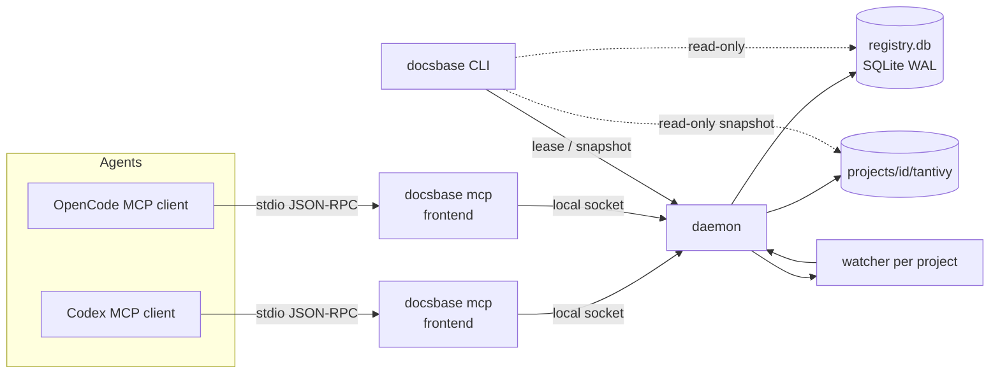

# Technical Design: docsbase-memory-mcp

**Status:** Draft
**Дата:** 2026-09-28
**Spec:** `docs/specs/docsbase-memory-mcp/requirements.md` (rev 2)
**Constitution:** `docs/specs/constitution.md`

## 1. Overview

`docsbase` — один Rust-бинарь с тремя ролями: CLI, тонкий stdio-MCP-frontend и
per-account daemon. Daemon владеет реестром проектов, per-project индексами
(SQLite + tantivy), watcher'ами и sync-джобами; frontend'ы подключаются к нему через
local socket (platform transport, ADR-9) и пробрасывают MCP tool-calls. Индексация явная (`index_project`), опционально
автоматическая (`auto_index`, default false). Реализует FR-1…FR-34, NFR-1…NFR-9.

**Библиотечное встраивание (направление, конституция 1.3.0).** Ядро живёт в
crate `docsbase_memory` (`src/lib.rs`) и не требует daemon'а: `index`, `store`,
`vector_cache`, `hybrid` вызываются напрямую (так уже делают интеграционные
тесты). CLI, daemon и MCP-frontend — потребители этого же API, а не его хозяева:
новые возможности по умолчанию реализуются в ядре, бинарные слои остаются
тонкими. Целевой сценарий — cargo-зависимость и встраивание в приложения и
пайплайны; стабильность API и публикация — отдельным решением (ADR) после 1.0.

## 2. Global constraints

Скопировано из constitution:

- Rust, edition 2024, MSRV 1.88; `cargo fmt`, `cargo clippy -- -D warnings`.
- v1 — Linux/WSL2 (x86_64); первая рабочая версия также Windows x64 (ADR-10).
  Весь ОС-зависимый код изолирован в `src/platform/` (`pub`-фасад, внутренний контракт;
  `#[cfg]`-выбор backend'а — только там), остальные модули к ОС не обращаются (ADR-9).
- Один статический бинарь; ноль сетевых вызовов и внешних сервисов в рантайме
  по умолчанию (hybrid-стадии за флагами per-project/per-request, конституция 1.2.0).
- `unwrap`/`expect` запрещены в библиотечном коде; `thiserror` в libs, `anyhow` на границе.
- Один canonical cache root; версия схемы; один writer.
- Крейты — только из таблицы §7; крейт вне списка — через ADR; каждый новый крейт
  обосновывается в шапке задачи.

## 3. Architecture



Компоненты и границы — разделы 4–6. Все публичные контракты версионируются
(`protocol_version`, `schema_version`) — NFR-7.

### Runtime layout

```
$CACHE = ~/.cache/docsbase-memory-mcp (0700)
├── state/daemon.json          # pid, socket, build_id, schema_version, cache_root
├── state/daemon.sock          # local socket (Endpoint), 0600 (FR-33, ADR-9)
├── state/daemon.start.lock    # flock: гонка старта (FR-9)
├── state/admission.lock       # flock: admission/lease (FR-4)
├── registry.db                # SQLite WAL: projects/docs/chunks/sync_jobs (NFR-3)
├── projects/<id>/tantivy/     # per-project FTS index (FR-19)
├── projects/<id>/.writer.lock # per-project writer lock
└── logs/{daemon.log, conflicts.ndjson}   # NFR-8, FR-4

$CONFIG = ~/.config/docsbase-memory-mcp/config.toml   # FR-28
$DATA = ~/.local/share/docsbase-memory-mcp            # FR-1, FR-5 (T25)
├── bin/docsbase               # installed binary (0755)
└── install.json               # owned manifest: binary, socket, cache_root, versions
Project: .docsbase.toml, .docsbaseignore              # FR-14, FR-28
```

## 4. Components

| Компонент | Ответственность | Публичный интерфейс | Зависит от | FR |
|---|---|---|---|---|
| `cli` | Парсинг и выполнение команд | `docsbase <cmd>` | daemon client, config, index (snapshot) | FR-30 |
| `mcp::frontend` | stdio MCP server; проксирование в daemon; ensure daemon | MCP tools | ipc client, rmcp | FR-7, FR-20…FR-27 |
| `daemon::lifecycle` | Старт/стоп, grace, admission, lock recovery | socket, `daemon stop` | store, ipc, admission | FR-2, FR-4, FR-5, FR-6, FR-9 |
| `daemon::server` | Accept loop, маршрутизация запросов | `Request -> Response` | session, registry, index, watch | FR-3, FR-25, FR-26 |
| `daemon::session` | Регистрация сессий, учёт соединений, cleanup | session registry | ipc | FR-2, FR-3, FR-8, NFR-9 |
| `daemon::registry` | Реестр проектов и статусы | `list_projects`, `index_project` | store | FR-10, FR-11, FR-12, FR-13 |
| `index::walk` | Обход `.md` с игнорами и границами root | `walk(root) -> [Path]` | ignore | FR-14, FR-32 |
| `index::frontmatter` | Разбор опционального YAML-frontmatter | `parse(text) -> (meta, body)` | — | FR-18 |
| `index::chunk` | Heading-чанкование, breadcrumb, code fences | `chunk(md) -> [Chunk]` | pulldown-cmark | FR-22 |
| `index::tantivy_index` | Схема, writer, reader, удаление чанков | `add/delete/search` | tantivy | FR-19, FR-21, FR-27, NFR-1 |
| `index::tokenizer` | camel/snake/идентификаторный токенизатор | `Tokenizer` | tantivy | FR-21 |
| `index::job` | Полный/инкрементальный прогон, sync-джобы | `run_job(project)` | walk, chunk, store, tantivy | FR-15…FR-17, NFR-1 |
| `watch` | Debounce и коалесценция событий | `WatcherEvents` | notify | FR-15, NFR-4 |
| `store` | SQLite-модель, миграции, реестр | repositories | rusqlite | FR-10, FR-16, FR-26, NFR-7 |
| `config` | Global/project config, precedence, paths | `Config::load` | toml, directories | FR-28, FR-29 |
| `ipc` | Версионированный JSON-RPC поверх local transport | `Request/Response` | serde, tokio, platform | FR-7, FR-33 |
| `platform` | Изоляция ОС: transport, signals, process, perms, path semantics | внутренний `pub`-фасад (ADR-9/10) | tokio, serde, directories; Windows: interprocess, windows-sys | NFR-6, FR-33 |
| `error` | Таксономия ошибок и маппинг в MCP/CLI | `enum Error` | thiserror | NFR-8 |

## 5. Module interfaces

Ключевые типы и инварианты (сокращённо):

```rust
// ipc/protocol.rs — FR-7, FR-33
#[derive(Serialize, Deserialize)]
#[serde(tag = "method", content = "params")]
pub enum Request {
    Hello { protocol_version: u32, build_id: String, client: String },
    RegisterSession { pid: u32, cwd: PathBuf },
    RegisterUnbound { pid: u32, cwd: PathBuf }, // C8 fallback: index_project from cwd
    CallTool { name: String, args: serde_json::Value },
    StopDaemon,
}

#[derive(Serialize, Deserialize)]
pub enum Response {
    Hello { protocol_version: u32, build_id: String, schema_version: u32 },
    ToolResult { value: serde_json::Value },
    Error { code: i32, message: String, instruction: Option<String> },
}

// platform/mod.rs — ADR-9 (внутренний pub-фасад; не стабильный API 0.1.0)
pub enum Endpoint { Unix(PathBuf) }      // serde как строка: daemon.json.socket
pub fn daemon_endpoint(cache: &Path) -> Endpoint;
pub fn bind(endpoint: &Endpoint) -> io::Result<Listener>;
pub fn bind_blocking(endpoint: &Endpoint) -> io::Result<BlockingListener>; // фейки/тесты
pub fn connect_blocking(endpoint: &Endpoint) -> io::Result<BlockingStream>;
pub fn connect_probe(endpoint: &Endpoint) -> bool;
pub fn exists(endpoint: &Endpoint) -> bool;
pub fn remove(endpoint: &Endpoint) -> io::Result<()>;
impl Listener { pub async fn accept(&self) -> io::Result<Stream>; }
impl Stream {}                            // AsyncRead + AsyncWrite (tokio::io::split)
impl BlockingStream {}                    // Read + Write + set_read_timeout (SO_RCVTIMEO)

// index/chunk.rs — FR-22, NFR-1
pub struct Chunk {
    pub doc_id: i64,
    pub seq: u32,
    pub heading_path: Vec<String>, // breadcrumb: file > H1 > H2
    pub kind: ChunkKind,           // Prose | Code { lang } | Table
    pub line_start: u32,
    pub line_end: u32,
    pub text: String,
}

/// Инвариант: чанк не начинается/не заканчивается внутри code fence;
/// секция > max_chunk_chars режется по границам абзацев, но не внутри fence.
pub fn chunk_markdown(body: &str, max_chunk_chars: usize) -> Vec<Chunk>;

// index/tokenizer.rs — FR-21
/// "defineStore" -> ["definestore", "define", "store"]
/// "__bt_tt_getProp" -> ["__bt_tt_getprop", "bt", "tt", "getprop", "get", "prop"]
/// "X-Request-ID" -> ["x-request-id", "x", "request", "id"]
pub struct IdentifierTokenizer;

// store/models.rs — FR-10, FR-16
pub struct Project {
    pub id: i64,
    pub canonical_root: PathBuf,
    pub status: ProjectStatus, // NotIndexed | Indexing | Indexed | Error
    pub schema_version: u32,
}
```

Инварианты:

- **I1 (FR-4):** daemon не обслуживает запросы, если `build_id`/`schema_version` не
  совпадают с записанными в `state/daemon.json`.
- **I2 (FR-8):** сессия существует ровно пока жив её socket; при EOF/ошибке запись
  удаляется, связанные ресурсы освобождаются.
- **I3 (FR-13):** `canonical_root` — результат `realpath` + git root; дубликаты
  невозможны, повторный `index_project` идемпотентен.
- **I4 (FR-32):** любой путь перед использованием проверяется на префикс зарегистрированных
  roots после `realpath`; symlink наружу — ошибка.
- **I5 (NFR-3):** на проект — не более одного `IndexWriter` и одного активного job.
  Index/sync jobs принадлежат **daemon**, а не сессии: смерть frontend не прерывает
  индексацию (FR-3).
- **I6 (FR-20):** сессия привязана к проекту по `cwd` — ближайший зарегистрированный
  ancestor; незарегистрированный проект → `Project`-ошибка с инструкцией вызвать
  `index_project`.
- **I7 (FR-32):** регистрировать можно только существующую директорию; realpath не может
  быть `/`, `$HOME`, системным каталогом (ADR-11) или cache root; хранится realpath (FR-13).
- **I8 (FR-34):** frontend валидирует имя tool по allowlist; неизвестное имя не уходит в
  daemon.

## 6. Data flow

**Старт и подключение (FR-2, FR-7, FR-9):**

1. Агент спавнит `docsbase mcp`.
2. Frontend пытается подключиться к `$CACHE/state/daemon.sock`.
3. Нет daemon → `flock(state/daemon.start.lock)`; победитель спавнит
   `docsbase serve --detached` и ждёт появления сокета (timeout 10 с); остальные ждут.
4. `Hello` → проверка `protocol_version`/`build_id`; затем `RegisterSession { pid, cwd }` —
   daemon привязывает сессию к ближайшему зарегистрированному проекту (I6); иначе
   `Project`-ошибка с инструкцией `index_project` (C8).
5. Смерть frontend → daemon видит EOF, чистит сессию (I2), если это была последняя —
   запускает grace-timer (OQ-7: 5 с) и завершается. Daemon-owned jobs при этом не
   отменяются (I5).

**Индексация (FR-10…FR-18):**

1. `index_project(path)` → `registry.ensure(path)` → `ProjectStatus::Indexing`.
2. `walk` → список `.md`; для каждого: hash → сравнение с `docs.content_hash`.
3. Новые/изменённые → `frontmatter` + `chunk` → tantivy `delete_term(doc_id)` + `add`.
4. SQLite: upsert `docs`/`chunks`; удалённые → `delete`.
5. Перед tantivy-операциями изменённые и удаляемые документы помечаются in-flight
   (`content_hash = ''` в SQLite); затем commit tantivy, затем commit SQLite
   (при краше повторный прогон переобрабатывает помеченные документы и сходится).
6. `ProjectStatus::Indexed`, `last_indexed_at`. Job принадлежит daemon: смерть frontend не
   прерывает прогон.

**CLI (FR-30):** сначала пробует подключиться к сокету; если daemon жив — идёт через него
(консистентно, без второго writer). Если daemon не запущен — команды чтения открывают
`registry.db`/tantivy в read-only snapshot, мутирующие берут per-project lease (FR-30).

**Конфиг (OQ-6, FR-28/29):** global читается на старте daemon; project — при открытии
проекта. Изменение global требует рестарта daemon (`docsbase daemon stop`), что
документируется в сообщении `status`.

**Правка файла (FR-15, FR-16, NFR-4):** watcher → debounce 1.5 с → коалесценция →
инкрементальный job по затронутым файлам → поиск видит новую версию ≤ 2 с.

**Поиск (FR-19…FR-21):**

1. `search_docs(query)` → frontend → IPC.
2. Запрос токенизируется `IdentifierTokenizer`; строится `BooleanQuery` по полям
   `text^1.0`, `title^2.0`, `heading_path^1.5`, `identifiers^2.5`, BM25.
3. Top-k → join с SQLite для citation (`path`, `heading_path`, `lines`).
4. Чанки длиннее `max_chunk_chars` получают штраф 0.5 до усечения top-k; поле
   `title` — верхний заголовок документа, а не последний (T27).
5. Ответ через IPC → MCP.

## 7. Dependencies + rationale

| Крейт | Зачем | FR/NFR |
|---|---|---|
| `rmcp` | официальный MCP SDK (stdio, типы tools) | FR-7, FR-20…27 |
| `tokio` (`rt-multi-thread`, `net`, `fs`, `time`, `signal`, `io-util`, `sync`, `macros`) | runtime для rmcp, socket, watcher, NDJSON-half'ов | FR-2, FR-7 |
| `clap` (derive) | CLI и subcommand'ы | FR-30 |
| `tantivy` | BM25/FTS, кастомный токенизатор, реляционная выдача | FR-19, FR-21, NFR-1 |
| `pulldown-cmark` | Markdown → события с byte-offset (line ranges, fences, tables) | FR-22 |
| `rusqlite` (`bundled`) | метаданные и реестр; статическая сборка SQLite | FR-10, FR-16, NFR-6 |
| `notify` | watcher; debounce/коалесценция — собственный quiet-collector 1.5 с (кап 2 с) | FR-15, NFR-4 |
| `ignore` | обход с gitignore-семантикой, `.docsbaseignore` и границы root | FR-14, FR-32 |
| `blake3` | content hash | FR-16 |
| `serde`, `serde_json` | IPC и MCP payloads | FR-7 |
| `toml` | конфиги | FR-28 |
| `directories` | XDG/known-folders пути (cache/config/data), home_dir | FR-28, FR-29 |
| `fd-lock` | RAII flock для admission/locks | FR-4, FR-9 |
| `thiserror`, `anyhow` | таксономия ошибок | constitution |
| (без крейта) файловый лог `logs/daemon.log` 0600 + `logs/conflicts.ndjson` | диагностика и admission-конфликты | NFR-8 |
| `interprocess` (`cfg(windows)`, feature `tokio`) | local sockets: daemon-транспорт на Windows | FR-33, ADR-10 |
| `windows-sys` (`cfg(windows)`, `Win32_System_Threading`, `Win32_Foundation`) | `process_alive` (OpenProcess/GetExitCodeProcess) и флаги `detach` (std не экспортирует `CREATE_*`) | ADR-10 |
| `reqwest` (`default-features = false`, `rustls-tls-webpki-roots`, `json`; feature `hybrid-remote`) | HTTP-клиент hybrid-ступеней (embeddings + rerank через OpenRouter); вне дефолтной сборки — SC-4-гейт «без reqwest в `cargo tree`» | hybrid-providers FR-1/2/7, ADR-14 |
| `hnsw_rs` 0.3.5 + `ouroboros` 0.18.5 | persisted HNSW для dense-канала (ANN), exact fallback | ann-index FR-1…FR-13, ADR-15 |
| (фаза 2, за флагом, ADR-13) `fastembed` + ONNX-runtime | локальные embedding-модели; опция, не дефолт | FR-27, ADR-12, ADR-13 |
| dev: `tempfile`, `assert_cmd`, `insta`, `criterion` | интеграционные, golden и perf-тесты (T27, T30) | NFR-1, NFR-7 |

**Точечные альтернативы:** вместо `serde_yaml` — минимальный flat-парсер frontmatter
(только `key: value`, вложенность не нужна); при росте требований заменить через ADR.

## 8. Required / Forbidden stack

- **Required:** `rmcp`, `tantivy`, `pulldown-cmark`, `rusqlite`, `tokio`, `clap`.
- **Forbidden по умолчанию:** сетевые клиенты, embedding/LLM SDK, Docker/внешние БД,
  Python/Node в рантайме, `unsafe` без `SAFETY`. Исключение (конституция 1.2.0):
  embedding/LLM API-клиенты — только как провайдеры hybrid-стадий за флагами
  per-project/per-request, каждый крейт — через ADR и таблицу §7.
- Реализовано (spec `docs/specs/hybrid-providers`, ADR-14): HTTP-клиент OpenRouter —
  `reqwest` + rustls (`webpki-roots`) за feature `hybrid-remote`; дефолтная сборка
  остаётся офлайн (SC-4: `cargo tree` без `reqwest`, CI-джоба `linux-hybrid`).
- ANN (спека `docs/specs/ann-index`, ADR-15): `hnsw_rs 0.3.5` +
  `ouroboros`; реализовано (T2–T6): persisted index, daemon BuildOrLoad,
  direct CLI LoadOnly, exact fallback.
  `usearch`/`sqlite-vector-rs` — отклонённые альтернативы (C++/FFI).
- Позже (ADR-13): `fastembed`/ONNX-runtime — локальные embedding-модели;
  не входят в итерацию 1.
- **Delta 2026-10-22:** ANN proposal — отдельная спека
  `docs/specs/ann-index/`; выбран `hnsw_rs` + `ouroboros`, не `usearch`
  (ADR-15). Exact dense scan остаётся fallback; после T2–T7 ANN — основной
  путь для проектов выше порога.
- **Delta 2026-10-22 (T7):** ADR-15 финализирован: `hnsw_rs 0.3.5` +
  `ouroboros 0.18.5` — единственные версии v1 (fallback-версии нет);
  формат `meta.json`/`READY`/atomic write — v1; core-замеры `AnnIndex`
  (release, 75k×2048): build 56.5 s, p95 5.4 ms, recall@10 1.0000, mmap load
  549 ms, bin 12 MiB (бюджет 40 MiB). End-to-end `DenseCache`/`VectorCache`/
  `search_docs` подтверждён T10 (8k CI + 75k manual).

## 9. Error handling

| Категория | Пример | Поведение | Код MCP |
|---|---|---|---|
| `Admission` | build/schema/root mismatch | отказ до работы, conflict-log (`build_id`, `schema_version`, `cache_root`, `pid`), сообщение с командой (`docsbase install`, rebuild через `docsbase index`) | `-32010` |
| `Protocol` | несовпадение `protocol_version` | закрыть соединение с понятной ошибкой | `-32011` |
| `Project` | проект не зарегистрирован, путь вне root | инструкция вызвать `index_project` | `-32012` |
| `Index` | IO/parse ошибка файла | файл пропускается, остальные индексируются, warning в `status` | `-32013` |
| `Query` | пустой/битый запрос | понятная ошибка без паники | `-32014` |
| `Internal` | прочее | лог + маскированное сообщение | `-32603` |

Правило: ошибка одного файла не валит job (A4); ошибка файла фиксируется в `status`.

## 10. Testing strategy

- **Unit:** chunker (границы fence/heading/абзацев), tokenizer (3 примера из
  спецификации), frontmatter, ignore-правила, precedence конфигов, line-range.
- **Integration (`tests/`):**
  - lifecycle: первый frontend поднимает daemon, последний гасит, grace, `daemon stop`;
  - cleanup (FR-8/NFR-9): kill -9 frontend → ресурсы освобождены ≤ 2 с; 1000 циклов — без
    роста fd/потоков;
  - admission (FR-4/FR-9): подмена `build_id` → отказ + conflict-log; recovery lock;
  - registry/indexing (FR-10…FR-18): not_indexed → index_project → indexed; инкремент;
    удаление файла; `auto_index = true`;
  - watcher (FR-15): debounce, коалесценция git-checkout-подобного всплеска;
  - CLI snapshot (FR-30): поиск при живом daemon и без него.
- **Golden (SC-1…SC-4):** фиксированный корпус + 4 типа запросов; снапшоты top-3.
- **Perf (NFR-1/2):** criterion для search/index; 50k чанков.
- **Soak (SC-5):** 3 агента + watcher 1 час (CI nightly).
- **Offline (SC-8):** тест в network namespace, проверка отсутствия connect() в
  дефолтной конфигурации; для hybrid-стадий с сетью — отдельный гейт на
  allowlist-эндпоинты.

## 11. Risks & trade-offs

| # | Риск | Вероятн. | Влияние | Митигация |
|---|---|---|---|---|
| R1 | Полный CBM-протокол (C1) съедает срок | высокая | высокое | Поэтапный ввод: S1 lock+lifecycle → S2 version/schema-проверки → S3 conflict-лог → S4 install/update coordination. Резать S3 → S2 при перерасходе |
| R2 | Две БД (SQLite + tantivy) расходятся при краше | средняя | среднее | Порядок commit'ов + сходимость по hash; тест с инъекцией краша между commit'ами |
| R3 | tantivy writer/reader конкуренция | средняя | среднее | Один `IndexWriter` на проект (I5); readers с `ReloadPolicy` |
| R4 | watcher-шторм при массовых операциях | средняя | среднее | Debounce + коалесценция; игнор директории индекса |
| R5 | Orphan daemon после краша | средняя | низкое | `daemon.json` + сокет; при старте — проверка pid и очистка stale |
| R6 | `rmcp` API меняется | низкая | среднее | Пин версии; адаптер в `mcp/` изолирует API |
| R7 | Line-range расходится с реальным файлом | низкая | низкое | Offsets из pulldown-cmark + тесты на edge cases |
| R8 | Корень проекта исчез/перемещён | средняя | низкое | `status = error` для записи; автоудаления нет; повторный `index_project` по новому пути создаёт запись и явно помечает старую |

**Компромиссы:** per-project индексы не дают кросс-проектного поиска (вернётся shared-слоем,
P6); BM25-only не ловит парафразы (фаза 2); explicit index добавляет шаг настройки (взамен
предсказуемости и контроля ресурсов).

## 12. Alternatives considered (ADR)

**ADR-1. Per-project vs единый глобальный индекс.**
Рассматривали: (a) глобальный с collections; (b) per-project; (c) гибрид.
Выбрано **(b)** по требованию владельца: изоляция ресурсов и предсказуемость; кросс-проектные
доки откладываются (P6). Цена: дублирование vendor-доков, закрывается Context7/скиллами (C3).

**ADR-2. stdio+daemon vs HTTP localhost vs ручной сервер.**
Выбрано **stdio frontend + daemon** (модель CBM): клиенту не нужен URL/порт, автостарт
естественен, один writer. Цена: свой IPC и lifecycle. HTTP-вариант отвергнут из-за
ручного управления процессом и портами.

**ADR-3. Полный CBM admission-протокол vs лёгкий lock.**
Выбрано **полный протокол** (решение владельца, FR-4/FR-5/FR-9): точное совпадение
build/ABI/root, conflict-log, безопасный install/update. Цена — R1; вводится поэтапно.

**ADR-4. `pulldown-cmark` vs `comrak`.**
Выбрано **pulldown-cmark**: byte-offset'ы из коробки (линум ranges), быстрее, меньше
зависимостей. `comrak` дал бы AST, но требует ручного маппинга позиций.

**ADR-5. Один SQLite + tantivy per project vs SQLite per project.**
Выбрано **один `registry.db` + tantivy per project**: единый реестр упрощает `status`,
WAL-конкурентность, миграции; изоляция обеспечивается каталогом tantivy и префиксами.

**ADR-6. `auto_index` default.**
Выбрано **false** (FR-12): явный контроль ресурсов; неожиданная индексация большого
репозитория на первом подключении — плохой UX (C8). Mitigation: явная инструкция в `status`.

**ADR-7. sync vs async.**
Выбрано **tokio** из-за `rmcp`; тяжёлые операции (tantivy, SQLite, walk) — через
`spawn_blocking`; это держит IPC отзывчивым (NFR-1).

**ADR-8. Статическая сборка: gnu `+crt-static` vs musl (NFR-6, T32).**
Выбрано **`x86_64-unknown-linux-gnu` с `+crt-static`** (static-pie, 12 МБ stripped):
системный GCC линкует bundled C-код (SQLite, zstd) без кросс-тулчейна, бинарь
работает на любой glibc/WSL2. musl дал бы libc-free артефакт, но требует
`x86_64-linux-musl-gcc` для C-зависимостей; отложено до появления тулчейна в CI.
Rustflags заданы через alias `cargo release-static` (`--target` + target-scoped
`--config`), чтобы обычные host-сборки оставались динамическими (proc-macro не
собираются с `+crt-static`).

**ADR-9. Platform seam: ядро vs `src/platform/` (фаза 3 prep, T33…T37).**
Выбрано **вынести все ОС-вызовы в `src/platform/` за внутренний фасад**
(local transport, signals, process detach/liveness/counters, fs-permissions,
path semantics); spawn процесса остаётся в lifecycle как portable `std::process`,
оставив ядро (`store`, `index`, `watch`-логика, `mcp`, `ipc`-протокол, `cli`)
платформенно-нейтральным. Фасад объявляется `pub` как остальные внутренние модули
крейта (`daemon`, `ipc`, `store`…): интеграционные тесты и `platform::daemon_endpoint`
обращаются к нему напрямую, но это внутренний контракт, не стабильный API (0.1.0).
Рассматривали: (a) оставить `#[cfg(unix)]` по месту — дешевле для v1, но порт фазы 3
трогает ядро и тесты; (b) отдельный workspace-крейт — жёсткая граница, но структурная
перестройка при 16k строк; (c) модуль в текущем крейте — выбрано как баланс.
Цена: разовый behavior-preserving рефактор (T34–T36) без смены wire-контрактов и
`schema_version`; инвариант проверяется `tests/platform_boundary.rs`.
Отложено в фазу 3 с отдельными ADR: транспорт Windows (AF_UNIX через `interprocess`
vs named pipes — новый крейт), замена запущенного бинаря в `install`, read-timeout
на named pipes, CI-матрица macOS/Windows.

**ADR-10. Windows backend: local sockets через `interprocess` (T38…T43).**
Выбрано: `src/platform/windows.rs` использует крейт **`interprocess`** (feature `tokio`)
как local-socket транспорт (named pipes), а `windows-sys` — для `process_alive` и
флагов `detach` (std экспортирует `creation_flags`, но не сами `CREATE_*`).
Рассматривали: (a) tokio named pipes + `std File` без крейта — дешевле по зависимостям,
но ручная ротация pipe-инстансов и собственный blocking-listener для тестов;
(b) `interprocess` — выбрано: blocking/tokio listener из коробки, единая обработка краёв,
задел под SDDL-ACL, условная зависимость `[target.'cfg(windows)']` (Linux крейт не
компилирует); (c) AF_UNIX на Windows — отвергнуто: неоднородная поддержка по сборкам,
std/tokio не предоставляют, мало боевых кейсов. Инварианты: Linux-реализация не
меняется; `Endpoint` получает вариант `Pipe(String)` (serde строкой; `daemon.json.socket`
совместим); имя `\\.\pipe\docsbase-<blake3(canonical cache)>` уникально на кэш;
`Client::connect` теряет exists-precheck (connect-ошибка → None). Деградации:
`secure_*` — best-effort no-op (приватность через `%LOCALAPPDATA%` и дефолтный DACL
пайпа), `fd_count/thread_count` = 0, `remove` пайпа — no-op. Вне этой фазы: SDDL-ACL,
статический `.exe` (msvc `+crt-static`), 10k-doc RSS (см. T43).

**ADR-11. `index_project`: системный blacklist вместо allowlist (T47).**
Выбрано: отвергать в `registry::normalize_root` корни, попадающие в системные каталоги
(`platform::paths::is_system_dir`: поддеревья `/etc`, `/usr`, `/bin`, `/sbin`, `/lib*`,
`/boot`, `/proc`, `/sys`, `/dev`, `/snap`, `/var/lib|cache|log|spool`; равенство `/home`,
`/root`, `/var`, `/mnt`, `/media`, `/run` (`/run/media` — исключение); Windows — `%SystemRoot%`, `%ProgramFiles%`,
`%ProgramFiles(x86)%`, `%ProgramData%`, `$Recycle.Bin`, `Recovery`, `PerfLogs`,
`System Volume Information`, равенство `<drive>/Users`), плюс уже существующие отказы
`/`, `$HOME` и cache root. **Любой другой каталог** регистрируется и индексируется
свободно — и из MCP, и из CLI. Рассматривали: (a) allowlist/ограничение «только session
cwd» — отвергнуто: same-user daemon-протокол не аутентифицирован (`RegisterSession {cwd}`
может отправить любой процесс пользователя), поэтому path-ограничение не даёт
конфиденциальности, лишь ограничивает легитимные сценарии (монорепо-родитель, соседний
worktree); (b) серверный `confirm=true`-токен — отвергнуто: агент может подставить его
сам, подтверждение без ценности; (c) серверный elicitation — возможное будущее (rmcp
feature, многие хосты авто-деклайнят), не обязательство. Граница доверия: подтверждение
индексации сторонних путей — ответственность MCP-хоста (permission prompt вне yolo);
blacklist — гигиена/анти-footgun, а не confidentiality-барьер. Известные ограничения:
`$Recycle.Bin`/`Recovery`/`PerfLogs` покрываются только для диска `%SystemRoot%`;
macOS-канонизация (`/private/*`, `/Users`) — фаза 3.

**ADR-12. Кэш векторов: контент-адресуемый `(model_id, chunk_hash)` (T53; фаза 2).**
Выбрано: векторы адресуются ключом `(model_id, blake3-хэш текста чанка)`, а не путём или
`(doc_id, seq)`; кэш глобальный на пользователя (`vectors.db` в cache root, LRU-кап по
entries/bytes), а live-индекс проекта содержит только чанки текущего дерева. Следствия:
переключение ветки/rebase/amend не эмбеддят неизменённые чанки, возврат на прежнюю ветку
бесплатен; worktrees с общим контентом не дублируют инференс; смена `model_id` инвалидирует
по ключу (старые векторы эвиктятся по LRU); эмбеддинг — фоновая стадия, перепроверяющая
`chunk_hash` перед публикацией (branch switch в момент инференса безопасен). Отклонено:
path-ключ, `(doc_id, seq)`, per-project/per-worktree кэш (дублирование, как у CBM).
Известное ограничение: partial-failure эмбеддера не должен оставлять «полу-поколение» —
батч валидируется целиком до записи.

**Delta 2026-10-14 (spec `hybrid-providers`, ADR-14):** контракт подключён в итерации 1.
Ключ `model_id` уточнён до `openrouter/<model>@d<dim>@<l2|raw>` (dim и нормализация обязаны
входить в ключ; FR-5 спеки); `count_present` добавлен для покрытия (`embed_coverage`).
Подключены: plan-эмбеддинг в index-джобе, полный sweep в sync-джобе (backfill) и
открытие проекта (авто-enqueue при покрытии < 100%).

**ADR-13. Embedding-провайдеры: OpenRouter + локальные модели за флагами (конституция 1.2.0).**
Выбрано: hybrid-ступени (embedding, reranker) включаются per-project (конфиг) и
per-request; embedding-провайдер абстрагирован: старт — OpenRouter API (без локального
веса), опция — локальная модель (докачка с HF в кэш моделей, `fastembed`/ONNX). Дефолт —
выключено (полный офлайн; SC-8 проверяет дефолтную конфигурацию). Сеть — только при явно
включённых ступенях, молчаливый сетевой доступ запрещён; API-ключи — в конфиге, обзор
security — до реализации (утечка документов, креденшелы, allowlist). Кэш векторов
(ADR-12) не зависит от источника: `model_id` обязан включать провайдера и ревизию
модели, чтобы remote-апдейты не смешивали векторы. 40 MiB (NFR-2) — бюджет самого ПО;
кэши моделей/индексы вне бюджета; сетевые/локальные hybrid-крейты — за feature-флагом,
чтобы дефолтный статический артефакт не рос. Отклонено: обязательный локальный вес в v1,
безусловная сеть, сеть без флага.

**Delta 2026-10-14 (spec `hybrid-providers`, ADR-14):** «ревизия модели» из `model_id`
реализована как `@d<dim>@<l2|raw>` (пин ревизии весов провайдера — принятое ограничение
итерации 1, риск A3/R2 спеки); ключ — только env (`OPENROUTER_API_KEY`), не в конфиге
(FR-4 уточнил пункт «API-ключи — в конфиге»: обзор security закрыт env-only).

**ADR-14. Hybrid iteration 1: OpenRouter-only за feature `hybrid-remote` (spec `docs/specs/hybrid-providers`).**
Выбрано: единственный провайдер итерации — OpenRouter (embeddings — `qwen/qwen3-embedding-8b`
@ `dimensions=1024` MRL: спайк 2026-10-14 показал отсутствие `qwen3-embedding-0.6b` в каталоге,
8B — нормированные вектора, $0.01/M; rerank — `cohere/rerank-v3.5`, $0.001/search). Sync-трейты
(`Embedder` существующий, `Reranker` новый) с единственным санкционированным входом
`hybrid::blocking::enter` (thread-local маркер; daemon роутит tool-вызовы через `spawn_blocking`).
Поиск: BM25-окно `max(limit, window)` (10..=100, дефолт 50) → провайдерский порядок listwise,
`score = relevance_score`, `rerank=false` — строгий BM25-порядок; `rerank=true` без ступени —
явная ошибка. Backfill: авто-enqueue sync-джобы при открытии проекта с покрытием < 100%
(`embed_coverage` в `status`); sync-джоба делает полный sweep чанков (content-addressed кэш —
бесплатно при покрытии). TOML: `hybrid = true` шорткат или untagged-таблица с per-stage
секциями; feature-off / чужой провайдер / нет ключа / window вне границ — явный `Admission`
без молчаливого fallback. Дефолтная сборка — офлайн (SC-4 гейт в CI-джобе `linux-hybrid`).
Отклонено: `reqwest::blocking` (паника внутри runtime, issue #1017), `rustls-tls-manual-roots`
(не верифицирует без рутов), прямой Cohere (второй ключ/биллинг — итерация 2+), async-трейты
(триггер пересмотра — веерные per-request запросы с дедлайном).

**Delta 2026-10-15 (итерация 2, spec `hybrid-providers` DELTA-3/DELTA-7):**
добавлен dense-канал и RRF-fusion. `hybrid.ranking = "lexical" | "rrf"`
(дефолт lexical — смена порядка выдачи только с замером, NFR-6; `rrf` требует
embedding-ступень — `Admission`). Списки BM25 и dense (косинус по кэшу векторов
текущей ревизии, `k = 60`, детерминированные тай-брейки) сливаются; rerank
остаётся верхней ступенью, без rerank `score` = RRF-скор (rank-based).
`projects.index_generation` (схема v2; инкремент в R2-транзакции применения
плана) инвалидирует in-memory dense-кэш (`DENSE_CACHE_MAX_VECTORS = 1M`,
выше — стриминговый скан с bounded-хипом). Публичная библиотечная поверхность
расширена: `store::repo`, `Db::{connection,begin_write}` (конституция 1.3.0).
ANN — ADR-15; локальные модели и тюнинг `k`/весов — отдельные итерации.

**ADR-15. ANN для dense-канала: persisted HNSW (`hnsw_rs`) + `ouroboros` (spec `docs/specs/ann-index`).**
Выбрано: `hnsw_rs 0.3.5` + `ouroboros 0.18.5`; fallback-версии нет. Это внутренняя оптимизация dense-канала RRF:
`search_docs_with` получает те же `(chunk_id, score)`, rerank и MCP/CLI-контракты
не меняются. Persistence обязательна с v1: `AnnKey` (`project_id`,
`index_generation`, `model_id`, `dim`, count, chunk-set digest, format version),
`AnnMeta` (`hnsw_rs` version), `meta.json` + `READY`, atomic temp→rename, mmap
через `HnswIo` и owning-wrapper `ouroboros` (self_cell не подходит: builder даёт
`&Owner`, а `load_hnsw` требует `&mut`; `Hnsw` инвариантен по lifetime).
Dump чужой версии/формата отвергается и пересобирается; migration layer нет.
Build: `parallel_insert` — дефолт; warm — фоновый, поиск во время сборки идёт
exact streaming; `set_searching_mode(true)` после вставки. Ошибка ANN всегда
даёт exact fallback, не ошибку поиска. Ограничения: byte/vector/project caps,
LRU, `TooLarge` streaming; `env_logger` — normal-зависимость
`hnsw_rs`; размер release-бинаря после реализации — 12 MiB (бюджет 40 MiB).
Версия/cooldown: `0.3.5` опубликован 2026-10-09; на 2026-10-22 он был
моложе 14 дней, поэтому временно (2026-10-22 → 23) действовал **глобальный**
13-дневный `min-publish-age` (Cargo 1.101 nightly не имеет декларативного
per-package allowlist). T1.5 завершил исключение 2026-10-23: действует
политика `14 days`, `0.3.5` остаётся в `Cargo.lock`.
Отклонено: `instant-distance` (archived 2026-07-23, no persistence),
`self_cell` (lifetime/`&mut`), `sqlite-vector-rs`/`usearch` (C++/FFI, Arrow,
static/MSRV), `hnsw` (rust-cv; 2021, hamming-oriented), `hannoy`/LMDB (C).
`hnswlib-rs` (wilsonzlin) — запасной вариант: owned API и int8-квантование
интересны для следующей итерации, но сейчас меньше adoption, частые breaking
releases, кастомные `corenn-kernels` и нет mmap-истории в нашем сценарии.

**ADR-16. Vector-cache capacity/pinning для ANN (spec `docs/specs/hybrid-providers`, DELTA-9).**
Выбрано: `[hybrid.cache] max_bytes` (default 1 GiB; резидентный cap `DenseCacheLimits.max_bytes` — 1.5 GiB с Delta 0.3.1) ограничивает
content-addressed `VectorCache`; ANN требует 100% coverage, поэтому дефолт
256 MiB заменён. Backfill берёт per-project lease: уникальные хеши проекта
пишутся в `vector_cache_leases` на 1 час, `evict` их не трогает; успешный ANN
build снимает lease после `READY`, failed build оставляет его для retry.
Глобальный ANN-диск ограничен 4 GiB (oldest-first, newest/current project
kept). Отклонено: строить ANN по частичному покрытию (тихий recall-риск),
отдельный vector store (дублирует source of truth), безусловное удаление
tmp-каталогов (гонка с build), удаление текущего проекта при disk cleanup.
Закрыто T11 2026-10-23: Windows/macOS runtime подтверждён CI, T1.5 снят, спека ann-index — Final.

**ADR-17. Local embedding/rerank provider: `fastembed` + ONNX Runtime за фичей `hybrid-local` (spec `docs/specs/hybrid-local`).**
Выбрано: третий провайдер hybrid-ступеней — локальный `fastembed` (Apache-2.0) за
отдельной фичей `hybrid-local`; дефолтная сборка остаётся полностью офлайн (SC-8:
в `cargo tree` нет `fastembed`/`ort`/`tokenizers`/`hf-hub`/`reqwest`). Веса моделей
в бинарь не входят; дефолтных моделей нет. Провайдер становится доступен только
после явного `docsbase connect fastembed`, который ставит ONNX Runtime (не требует
предустановленного рантайма) и пишет `[providers.fastembed]` в **глобальный** конфиг
(`enabled = true`, версия/путь рантайма). Дефолтных моделей в реестре нет; существующие
дефолты OpenRouter не меняются, а для не-openrouter провайдера `model` обязателен.
Модели скачиваются только явно
(`docsbase models fetch <name>`) с HF по **pinned revision** с проверкой sha256;
`models use` purpose-first: `models use embed <model>` / `models use rerank <model>`,
одна стадия за вызов (смешать нельзя), опции под назначение (`--dims` / `--window`);
пишет только эту секцию в проект (по умолчанию) или в глобальный конфиг (`--global`,
обязателен вне проекта).
Сеть на index/search-путях запрещена: отсутствие рантайма/модели — admission-ошибка
с подсказкой, без молчаливого fallback.
ORT-стратегия: `ort-load-dynamic`; `connect` качает закреплённый ONNX Runtime
(**1.24.4**, `api-24`; `linux-x64/aarch64`, `osx-arm64`, `win-x64/arm64` — macOS
x86_64 больше не публикуется, минимальная macOS 14.0) под платформу/арх, проверяет
sha256 и кладёт в data-dir; на старте
`ort::init_from(path)` до создания сессий (порядок резолва: `ORT_DYLIB_PATH` →
`providers.fastembed.runtime_path` → data-dir → ошибка; data-dir без записи провайдера
не используется). На macOS скачанный dylib проверяется `codesign --verify --strict`;
`com.apple.quarantine` снимается, если присутствует, а ad-hoc подпись (`codesign -s -`)
применяется только при провале проверки. `[providers]` валиден только в глобальном конфиге: проектный файл
парсится отдельным типом без поля `providers` — это структурная защита, а не проверка
после merge. Рантайм считается исполняемым кодом: explicit connect, pinned
version + hash, запись в SECURITY. Бюджет 40 MiB (NFR-2) относится к бинарю;
рантайм и модели — отдельные кэши вне бюджета (размеры фиксируются в CONFIG/docs).
Зависимости (фича, точные пины): `fastembed = { version = "=7.1.1",
default-features = false }` (cooldown 14 дней; 7.2+ — после 2026-11-04/06; embedding
ONNX грузится как `Vec<u8>` во всех версиях при MSRV 1.88: 7.5 всё ещё так, а
`OnnxSource` есть только для rerank; 7.5.0 сам объявляет 1.88, но пинит ort rc.15
с MSRV 1.92),
`ort = { version = "=2.0.0-rc.13", default-features = false, features = ["load-dynamic"] }`
(release candidate — риск зафиксирован), `ureq = "=3.4.2"`, `sha2 = "=0.10.9"`,
`flate2 = "=1.1.10"`, `tar = "=0.4.46"`, `zip = "=8.6.0"` для загрузки/распаковки
рантайма (9.0.0 ровно на границе cooldown, поэтому 8.6.0), `tokenizers` с
Oniguruma (C, прецедент — bundled sqlite3). Модели:
`bge-small-en-v1.5` (384, CLS, 133 MB), `multilingual-e5-small` int8 (384,
Mean, 118 MB), rerank-кандидаты `jina-reranker-v1-turbo-en` int8 (38 MB, Apache-2.0,
8K) и `bge-reranker-base` (1.11 GB);
`jina-reranker-v2` отклонён (CC-BY-NC-4.0); ни одна модель не выбирается по умолчанию.
E5 требует `query: `/`passage: `, BGE — query-instruction; `Embedder` получает
`embed_query`, канонический `model_id` — `@p<prompt_version>` (FR-9/FR-10).
Фичи: `hybrid-local` даёт `connect fastembed`/status и `models fetch|list|remove`;
`hybrid-remote` — `connect openrouter`; `models use` доступен при любой из фич (probe
диспетчеризуется по провайдеру); обе совместимы, дефолтная сборка не содержит ни одной.
Отклонено: бандлить ORT в релизные артефакты, авто-скачивание при первом поиске,
дефолтная модель, обязательный локальный вес в v1, candle-only путь (нет rerank),
новые пользовательские ключи сверх `[providers]`/`[hybrid]`.

## 13. Directory structure

```
src/
├── main.rs                 # entry: dispatch CLI/subcommands
├── cli/                    # clap definitions + commands (FR-30)
│   ├── mod.rs
│   ├── index.rs            # docsbase index [path] (FR-11)
│   ├── search.rs           # docsbase search (FR-20)
│   ├── status.rs           # list/status snapshots (FR-25, FR-26)
│   └── install.rs          # install/uninstall (FR-1, FR-31)
├── mcp/
│   ├── mod.rs
│   ├── frontend.rs         # stdio MCP server, ensure-daemon, proxy (FR-7)
│   └── tools.rs            # tool schemas (FR-20…FR-27)
├── daemon/
│   ├── mod.rs
│   ├── server.rs           # accept loop, routing (FR-3)
│   ├── session.rs          # session registry + cleanup (FR-8, NFR-9)
│   ├── lifecycle.rs        # start/stop/grace/admission (FR-2, FR-4…FR-6, FR-9)
│   └── registry.rs         # project registry (FR-10…FR-13)
├── ipc/
│   ├── mod.rs
│   └── protocol.rs         # Request/Response, protocol_version (FR-7)
├── index/
│   ├── mod.rs
│   ├── walk.rs             # ignore-aware walk (FR-14, FR-32)
│   ├── frontmatter.rs      # flat frontmatter (FR-18)
│   ├── chunk.rs            # heading chunker (FR-22)
│   ├── tokenizer.rs        # camel/snake tokenizer (FR-21)
│   ├── tantivy_index.rs    # schema/writer/reader (FR-19, NFR-1)
│   └── job.rs              # full/incremental jobs, sync (FR-15…FR-17)
├── watch/mod.rs            # debounced watcher (FR-15, NFR-4)
├── store/
│   ├── mod.rs
│   ├── migrations.rs       # schema_version (NFR-7)
│   ├── repo.rs             # SQL repositories (docs/chunks/sync_jobs)
│   └── models.rs           # projects/docs/chunks/sync_jobs
├── config/
│   ├── mod.rs              # load + precedence (FR-28, FR-29)
│   └── paths.rs            # XDG dirs
├── platform/               # ОС-изоляция (ADR-9)
│   ├── mod.rs              # фасад: Endpoint/Listener/Stream, process/fs/paths
│   ├── unix.rs             # Unix-реализация v1 (transport/signals/process/perms)
│   ├── windows.rs          # Windows x64 backend (T39–T41, interprocess + windows-sys)
│   └── paths.rs            # home_dir, is_under, normalize_for_compare
└── error.rs                # taxonomy (NFR-8)

tests/
├── lifecycle.rs / cleanup.rs / admission.rs / admission_ux.rs
├── watcher.rs / index_job.rs / index_incremental.rs
├── search_golden.rs (+ snapshots) / mcp_docs.rs / error_surface.rs
├── install.rs / config_runtime.rs / perf_budget.rs / artifact.rs
├── platform_{transport,process,boundary}.rs (ADR-9)
├── soak.rs / offline.rs
└── …
```

## 14. Traceability

| Требование | Где реализуется |
|---|---|
| FR-1, FR-31 | `cli/install.rs` |
| FR-2…FR-6, FR-9 | `daemon/lifecycle.rs`, `daemon/session.rs` |
| FR-7 | `mcp/frontend.rs`, `ipc/protocol.rs` |
| FR-8, NFR-9 | `daemon/session.rs` |
| FR-10…FR-13 | `daemon/registry.rs`, `store` |
| FR-14, FR-32 | `index/walk.rs` |
| FR-15, NFR-4 | `watch/`, `index/job.rs` |
| FR-16 | `store`, `index/job.rs` |
| FR-17 | `index/job.rs`, `store.sync_jobs` |
| FR-18 | `index/frontmatter.rs` |
| FR-19, FR-21, FR-27, NFR-1 | `index/tantivy_index.rs`, `index/tokenizer.rs` |
| FR-20, FR-22…FR-26 | `index/`, `mcp/tools.rs` |
| FR-28, FR-29 | `config/` |
| FR-30 | `cli/` |
| FR-33 | `ipc/` + `platform/` (local socket, 0600, ADR-9) |
| FR-34 | `mcp/tools.rs` (read-only набор) |
| NFR-2, NFR-3, NFR-6 | `store`, `index/`, сборка, `platform/` (seam, ADR-9) |
| NFR-6 (Windows x64) | `platform/windows.rs`, CI-матрица (ADR-10, T38–T43) |
| NFR-5, NFR-8 | `logs/daemon.log` + conflict-log, отсутствие сетевых крейтов в дефолтной сборке |
| NFR-7 | `store/migrations.rs` |
