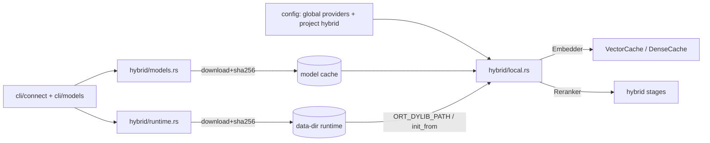

# Technical Design: hybrid-local (итерация 4)

**Status:** Draft, ревизия 0.3 · **Дата:** 2026-10-23
**Spec:** `docs/specs/hybrid-local/requirements.md` (ревизия 0.3)
**ADR:** ADR-17 (product design); ADR-12/13/14 (adjacent).

## 1. Overview

Adds a third hybrid provider (`fastembed`) behind feature `hybrid-local`. The provider is
an `Embedder` and a `Reranker` like OpenRouter, so search/RRF/ANN code does not change.
Everything that touches the network or the filesystem lifecycle (runtime, model files) lives
in new modules and CLI commands and is dead code in the default build. The provider becomes
usable only after an explicit `connect` (runtime) and `fetch` (model) from the user; search
never downloads anything (FR-3…FR-10, NFR-1, NFR-6).

## 2. Global constraints

- Rust edition 2024, MSRV 1.88; `cargo fmt --check`; clippy `--all-targets -D warnings`.
- No `unwrap`/`expect`/`panic!` in `src/**`.
- Default build: no `fastembed`, `ort`, `tokenizers`, `hf-hub`, `ureq`, `reqwest` (NFR-1).
- New crates only per ADR-17: `fastembed = "=7.1.1"`, `ort = "=2.0.0-rc.13"`,
  `ureq 3.4.x`, `sha2`, `flate2`, `tar`, `zip` — all optional, behind `hybrid-local`.
- No model weights or runtime binaries inside the crate/binary (NFR-8).
- ORT version: **1.24.4** exactly; supported targets: `linux-x64`, `linux-aarch64`,
  `osx-arm64`, `win-x64`, `win-arm64` (macOS x86_64 is not published; macOS >= 14.0).
- Network only in `connect`/`fetch`; none on index/search paths (FR-12).
- `[providers]` only in the global config; `.docsbase.toml` may contain only `[hybrid]`.
- `model_id = fastembed/<name>@d<dim>@<l2|raw>@r<rev8>@p<prompt_version>`; a revision
  or prefix change invalidates the vector cache and the ANN key by construction (FR-13).

## 3. Architecture



Two phases, strictly separated: **provisioning** (`connect`, `fetch`, `models use`) and
**runtime** (open project, embed, rerank). The runtime phase may fail closed (admission) but
never performs I/O to the network (FR-12, NFR-6).

## 4. Components

| Component | Responsibility | Public interface | Depends on |
|---|---|---|---|
| `hybrid::runtime` | platform detection, download/extract/verify ORT, resolve path, `init_from` once | `runtime::ensure(version, path)`, `runtime::resolve(cfg)`, `runtime::status()` | `ureq`, `sha2`, `flate2`, `tar`, `zip`, `ort` |
| `hybrid::models` | registry, cache layout, `fetch/list/remove`, sha256, lock | `models::entry(name)`, `models::fetch(entry, source)`, `models::cache_state(entry)` | `ureq`, `sha2`, `fd-lock` |
| `hybrid::local` | `FastEmbedEmbedder`, `FastEmbedReranker`, one-time model construction | `impl Embedder`, `impl Reranker`, `local::embedder(cfg)`, `local::reranker(cfg)` | `fastembed`, `ort`, `models`, `runtime` |
| `cli::connect` | status table, `connect openrouter/fastembed`, global config write | `connect::run(args)` | `hybrid::runtime`, `hybrid::models`, `config` |
| `cli::models` | existing `use` + `fetch/list/remove`, scope resolution | `models::run(args)` | `hybrid::models`, `config` |
| `config` | `[providers]`, precedence, validation, scope | `Config::global`, `Config::for_project`, `providers::status` | — |

Each component maps to requirements: runtime → FR-4/FR-10; models → FR-5/FR-6/FR-7;
local → FR-9 (SC-6); cli → FR-2/FR-3/FR-8; config → FR-1 (NFR-5/6).

## 5. Module interfaces

```rust
// hybrid/runtime.rs
pub struct RuntimeStatus { pub version: Option<String>, pub path: Option<PathBuf>, pub broken: Option<String> }
pub fn platform_target() -> Result<Target>;             // six supported targets, else Admission
pub fn resolve(cfg: &ProvidersCfg) -> Result<PathBuf>;  // FR-10 order
pub fn install(target: Target, source: &dyn RuntimeSource, force: bool) -> Result<PathBuf>;
pub fn init(path: &Path) -> Result<()>;                 // ort::init_from(..).commit(), OnceLock

// hybrid/models.rs
pub struct FileSpec { pub path: &'static str, pub size: u64, pub sha256: &'static str }
pub struct ModelEntry { /* name, task, repo, revision, onnx, additional, dim, pooling,
                           quantization, output_key, license, files,
                           query_prefix, passage_prefix, prompt_version */ }
pub trait ModelSource { fn fetch(&self, repo: &str, revision: &str, path: &str) -> Result<Vec<u8>>; }
pub fn entry(name: &str) -> Result<&'static ModelEntry>;
pub fn cache_dir(name: &str, revision: &str) -> PathBuf;   // <cache>/<name>/<revision>
pub fn fetch(entry: &ModelEntry, source: &dyn ModelSource) -> Result<PathBuf>;
pub fn cached(entry: &ModelEntry) -> bool;                 // .complete present + files exist

// hybrid/local.rs
pub fn embedder(cfg: &EmbeddingCfg, providers: &ProvidersCfg) -> Result<Arc<dyn Embedder>>;
pub fn reranker(cfg: &RerankerCfg, providers: &ProvidersCfg) -> Result<Arc<dyn Reranker>>;
// both: resolve runtime, require cached model, build TextEmbedding/TextRerank once (OnceLock)
// embedder additionally implements: fn embed_query(&self, text: &str) -> Result<Vec<f32>>
// (default trait method = embed(&[text]); local impl prepends query_prefix, while
//  passage embeds prepend passage_prefix — FR-13)
```

Invariants: `init` runs before any `fastembed` constructor; `model_id` is derived only from
the registry + dim + normalize + revision; `fetch` never leaves a directory without
`.complete`; `resolve` never downloads.

## 6. Data flow

1. **connect fastembed** → detect target → download archive → verify sha256 → extract the
   shared library → temp dir → fsync → rename into
   `<data>/runtimes/onnxruntime/<version>/<target>/` → write `[providers.fastembed]`
   (global) → print status.
2. **models fetch** → registry entry → for each file: download to `*.part`, verify size and
   sha256, fsync, rename → write `.complete` last. A lock file serializes concurrent fetches.
3. **models use** → resolve scope (project vs `--global`) → validate provider connected,
   model cached (or `--dry-run`) → write the `[hybrid]` table atomically, preserving other
   sections (comments are not preserved; the command says so).
4. **search/index** → `from_config` resolves the provider → `local::embedder`/`reranker` →
   runtime `init_from` + `TextEmbedding::try_new_from_user_defined` (cached in `OnceLock`) →
   search uses `embed_query` (query prefix), backfill uses `embed` (passage prefix) →
   vectors stored under `model_id` → ANN/RRF unchanged.
5. **failure** → missing provider/runtime/model/dim → `Error::Admission` with one action;
   no network attempt, no fallback.

## 7. Dependencies + rationale

| Crate | Why | Notes |
|---|---|---|
| `fastembed = "=7.1.1"` | local embed/rerank, user-defined ONNX models | Apache-2.0; 7.2+ blocked by the 14-day cooldown until 2026-11-06; embedding ONNX is loaded via `Vec<u8>` (7.5+ adds file-based `OnnxSource`) |
| `ort = "=2.0.0-rc.13"` | ONNX Runtime binding with `load-dynamic` and `init_from` | transitive via fastembed; rc risk accepted in ADR-17; `ort v2` targets ORT 1.24.4 (`api-24`) |
| `ureq 3.4.x` | blocking HTTPS for runtime/model downloads | matches `hf-hub`'s stack; rustls; no async runtime on CLI paths |
| `sha2 0.10` | sha256 verification | RustCrypto, MIT/Apache |
| `flate2`, `tar` | extract ORT `.tgz` (Linux/macOS) | standard, pure-Rust defaults |
| `zip` | extract ORT `.zip` (Windows) | standard |
| `tokenizers` (via fastembed) | tokenization | pulls Oniguruma (C), same class as bundled sqlite3 |

Nothing above is linked into the default build (NFR-1).

## 8. Required / Forbidden stack

- **Required:** `ort-load-dynamic` + `ort::init_from`; pinned registry revisions; `sha2`
  verification; `blocking::enter` around inference; `Error::Admission` for provisioning
  errors.
- **Forbidden:** `fastembed`'s built-in downloader (`TextInitOptions` with cache_dir),
  `hf-hub` implicit downloads, `REQWEST`/`ureq` on search paths, defaults for model names,
  bundling weights or ORT into the binary, writing `[providers]` into project config,
  GPU execution providers.

## 9. Error handling

| Situation | Error | User-visible action |
|---|---|---|
| provider not connected | `Admission` | `docsbase connect fastembed` |
| runtime missing/broken | `Admission` | same, or `ORT_DYLIB_PATH` / `--force` |
| model not fetched / partial | `Admission` | `docsbase models fetch <name>` |
| dims mismatch / normalize=false | `Admission` | fix `[hybrid.embedding]` |
| sha256 mismatch | `Internal` (fetch) | retry `--force`; nothing installed |
| ORT/tokenizer inference failure | `Internal` | no fallback; log detail, keep exact/lexical? no — fail closed for the stage |
| `[providers]` in project | `Admission` | move to global config |

## 10. Testing strategy

- **Unit (offline, default build):** config parse/precedence/scope matrix, provider
  validation, `model_id`, registry invariants, cache layout with a fake `ModelSource`,
  runtime target selection and status with a fake source; no network.
- **Feature unit (`--features hybrid-local`):** constructors with missing runtime/model
  return admission (no ORT needed); `models use --global` writes global config.
- **Integration:** `docsbase connect --check` and `models fetch` against a local fake HTTP
  server (or `ModelSource` stub) — deterministic, no HF.
- **Live (`#[ignore]`):** real connect + fetch + embed + rerank; manual/nightly, ledger
  records versions/hashes/sizes/latency/RSS (T8).
- **CI:** `linux-local` builds/tests the feature; default job asserts the tree gate.
- **Not tested in CI:** actual model quality/recall (no weights), GPU paths (absent).

## 11. Risks & trade-offs

| Risk | Impact | Mitigation |
|---|---|---|
| `ort` rc API churn | build/behaviour changes on upgrade | exact pin `=2.0.0-rc.13`; upgrade is a task with live test |
| ORT download supply chain | malicious/corrupt runtime | pinned URL+sha256, explicit connect, SECURITY note |
| Model size / first-run UX | 38–118 MB with the chosen int8 models (bge-reranker-base would be 1.11 GB and is not a default) | explicit fetch with size shown; `.complete` prevents partial use |
| Prefix omission (BGE/E5) | silent retrieval-quality loss | FR-13 role-aware `embed_query`, registry prefixes, prompt-version in `model_id`, tests in T4 |
| macOS 14 floor / no x64 macOS | users on older Intel Macs cannot run local models | documented; `connect` fails with a clear unsupported-target error |
| Oniguruma C build | platform build failures | CI matrix in T7; same toolchain as bundled sqlite3 |
| TOML rewrite loses comments | user annoyance | printed warning; `toml_edit` considered for a later iteration |
| Global provider config drift | a repo selects a provider not installed elsewhere | project files cannot contain `[providers]`; admission at open |
| Two features (`local`+`remote`) | dependency duplication | Cargo feature unification; CI builds both together |

## 12. Alternatives considered (ADR-style)

1. **Bundle ORT in release artifacts** (build-time `download-binaries`): rejected — bigger
   artifacts, per-platform packaging/signing, install-script complexity; `load-dynamic` +
   `connect` keeps the binary small and the step explicit.
2. **Auto-download runtime/model on first search**: rejected — violates "no silent network"
   (ADR-13), makes search unpredictable and non-hermetic.
3. **Default local model**: rejected — hides re-embedding cost and silently changes ranking;
   no defaults (FR-5).
4. **`hf-hub`/fastembed built-in downloader**: rejected — hides network inside the stage and
   bypasses our revision/hash policy.
5. **`bge-reranker-base` as the registry's only reranker**: rejected — 1.11 GB fp32 and
   514-token context; `jina-reranker-v1-turbo-en` int8 is 38 MB, Apache-2.0, 8K context.
   Neither is a default: both are selectable, and `models use --rerank` is required.
5. **candle-only (pure Rust, qwen3)**: rejected for v1 — no rerank path, larger model set
   churn; may be a later provider.
6. **Project-level `[providers]`**: rejected — machine capability cannot be committed.
7. **`toml_edit` for config writes**: deferred — no new dependency in v1; comments are a
   known limitation.

## 13. Directory structure

```
src/hybrid/local.rs      # FastEmbedEmbedder / FastEmbedReranker (feature hybrid-local)
src/hybrid/models.rs     # registry, cache layout, fetch/list/remove (feature)
src/hybrid/runtime.rs    # ORT target table, install, resolve, init (feature)
src/cli/connect.rs       # docsbase connect ...
src/cli/models.rs        # models use/fetch/list/remove + scope
docs/specs/hybrid-local/ # this spec
```
