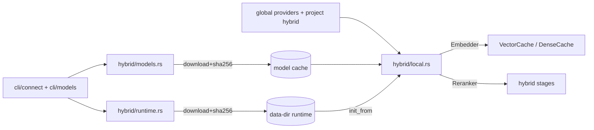

# Technical Design: hybrid-local (итерация 4)

**Status:** Draft, ревизия 0.7 · **Дата:** 2026-10-23
**Spec:** `docs/specs/hybrid-local/requirements.md` (ревизия 0.7)
**ADR:** ADR-17 (product design); ADR-12/13/14 (adjacent).

## 1. Overview

Adds a third hybrid provider (`fastembed`) behind feature `hybrid-local`: an `Embedder` and a
`Reranker` like OpenRouter, so search/RRF/ANN code does not change. Provisioning (runtime,
model files) is a separate phase (`connect`, `fetch`, `models use`) and is dead code in the
default build. Search never downloads: a missing provider/runtime/model is an admission
error with one action (FR-11…FR-13).

## 2. Global constraints

- Rust edition 2024, MSRV 1.88; `cargo fmt --check`; clippy `--all-targets -D warnings`.
- No `unwrap`/`expect`/`panic!` in `src/**`.
- Default build: no `fastembed`, `ort`, `tokenizers`, `hf-hub`, `image`, `native-tls`,
  `ureq`, `reqwest` (NFR-1). The CI tree gate covers all of them.
- Manifest (T1/T7; every version is older than the 14-day cutoff on 2026-10-09):
  ```toml
  fastembed = { version = "=7.1.1", default-features = false, optional = true }  # 2026-10-07
  ort = { version = "=2.0.0-rc.13", default-features = false,
          features = ["load-dynamic"], optional = true }                        # 2026-07-28
  ureq = { version = "=3.4.2", default-features = false, features = ["rustls"], optional = true } # 2026-09-13
  sha2 = { version = "=0.10.9", optional = true }                               # 2025-04-30
  flate2 = { version = "=1.1.10", optional = true }                             # 2026-08-28
  tar = { version = "=0.4.46", optional = true }                                # 2026-05-18
  zip = { version = "=8.6.0", optional = true }                                 # 2026-04-25
  ```
  A direct `ort` dependency is required to enable `load-dynamic`/`init_from`; fastembed's
  defaults (`ort-download-binaries-native-tls`, `hf-hub-native-tls`, `image-models`) must
  be off. `zip 9.0.0` is exactly on the 14-day boundary, so 8.6.0 is pinned instead; exact
  pins keep the cooldown policy (`docs/supply-chain.md`). Transitives are resolved under the
  nightly `min-publish-age`; `Cargo.lock` is generated with it, and any too-new transitive
  is pinned to the newest allowed version (recorded in the ledger).
- No weights/runtime in the crate or binary (NFR-8). ORT **1.24.4**; targets
  `linux-x64`, `linux-aarch64`, `osx-arm64`, `win-x64`, `win-arm64` (no macOS x64,
  macOS >= 14).
- Network only in `connect`/`fetch`; none on index/search paths (FR-12).
- Feature matrix: `hybrid-local` provides `connect fastembed`, `models fetch/list/remove`,
  `connect` status; `hybrid-remote` provides `connect openrouter`; both may be enabled
  together. `connect openrouter` is `#[cfg(feature = "hybrid-remote")]`, so a local-only
  build must still compile and pass its tests.
- `[providers]` only in global config. The project file is parsed by a separate
  `ProjectFileConfig` **without** a `providers` field (structural); its other settings are
  unchanged.
- Canonical model id (FR-9): `fastembed/<name>@d<dim>@<l2|raw>@r<rev8>@p<prompt_version>`,
  produced by **one** function used by the embedder, `coverage()` and ANN warm.
- **The typed model enums are not used.** Both stages take the BYO path
  (`UserDefinedEmbeddingModel` / `UserDefinedRerankingModel`); the ONNX contract is
  `input_ids` + `attention_mask` (+ optional `token_type_ids`), output
  `last_hidden_state`/`text_embeds`, pooling `Cls|Mean`, HF `tokenizer.json` set.
  Adding a conforming model is a registry row, not new code (design §7, requirements
  Assumptions).

## 3. Architecture



Provisioning and runtime are strictly separated: the runtime phase may fail closed but never
performs network I/O (FR-12, NFR-6).

## 4. Components

| Component | Responsibility | Interface | Depends on |
|---|---|---|---|
| `hybrid::runtime` | target detection, download/extract/verify ORT, resolve path, `init_from` once | `platform_target()`, `resolve(&ProvidersCfg)`, `install(target, source, force)`, `init(path)` | `ureq`, `sha2`, `flate2`, `tar`, `zip`, `ort` |
| `hybrid::models` | registry, cache layout, fetch/list/remove, hash re-verification, lock | `entry(name)`, `fetch(entry, source)`, `cached(entry)`, `cache_dir`, `canonical_id(entry, dims, normalize)` | `ureq`, `sha2`, `fd-lock` |
| `hybrid::local` | `FastEmbedEmbedder` (+`embed_query`), `FastEmbedReranker`, one instance per key | `local::embedder(cfg, providers)`, `local::reranker(cfg, providers)` | `fastembed`, `ort`, `models`, `runtime` |
| `cli::connect` | status, `connect openrouter/fastembed`, global config write | `connect::run(args)` | `runtime`, `models`, `config` |
| `cli::models` | `use embed|rerank`, `fetch/list/remove`, scope, per-purpose options | `models::run(args)` | `models`, `config` |
| `config` | `[providers]`, `ProjectFileConfig`, precedence, canonical id | `Config::global`, `Config::for_project`, `providers::status`, `embedding_model_id` | — |

## 5. Module interfaces

```rust
// hybrid/runtime.rs
pub struct Target {
    pub triple: &'static str,
    pub archive_url: &'static str,
    pub archive_sha256: &'static str,
    pub archive_size: u64,
    pub library_path: &'static str, // inside the archive: lib/libonnxruntime.so|.dylib,
                                    // lib/onnxruntime.dll
    pub library_size: u64,
}
pub enum ProviderState { Unknown, NotConnected, Connected, Broken }
pub struct RuntimeStatus { pub state: ProviderState, pub version: Option<String>,
                           pub path: Option<PathBuf>, pub reason: Option<String> }
pub fn platform_target() -> Result<Target>;              // five targets, else Admission
pub fn resolve(cfg: &ProvidersCfg) -> Result<PathBuf>;   // ORT_DYLIB_PATH -> provider path -> data-dir
pub fn install(target: Target, source: &dyn RuntimeSource, force: bool) -> Result<PathBuf>;
pub fn init(path: &Path) -> Result<()>;                  // first ORT call, OnceLock

// hybrid/models.rs
pub struct FileSpec { pub path: &'static str, pub size: u64, pub sha256: &'static str }
pub struct ModelEntry { /* name, task, repo, revision, dim, pooling, quantization,
                           output_key, license, files (authoritative: ONNX + tokenizer),
                           query_prefix, passage_prefix, prompt_version */ }
pub trait ModelSource { fn fetch(&self, repo: &str, revision: &str, path: &str) -> Result<Vec<u8>>; }
pub fn entry(name: &str) -> Result<&'static ModelEntry>;
pub fn cache_dir(name: &str, revision: &str) -> PathBuf;   // <cache>/<name>/<revision>
pub fn fetch(entry: &ModelEntry, source: &dyn ModelSource) -> Result<PathBuf>;
pub fn cached(entry: &ModelEntry) -> Result<bool>;          // .complete + re-verified hashes
pub fn canonical_id(entry: &ModelEntry, dims: usize, normalize: bool) -> String;

// instance cache key (NFR-4/NFR-7): one instance per key, never per config
pub struct ModelCacheKey { pub model_id: String, pub max_length: usize,
                           pub intra_threads: Option<usize>, pub runtime: PathBuf }

// config: ONE canonical key (FR-9). The fastembed arm MUST call
// models::canonical_id; the OpenRouter arm keeps the legacy format byte-for-byte.
pub fn embedding_model_id(cfg: &EmbeddingCfg) -> String;    // provider-dispatched

// hybrid/local.rs
pub fn embedder(cfg: &EmbeddingCfg, providers: &ProvidersCfg) -> Result<Arc<dyn Embedder>>;
pub fn reranker(cfg: &RerankerCfg, providers: &ProvidersCfg) -> Result<Arc<dyn Reranker>>;
// Embedder::embed_query default = embed([text]); local impl prepends query_prefix,
// passage embeds prepend passage_prefix (FR-10).
```

Invariants: `init` runs before any `fastembed` constructor; `embedding_model_id` is the only
key source; `fetch` never leaves a directory without `.complete`; `resolve` never downloads.

## 6. Data flow

1. **connect fastembed** → detect target (five; macOS >= 14) → free-space preflight
   (`target.archive_size + target.library_size`) → download archive (size cap) →
   verify sha256 → extract the single target library (`library_path`; Linux `.so`, macOS
   `.dylib`, Windows `onnxruntime.dll`) → on macOS remove `com.apple.quarantine` if present,
   verify `codesign --verify --strict`, and ad-hoc sign (`codesign --force --sign -`) only
   when verification fails → temp → fsync → rename into
   `<data>/runtimes/onnxruntime/1.24.4/<target>/` → write `[providers.fastembed]` (global).
   `resolve` refuses a data-dir runtime without an enabled provider entry unless
   `ORT_DYLIB_PATH` is set; `init_from` is the first ORT call; failure is `Admission`
   (never let `ort::api()` panic). `connect openrouter` instead probes
   `GET /key` (0 model tokens) and writes the provider entry without the key.
2. **models fetch** → registry entry → if `.complete` and all hashes verify, return the
   path without taking the install lock → free-space preflight (>= 1.5x Σ `files[].size` +
   256 MiB) →
   per file: download to `*.part`, verify size+sha256 against the registry (per-file <= 2 GiB,
   model total <= 3 GiB), fsync, rename → `.complete` last. A lock serializes concurrent
   fetches. Opening a cached model re-verifies hashes.
3. **models use embed|rerank <model>** → purpose selects exactly one stage and its options
   (`--dims` for embed, `--window` for rerank) → scope (project vs `--global`) → provider
   inferred from the registry or explicit `--provider` → validate provider connected, model
   cached (or `--dry-run`) → probe per provider (OpenRouter under `hybrid-remote`: one
   embedding of `docsbase probe` for the embed stage, one rerank of (`docsbase`, `probe`)
   for the rerank stage, via a **single-shot path that bypasses the retry wrapper**; 401/403
   → `Admission` (`check key`), transport → `Admission` (retry); fastembed offline against
   the cached model) → write only that stage's table atomically, leaving the other
   untouched.
4. **search/index** → `from_config` resolves the provider → `local::embedder`/`reranker` →
   runtime `init_from` + `TextEmbedding::try_new_from_user_defined` (cached in a
   process-wide map keyed by `ModelCacheKey`) →
   search uses `embed_query` (query prefix), backfill uses `embed` (passage prefix) →
   vectors stored under the canonical id → ANN/RRF unchanged.
5. **failure** → missing provider/runtime/model/dim → `Admission` with one action; no network
   attempt, no fallback.

## 7. Dependencies + rationale

| Crate | Why | Notes |
|---|---|---|
| `fastembed = "=7.1.1"` | local embed/rerank, user-defined ONNX | Apache-2.0; `default-features = false`; embedding ONNX is `Vec<u8>` in every release at MSRV 1.88 (7.5 still; `OnnxSource` only for rerank; 7.5.0 declares 1.88 but pins ort rc.15, whose MSRV is 1.92) |
| `ort = "=2.0.0-rc.13"` | `load-dynamic` + `init_from` | rc risk accepted in ADR-17; targets ORT 1.24.4 (`api-24`) |
| `ureq = "=3.4.2"` | blocking HTTPS for downloads | rustls; exact pin (3.4.3+ inside cooldown) |
| `sha2 = "=0.10.9"` | sha256 verification | RustCrypto |
| `flate2 = "=1.1.10"`, `tar = "=0.4.46"` | extract ORT `.tgz` (Linux/macOS) | exact pins (2026-08-28 / 2026-05-18) |
| `zip = "=8.6.0"` | extract ORT `.zip` (Windows) | platform-scoped (9.0.0 is on the cooldown boundary) |
| `tokenizers` (via fastembed) | tokenization | Oniguruma (C), same class as bundled sqlite3 |

## 8. Required / Forbidden stack

- **Required:** `ort-load-dynamic` + `init_from`; pinned registry revisions; `sha2`
  verification; `blocking::enter` around inference; `Error::Admission` for provisioning.
- **Forbidden:** fastembed defaults (`download-binaries`, `hf-hub`, `image`, `native-tls`),
  fastembed/hf-hub implicit downloads, network on search paths, defaults for local models,
  weights/ORT in the binary, `[providers]` in project config, GPU providers.

## 9. Error handling

| Situation | Error | Action |
|---|---|---|
| provider not connected | `Admission` | `docsbase connect fastembed` |
| runtime missing/broken | `Admission` | connect / `ORT_DYLIB_PATH` / `--force` |
| model not fetched / partial | `Admission` | `docsbase models fetch <name>` |
| dims mismatch / normalize=false | `Admission` | fix `[hybrid.embedding]` |
| unsupported target / macOS < 14 | `Admission` | no local provider on this machine |
| sha256/size mismatch (fetch) | `Admission` | retry or `--force`; nothing installed |
| offline/transport (fetch, connect) | `Admission` | check network and retry |
| 401/403 (openrouter probe) | `Admission` | check `OPENROUTER_API_KEY` |
| free space below preflight | `Admission` | free space / choose another data dir |
| inference failure | `Internal` | fail the stage; no fallback |
| `[providers]` in project | `Admission` (parse error) | move to global config |

## 10. Testing strategy

- **Offline unit (default build):** `ProjectFileConfig` rejects `[providers]`; scope matrix;
  provider/model validation; canonical id; registry invariants; fake `ModelSource` fetch and
  hash rejection; no network crates in the tree.
- **Feature unit (`--features hybrid-local`):** constructors fail with admission without
  runtime/model; `models use --global`; fastembed probe offline. `connect openrouter` and
  its fake-`Transport` test run under `hybrid-remote`; both features may be combined.
- **Integration:** `connect --check`/`fetch` against a fake source; prefix roles through
  `dense_candidates` with a spy embedder.
- **Live (`#[ignore]`):** real connect + fetch + embed + rerank; manual/nightly; ledger
  records versions/hashes/sizes/latency/RSS (T8). Budgets: RSS <= 700 MB (e5 int8 + jina
  int8), embed p95 <= 250 ms/512-token chunk, rerank p95 <= 200 ms/50 docs on CI class.
- **CI:** `linux-local` (build+test, no model download); `cargo check --features
  hybrid-local` on windows/macos; default tree gate.
- **Not tested:** model quality/recall (no weights in CI), GPU, macOS < 14.

## 11. Risks & trade-offs

| Risk | Impact | Mitigation |
|---|---|---|
| `ort` rc API churn | build/behaviour changes | exact pin; upgrade is a MSRV/live-test task |
| ORT download supply chain | malicious runtime | pinned URL+sha256, explicit connect, SECURITY |
| Model size/first-run UX | 38–118 MB (chosen int8) | explicit fetch with size shown; `.complete` |
| Prefix omission (BGE/E5) | silent quality loss | FR-10 `embed_query`, registry prefixes, prompt version, tests |
| macOS 14 floor / no x64 macOS | older Intel users unsupported | explicit unsupported-target error |
| `Vec<u8>` embedding load | one extra model copy in RSS | int8 models, T8 budget; no file path at MSRV 1.88 |
| Platform loader | feature only tested on Linux | windows/macos `cargo check`; static binary live check |
| macOS dylib quarantine/signature | downloaded runtime may fail `dlopen` | strip quarantine if present; `codesign --verify --strict`, ad-hoc sign only on failure; macOS live check in T8 |
| Cooldown pins | `cargo update` picks too-new | exact pins; T1 asserts resolution |
| TOML rewrite loses comments | annoyance | printed warning; `toml_edit` later |

## 12. Alternatives considered

1. **Bundle ORT in release artifacts** — rejected: heavier artifacts, per-platform
   packaging/signing; `load-dynamic` + `connect` keeps the binary small and explicit.
2. **Auto-download runtime/model on first search** — rejected: silent network, unpredictable
   search (ADR-13).
3. **Default local model** — rejected: hides re-embedding cost and changes ranking; registry
   selects nothing.
4. **`hf-hub`/fastembed built-in downloader** — rejected: hidden network, bypasses revision
   and hash policy.
5. **`bge-reranker-base` as the only reranker** — rejected: 1.11 GB/514 tokens; jina v1
   turbo int8 (38 MB, Apache-2.0, 8K) is listed alongside it. Neither is a default.
6. **Project-level `[providers]`** — rejected: machine capability cannot be committed;
   enforced by `ProjectFileConfig`.
7. **`toml_edit`** — deferred: no new dependency in v1; comments are a known limitation.
8. **candle-only (pure Rust)** — rejected for v1: no rerank path.

## 13. Directory structure

```
src/hybrid/local.rs      # FastEmbedEmbedder / FastEmbedReranker (feature)
src/hybrid/models.rs     # registry, cache, fetch/list/remove (feature)
src/hybrid/runtime.rs    # ORT targets, install, resolve, init (feature)
src/cli/connect.rs       # docsbase connect ...
src/cli/models.rs        # models use/fetch/list/remove + scope
docs/specs/hybrid-local/ # this spec
```
