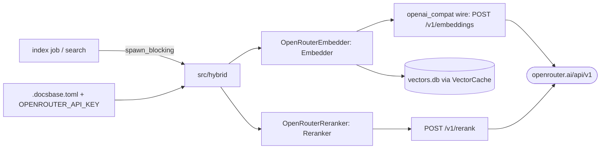

# Technical Design: hybrid-providers (итерация 1)

**Status:** Draft · **Дата:** 2026-10-08
**Spec:** `docs/specs/hybrid-providers/requirements.md`

## 1. Overview

Тонкий OpenAI-совместимый HTTP-клиент к двум ручкам OpenRouter за cargo-feature
`hybrid-remote`. Реализации садятся на существующий sync-контракт (`Embedder`,
новый `Reranker`), кэш и поиск не меняют сигнатур — только получают новые
источники данных за `hybrid`-флагом. Реализует FR-1…FR-10.

## 2. Global constraints

Из constitution 1.2.0 + design продукта (§2, §8):
- Дефолт — полный офлайн; сеть только при явно включённых ступенях (per-project конфиг).
- `hybrid-remote` — opt-in feature; дефолтная сборка: ноль сетевых крейтов, 40 MiB цел.
- `unwrap`/`expect` запрещены в lib-коде; `thiserror` в libs, `anyhow` на границе.
- Тяжёлое/сетевое — только через `spawn_blocking` (ADR-7); tokio-воркеры не блокировать.
- Ключи — только env; allowlist endpoint — `https://openrouter.ai/api/v1/*`.

## 3. Architecture



Поток индексации: `embed_missing` → cache-miss батч → `OpenRouterEmbedder::embed`
→ валидация (count, единый dim) → `put`. Поток поиска: BM25 top-k → `rerank`
→ переупорядочивание (fusion-правило — по итогам search-quality спеки, здесь —
сохранение порядка провайдера, обрезанное до `top_n`).

## 4. Components

| Компонент | Ответственность | FR |
|---|---|---|
| `hybrid::mod` | трейты `Reranker`, реэкспорт; конструктор по конфигу (v1: только openrouter, иначе `Admission`) | FR-2, FR-3, FR-10 |
| `hybrid::openrouter` | `OpenRouterClient { base_url, api_key, http }`; `embed`, `rerank`; чанкинг; retry; L2-нормализация; заголовки | FR-1, FR-2, FR-6…FR-9 |
| `config` (extend) | `[hybrid.embedding]`, `[hybrid.reranker]`; валидация provider/model/top_n/dimensions | FR-3, FR-4 |
| `index::job` (modify) | вызов `embed_missing` с remote-embedder за флагом | FR-1, FR-5 |
| `daemon::tools` search-путь (modify) | rerank BM25 top-k за флагом | FR-2 |

`base_url` — поле с дефолтом `https://openrouter.ai/api/v1`: весь задел под будущий
`custom`-пресет без нового кода.

## 5. Module interfaces

```rust
// src/hybrid/mod.rs
pub trait Reranker: Send + Sync {
    fn model_id(&self) -> &str;   // "openrouter/cohere/rerank-v3.5"
    fn rerank(&self, query: &str, docs: &[String], top_n: usize) -> Result<Vec<(usize, f32)>>;
}
pub fn from_config(cfg: &HybridConfig) -> Result<HybridStages>; // v1: только openrouter

// src/hybrid/openrouter.rs
pub struct OpenRouterClient { /* base_url, api_key (redacted Debug), http: reqwest::Client */ }
impl OpenRouterClient {
    pub fn embed_texts(&self, model: &str, dim: Option<u32>, texts: &[String]) -> Result<EmbedOut>;
    pub fn rerank(&self, model: &str, query: &str, docs: &[String], top_n: usize) -> Result<Vec<(usize, f32)>>;
}
// DTO: 4 поля + passthrough
struct EmbedReq<'a> { model: &'a str, input: &'a [String], dimensions: Option<u32>,
                      encoding_format: Option<&'a str> } // + #[serde(flatten)] extra
```

Инварианты: I1 — ответ короче/длиннее запроса или с разным dim → `Internal`, в кэш
ничего не пишется (батч целиком). I2 — ключ никогда в `Debug`/логах (`redacted`).
I3 — вызов только из `spawn_blocking` (`Handle::try_current` внутри runtime без
`spawn_blocking` → явная ошибка, защита от блокировки executor'а).

## 6. Data flow

Embed (фон): miss-батч (≤128 текстов / byte-budget) → один POST → проверка
count+dim → L2 (если флаг) → `put` по `(model_id@d, hash)`. Ошибка сети → ошибка
job'а чанков батча (без частичной записи), job помечает проект, не валит daemon.
Rerank (запрос): BM25 top-k (k ≥ top_n, напр. 50) → один POST → маппинг
`results[].index → исходный чанк` → срез top_n → join с SQLite как раньше.

## 7. Dependencies + rationale

| Крейт (feature `hybrid-remote`) | Зачем | Альтернатива — почему нет |
|---|---|---|
| `reqwest` (`rustls-tls-manual-roots`, без `blocking`) | async HTTP, пул, таймауты; sync-обёртка через `block_on` в `spawn_blocking` | `reqwest::blocking` — паника в runtime (issue #1017); `ureq` — второй стек без выигрыша при наличии tokio; `rig`/`async-openai` — чужие API-дизайны и лишний surface |
| `serde`/`serde_json` | уже в дереве | — |

`tokio` уже есть. `fastembed`/`usearch` — только будущий `hybrid-local`, не эта итерация.

## 8. Required / Forbidden stack

- Required: `reqwest` — только под `hybrid-remote`, только rustls (static-pie, без OpenSSL).
- Forbidden: ключ в toml/CLI-флагах/логах; base URL вне allowlist; sync-вызов embedder
  из async-контекста напрямую (I3); тихий fallback на BM25 при ошибке ступени.

## 9. Error handling

| Ошибка | Поведение |
|---|---|
| Нет `OPENROUTER_API_KEY` при `hybrid=true` | `Admission` с инструкцией (SC-3) |
| 4xx кроме 429 | `Error::Internal` с телом (обрезанным), без ретраев |
| 429/503/5xx, таймаут | backoff с джиттером, N попыток (число — из спайка), затем `Internal` |
| Schema-mismatch ответа | `Internal` «несовместимая схема OpenRouter», батч не пишется |
| `provider != openrouter` | `Admission` (итерация 1) |

## 10. Testing strategy

- Unit: чанкинг (count+bytes, переполненный одиночный), склейка порядка, сумма usage,
  L2-норма (property: норма ≈ 1), I3-гард, redact ключа в `Debug`.
- Wire (без сети): записанные фикстуры реальных ответов OpenRouter (embeddings, rerank,
  каждая ветка ошибок) через mock-транспорт; golden на маппинг `results[].index`.
- Integration: fake-embedder в `embed_missing` как сейчас + счётчик HTTP-вызовов:
  второй прогон — 0 вызовов (SC-1); rerank меняет синтетический порядок (SC-2).
- Live (не в CI): `#[ignore]` smoke за `OPENROUTER_API_KEY` — 1 embed-батч + 1 rerank;
  ручной прогон перед merge, опционально nightly.
- Regression: `search_golden`, `tokenizer`, `offline` — зелёные; `cargo tree` без
  `reqwest` в дефолтной сборке (SC-4).

## 11. Risks & trade-offs

| # | Риск | Митигация |
|---|---|---|
| R1 | Дрейф схемы OpenRouter | фикстуры фиксируют схему; mismatch — явная ошибка |
| R2 | Тихий апдейт весов провайдера (кэш не инвалидируется) | принято (A3); позже пин провайдера/ревизии |
| R3 | qwen3-вектора ненормированы | L2-флаг (FR-8), факт — из спайка |
| R4 | 503 cold-start / 429 при bulk-заливке | backoff + bounded parallelism ×8–16 |
| R5 | Блокировка executor'а будущим прямым вызовом | I3-гард с явной ошибкой |

## 12. Alternatives considered (ADR-14, кратко)

- **Прямой Cohere** вместо OpenRouter-rerank: точнее позиционирование, но второй ключ,
  второй биллинг, вторая схема. Отклонено до итерации 2 (трейт `Reranker` уже позволяет).
- **`ureq` вместо `reqwest`:** проще для чистого sync, но tokio уже в дереве, а `reqwest`
  пригодится будущим async-путям; вес в feature не критичен.
- **Async-трейт:** отклонён (анализ 2026-10-08): выигрыша нет, редизайн дорог;
  триггер пересмотра — веерные per-request запросы с дедлайном.
- **DeepSeek как embedding-провайдер:** отсутствует endpoint (только chat) — исключён.
