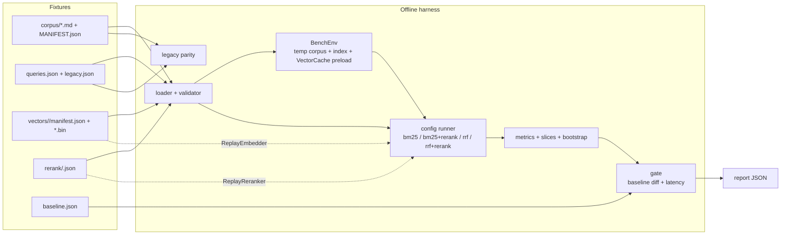

# Search Benchmark — Design (IMPLEMENTATION)

> Feature: `search-benchmark`. Спека: `docs/specs/search-benchmark/requirements.md`
> (ревизия 2). Контекст: `docs/specs/docsbase-memory-mcp/design.md`,
> `docs/specs/search-quality/`, `docs/specs/hybrid-providers/`,
> `docs/specs/constitution.md` (1.3.0).
> DELTA-1 (2026-10-19): adjudication `absent`, рубрикатор + второе ревью,
> lexical control semantic-среза, saturation/config-contribution (FR-26…FR-28).
> DELTA-2 (2026-10-19): баунд чанков FR-1 → 200–400, масштаб — внешним бенчам.

## 1. Overview

Строим test-only harness, который прогоняет один и тот же корпус и набор
запросов через четыре поисковые конфигурации (`bm25`, `bm25+rerank`, `rrf`,
`rrf+rerank`) и сравнивает качество, точность цитат и локальную latency с
версионированным baseline. Offline-режим не ходит в сеть: эмбеддинги и
rerank-скоры воспроизводятся из записанных фикстур через существующие трейты
`Embedder` и `Reranker`, а поиск идёт через существующий seam
`daemon::tools::search_docs_with`. Live-режим использует реальный OpenRouter
и пишет отдельный отчёт о качестве, latency и стоимости. Production-код не
меняется.

## 2. Global constraints

- Rust edition 2024, MSRV 1.88; `cargo fmt`; clippy `--all-targets -- -D warnings`.
- Никаких новых крейтов; используются `blake3`, `serde`, `serde_json`,
  `tempfile`, `rusqlite`, `anyhow` (dev), уже присутствующие в дереве.
- Offline-гейт работает в дефолтной сборке: без `hybrid-remote`, без
  `reqwest`, без сети и без `OPENROUTER_API_KEY` (FR-21, SC-10).
- Live-тесты — только `#[ignore]` + feature `hybrid-remote`; ключ только из
  `OPENROUTER_API_KEY`, никогда не пишется в отчёт (NFR-5).
- Фикстуры — доверенные repo-controlled файлы; пути валидируются внутри
  `tests/fixtures/search-bench/` (NFR-5).
- Векторы — raw little-endian `f32`; поддерживаемые платформы little-endian
  (Linux x86_64, Windows x64, macOS aarch64) (NFR-6).
- Offline-гейт: ≤30 с debug на CI-хосте, жёсткий предел 60 с; фикстуры ≤12 MiB
  (NFR-1, NFR-2).
- Production-контракты MCP/CLI и формат `search_docs` не меняются.
- В `src/**` не добавляем `unwrap`/`expect`/`panic!`; harness живёт в
  `tests/**`, где это допустимо, но предпочитает `anyhow::Result` с контекстом.

## 3. Architecture



Live-режим повторяет `S`–`M`, но вместо replay-стадий использует
`OpenRouterEmbedder`/`OpenRouterReranker`, а вместо offline latency — реальные
embedding/rerank/поиск. Live-отчёт не сравнивается побитово с baseline:
только предупреждения и дельты.

## 4. Components

### 4.1 `tests/support/bench.rs` — общий harness

Ответственность: загрузка и валидация фикстур, сборка временного проекта,
preload векторов, replay-стадии, запуск конфигураций, метрики, baseline,
gate, legacy parity. Не содержит production-логики поиска.

Зависимости: `docsbase_memory::{config, daemon::tools, index, store,
vector_cache, hybrid}`, `rusqlite`, `tempfile`, `blake3`, `serde`,
`serde_json`, `anyhow`.

### 4.2 `tests/search_bench.rs` — offline gate

Тесты:

- `fixtures_are_valid` — FR-24, FR-26, FR-27, SC-12.
- `metrics_match_baseline` — FR-14, SC-1, SC-3.
- `benchmark_is_discriminating` — FR-28, SC-11 (читает baseline).
- `evaluate_is_deterministic` — NFR-3, SC-1.
- `legacy_parity_matches_old_baseline` — FR-16, SC-6.
- `latency_gate` — FR-22 (Linux only).
- `#[ignore] regenerate_baseline` — FR-15, SC-9.
- `gate_rejects_sabotaged_stages` — SC-3 (sensitivity).
- `record_mode_writes_replayable_fixtures`, `record_mode_is_atomic_on_failure`,
  `record_mode_does_not_mix_model_pins` — FR-19 на fake-стадиях, без сети.

### 4.3 `tests/search_bench_live.rs` — live/record

`#![cfg(feature = "hybrid-remote")]`; оба теста `#[ignore]` (реальная сеть):

- `live_measurement` — FR-17/FR-18, SC-8.
- `record_fixtures` — FR-19, SC-9.

Record-логика проверяется без сети отдельными `record_mode_*` тестами в
`tests/search_bench.rs` (дефолтная сборка, fake embedder/reranker); в
live-файле остаётся только `#[ignore] record_fixtures`.

Live-клиент строится из `OPENROUTER_API_KEY`; `DOCSBASE_BENCH_COST_CAP_USD`
(default `2.0`) ограничивает прогон. Отчёт пишется в
`target/search-bench/live-report.json` (путь переопределяется
`DOCSBASE_BENCH_REPORT`), не в репозиторий.

### 4.4 `tests/support/mod.rs` — module root

`pub mod bench;` — чтобы оба интеграционных теста использовали один harness
без дублирования (Cargo не считает `tests/support/mod.rs` отдельным тестом).

## 5. Module interfaces

### 5.1 Fixtures

```rust
pub const BENCH_VERSION: u32 = 1;
pub const FIXTURE_VERSION: u32 = 1;
pub const DEFAULT_LIMIT: usize = 10;
pub const RERANK_WINDOW: u32 = 50;
pub const NDCG_TOLERANCE: f64 = 0.02;
pub const COST_CAP_USD_DEFAULT: f64 = 2.0;
pub const SEMANTIC_MAX_LEXICAL_JACCARD: f64 = 0.5; // calibratable
pub const SATURATION_MAX_RATIO: f64 = 0.70;          // calibratable
pub const SEMANTIC_DISAGREEMENT_MIN: usize = 3;      // calibratable
pub const RERANK_DISAGREEMENT_MIN: usize = 1;        // calibratable
pub const EARLY_CUTOFF: usize = 3;

#[derive(Debug, Clone, Copy, PartialEq, Eq, PartialOrd, Ord)]
pub enum ConfigId { Bm25, Bm25Rerank, Rrf, RrfRerank }

#[derive(Debug, Clone, Deserialize)]
pub struct QueryCase {
    pub id: String,
    pub query: String,
    pub class: String,
    pub k: usize,                 // 10 для main, 3 для legacy
    pub expected: Vec<ExpectedHit>,
    pub absent: Vec<AbsentHit>,
    pub source: String,           // real | synthetic | derived
    pub notes: String,
    pub reviewed_by: Vec<String>, // >=2 for semantic/hard_negative/absent
}

#[derive(Debug, Clone, Deserialize)]
pub struct ExpectedHit {
    pub path: String,
    pub lines: Option<LineRange>, // 1-based inclusive
    pub grade: u8,                // 1 | 2
}

#[derive(Debug, Clone, Deserialize)]
pub struct AbsentHit {
    pub path: String,
    pub lines: Option<LineRange>,
    pub reason: String,           // non-empty, adjudicated trap
}

#[derive(Debug, Clone, Copy, Deserialize)]
pub struct LineRange { pub start: u32, pub end: u32 }

pub fn lexical_jaccard(query: &str, text: &str) -> f64;

#[derive(Debug, Clone, PartialEq, Eq)]
pub enum ModelPin {
    Embedding { provider: String, model: String, dim: u32, normalize: bool },
    Rerank { provider: String, model: String },
}
```

Валидатор reject'ит expected/absent пересечение по одному path (иначе кейс
противоречив), дубли `id`, неизвестный класс, `k` вне `3..=20`, grade вне
`1..=2`, line range вне файла, пустой `absent.reason`, недостаточный
`reviewed_by`, grade 1 без `notes`, semantic-кейс с lexical Jaccard >0.5
(FR-26, FR-27), смешивание embedding- или rerank-пинов в одном прогоне
(FR-24, FR-25), а также выход за границы корпуса/запросов: 60–85 документов,
200–400 чанков, 120–200 кейсов.

**Рубрикатор (FR-26).** Grade 2 — чанк самодостаточно отвечает на запрос
(агент может ответить, прочитав только его). Grade 1 — чанк релевантен и
помогает, но ответ требует соседнего чанка или неполон; `notes` объясняет,
чего не хватает. Grade 0 существует только в `absent` (нерелевантно/
вводит в заблуждение). `absent.reason` — конкретная причина (например,
«near-duplicate: отличается только `MAX_FRAME_BYTES`»), а не «нет в
expected». `reviewed_by` для `semantic`, `hard_negative` и любого кейса с
`absent` содержит ≥2 имени (автор + свежий reviewer); это и есть запись
adjudication, `reason` — evidence. Разногласия пишутся в `progress.md`.

**Lexical control (FR-27).** `lexical_jaccard(query, expected_text)`:
обе строки прогоняются через **тот же** `IdentifierTokenizer`, что видит
индекс (`normalize` + lower + Snowball stem + CJK bigrams,
`TOKENIZER_VERSION`); из потока берётся один канонический токен на позицию
(последний эмитированный). `J = |Q∩E| / |Q∪E|` по множествам токенов.
Для `semantic`-кейса берётся максимум по expected-спанам; `expected[].lines`
обязателен, иначе кейс невалиден (считать по всему документу нельзя).
Значение ≤0.5. Semantic — EN/RU и только проза: идентификаторы идут в
`identifier`, CJK/AR — в своих срезах. Порог 0.5 — стартовая калибровка;
изменение — отдельный ruling в ledger.

### 5.2 Vector fixtures

```rust
pub struct VectorFixture {
    pub model_pin: String,        // provider/model@d<dim>@<l2|raw>
    pub dim: usize,
    pub corpus_hash: String,
    pub queries_hash: String,
    pub vectors: HashMap<String, Vec<f32>>, // blake3(text) -> vector
}

impl VectorFixture {
    pub fn load(pin: &str) -> anyhow::Result<Self>;
    pub fn get(&self, text: &str) -> anyhow::Result<&[f32]>; // missing -> error
}
```

Формат:

```text
vectors/<pin_slug>/
  manifest.json           # model_pin, dim, count, corpus_hash, queries_hash,
                          # bin: "vectors-<blake3>.bin",
                          # entries: [{text_hash, offset_bytes, len_floats}]
  vectors-<blake3>.bin    # concatenated f32 LE
```

`manifest.json` — commit point: сначала пишется новый `.bin`, затем
атомарно заменяется манифест. Старый `.bin` можно удалить после успешной
замены. `offset_bytes` и `len_floats` валидируются по длине файла; вектор
должен быть finite, длина = `dim`.

**Порядок байтов фиксирован:** перед записью `entries` сортируются по
`text_hash` (лексикографически), `offset_bytes`/`len_floats` присваиваются в
этом порядке, затем векторы конкатенируются. Нельзя писать в порядке обхода
`HashMap`: layout должен быть воспроизводим побайтно (SC-9).

Канонические хэши: `corpus_hash` — blake3 от отсортированного списка
`(relative_path, blake3(file_bytes))`; `queries_hash` — blake3 от
канонического JSON (BTreeMap-ключи, без пробелов, кейсы в файловом порядке).
Такой хэш не зависит от порядка обхода `HashMap` и платформы.

### 5.3 Replay-стадии

```rust
pub struct ReplayEmbedder {
    pin: String,
    vectors: Arc<VectorFixture>,
}

impl Embedder for ReplayEmbedder {
    fn model_id(&self) -> &str { &self.pin }
    fn embed(&self, texts: &[String]) -> Result<Vec<Vec<f32>>> {
        texts
            .iter()
            .map(|text| self.vectors.get(text).map(|vector| vector.to_vec()))
            .collect()
    }
}

pub struct ReplayReranker {
    pools: Arc<RerankFixture>,
}

impl Reranker for ReplayReranker {
    fn rerank(&self, query: &str, docs: &[String], top_n: usize)
        -> Result<Vec<(usize, f32)>>;
}
```

`ReplayReranker` вычисляет `(blake3(query), [blake3(doc)])`, ищет точный пул в
`RerankFixture` и возвращает записанные пары. Промах — `Error::internal` с
query hash и числом кандидатов; `top_n` должен совпасть с записанным.

```rust
pub struct RerankFixture {
    pub model_pin: String,
    pub pools: HashMap<RerankKey, RerankPool>,
}

pub struct RerankKey {
    pub query_hash: String,
    pub candidate_hashes: Vec<String>,
}

pub struct RerankPool {
    pub top_n: usize,
    pub results: Vec<(usize, f32)>,
    pub usage: Option<Usage>,
}

pub struct Usage {
    pub tokens: Option<u64>,
    pub search_units: Option<u64>,
}
```

Формат rerank-фикстуры:

```json
{
  "model_pin": "openrouter/cohere/rerank-v3.5",
  "pools": [
    {
      "query_hash": "blake3-hex",
      "top_n": 50,
      "candidate_hashes": ["...", "..."],
      "results": [{"index": 3, "score": 0.91}],
      "usage": {"search_units": 1}
    }
  ]
}
```

Пул адресуется точным `(query_hash, candidate_hashes[])`. Это осознанно:
изменение candidate set — сигнал, что ранжирование изменилось; offline-гейт
обязан это заметить, а не подставить старые скоры к новому набору.

### 5.4 Временное окружение

```rust
pub struct BenchEnv {
    pub cache: TempDir,
    pub root: TempDir,
    pub db: Db,
    pub project: Project,
    pub chunk_hashes: Vec<(u64, String)>, // (chunk_id, blake3(text))
    pub chunk_texts: Vec<String>,         // same order as chunk_hashes
    _index: IndexHandle,
}

pub fn build_env(
    corpus_dir: &Path,
    name: &str,
    expected_docs: RangeInclusive<usize>,
) -> anyhow::Result<BenchEnv>;

pub fn preload_vectors(
    env: &BenchEnv,
    fixture: &VectorFixture,
) -> anyhow::Result<()>; // missing hash -> error
```

Шаги `build_env`:

1. Скопировать `corpus_dir` во временный root без изменения файлов.
2. Открыть `Db` во временном cache root; вставить `projects` строку (как в
   существующих `search_quality`/`search_golden` harness) с
   `migrations::SCHEMA_VERSION`, не хардкодом.
3. `IndexHandle::open_or_create(cache/projects/1/tantivy)`; `run_full` с
   `Config::default()`.
4. Проверить число документов и чанков; `repo::chunk_texts` и
   `repo::chunk_hashes` дают одинаковый порядок.

`preload_vectors` открывает `VectorCache::open(cache.root())` и для каждого
chunk hash делает `put(pin, hash, vector)`; промах — ошибка. Это отдельный шаг,
чтобы legacy-parity (BM25) не зависела от типа `VectorFixture`.

Для legacy используется тот же `build_env` с `legacy-corpus/`.

### 5.5 Запуск конфигурации

```rust
pub fn stages_for(
    cfg: ConfigId,
    embedder: Option<Arc<dyn Embedder>>,
    reranker: Option<Arc<dyn Reranker>>,
) -> HybridStages;

pub fn run_config(
    env: &BenchEnv,
    cases: &[QueryCase],
    cfg: ConfigId,
    stages: &HybridStages,
) -> anyhow::Result<ConfigReport>;
```

Соответствие конфигураций:

| ConfigId | embedder | reranker | ranking | fetch |
|---|---|---|---|---|
| `Bm25` | — | — | `Lexical` | `limit` |
| `Bm25Rerank` | — | replay | `Lexical` | `max(limit, 50)` |
| `Rrf` | replay | — | `Rrf` | `max(limit, 50)` |
| `RrfRerank` | replay | replay | `Rrf` | `max(limit, 50)` |

`DenseCache::new()` создаётся заново на **каждый прогон конфигурации** (перед
её циклом кейсов), чтобы каждая `rrf`-конфигурация измерялась на холодном
dense-скане; `VectorCache` уже прогрет preload'ом. Для каждого кейса:

```rust
let args = json!({"query": case.query, "limit": case.k});
let started = Instant::now();
let value = tools::search_docs_with(
    stages, &dense, &env.db, env.cache.path(), &env.project, &args, RERANK_WINDOW,
)?;
let elapsed = started.elapsed();
```

Один warm-up
запрос на конфигурацию выполняется и отбрасывается перед latency-замерами;
метрики считаются по всем кейсам.

### 5.6 Метрики

```rust
pub struct Citation {
    pub chunk_id: u64,
    pub path: String,
    pub heading_path: String,
    pub lines: (u32, u32),
}

pub struct CaseMetrics {
    pub hit: bool,
    pub recall: f64,
    pub mrr: f64,
    pub ndcg: f64,
    pub citation_overlap: f64,
    pub forbidden_hit: bool,
    pub duplicate_path_ratio: f64,
}

pub fn evaluate_case(hits: &[Citation], case: &QueryCase) -> CaseMetrics;
```

Правила:

- `Citation` — распарсенный ответ `search_docs`: `path`, `lines`,
  `heading_path`, `chunk_id`; score не используется в метриках.
- Совпадение с `ExpectedHit`: `path` равен, и если `lines` задан — интервалы
  пересекаются. `grade` берётся из ожидания.
- Каждый expected-элемент учитывается не более одного раза: повторный чанк
  того же диапазона не добавляет gain (защита от накрутки дублями).
- `hit` — есть хотя бы один expected с `grade >= 1` в top-k.
- `recall` — `found_expected / expected.len()`.
- `MRR` — `1 / rank` первого релевантного, иначе 0.
- `nDCG` — graded: `gain = 2^grade - 1`, дисконт берётся из проверенной
  таблицы `NDCG_DISCOUNT[rank - 1]` (rank 1..=20), IDCG — те же грейды,
  отсортированные по убыванию; `ndcg = dcg / idcg`. Никакого `log2` в
  runtime: libm может отличаться между ОС, а quality-часть обязана совпадать
  побайтно (FR-12, SC-1).

```rust
/// 1 / log2(rank + 1) для rank 1..=20; литералы проверены и закоммичены.
/// k ограничен 20, поэтому таблицы достаточно.
const NDCG_DISCOUNT: [f64; 20] = [
    1.0,
    0.63092975357145753,
    0.5,
    0.43067655807339306,
    0.38685280723454163,
    0.35620718710802218,
    0.33333333333333331,
    0.31546487678572877,
    0.3010299956639812,
    0.28906482631788788,
    0.27894294565112987,
    0.27023815442731974,
    0.26264953503719357,
    0.2559580248098155,
    0.25,
    0.24465054211822604,
    0.23981246656813146,
    0.23540891336663824,
    0.23137821315975915,
    0.22767024869695299,
];
```
- `citation_overlap` — доля top-k позиций, чьи `lines` пересекают любой
  expected-диапазон (если `lines` не задан — совпадение пути).
- `forbidden_hit` — любой `AbsentHit` в top-k (path + lines, если задан).
- `duplicate_path_ratio` — доля позиций (после первой), чей `path` уже
  встречался выше, от числа возвращённых позиций.
- `k` берётся из кейса; для main это 10, для legacy — 3.

### 5.7 Срезы, дельты и bootstrap

```rust
pub struct SliceReport {
    pub cases: usize,
    pub hit_rate: f64,
    pub recall: f64,
    pub mrr: f64,
    pub ndcg: f64,
    pub citation_overlap: f64,
    pub forbidden_rate: f64,
    pub duplicate_path_ratio: f64,
}

pub struct DeltaReport {
    pub ndcg_delta: f64,
    pub hit_rate_delta: f64,
    pub wins: usize,
    pub losses: usize,
    pub ties: usize,
    pub ndcg_ci95: (f64, f64),
}
```

Срез — макро-среднее метрик кейсов. `wins/losses/ties` — по per-case `nDCG`
с допуском `0.02`: выше — win, ниже — loss, иначе tie. Bootstrap — 1000
resample'ов по кейсам с xorshift64* и фиксированным seed
`0x9E37_79B9_7F4A_7C15`; перцентили 2.5/97.5. Bootstrap только для отчёта,
не для hard gate (гейт использует детерминированные per-case/per-slice
сравнения).

### 5.8 Baseline и gate

```rust
pub struct ConfigReport {
    pub cases: Vec<CaseReport>,
    pub slices: BTreeMap<String, SliceReport>,
    pub latency: LatencyReport,
}

pub struct EarlyMetrics {
    pub hit_at_3: bool,
    pub recall_at_3: f64,
    pub ndcg_at_3: f64,
}

pub struct CaseReport {
    pub id: String,
    pub class: String,
    pub k: usize,
    pub ranks: Vec<Citation>,       // no scores: BM25 scores are engine-internal
    pub metrics: CaseMetrics,
    pub early: EarlyMetrics,        // cutoffs 3/10, same ranked list
}

pub struct OutcomeCounts {
    pub all_hit: usize,
    pub all_miss: usize,
    pub mixed: usize,
}

pub struct OutcomeMatrix {
    pub by_slice: BTreeMap<String, OutcomeCounts>,
}

pub struct ParetoPoint {
    pub config: ConfigId,
    pub quality: f64,               // nDCG
    pub cost_usd: f64,
    pub latency_p95_ms: f64,
    pub on_frontier: bool,
}

pub struct ParetoReport {
    pub points: Vec<ParetoPoint>,
}

pub struct LatencyReport {
    pub p50_ms: f64,
    pub p95_ms: f64,
}

pub struct DiscriminationReport {
    pub saturated_total: usize,
    pub saturated_ratio: f64,
    pub non_saturated_by_slice: BTreeMap<String, usize>,
    pub semantic_disagreements: usize,
    pub rerank_disagreements: usize,
    pub semantic_max_lexical_jaccard: f64,
    pub lexical_tokenizer_version: u32,
}

pub struct Baseline {
    pub bench_version: u32,
    pub fixture_version: u32,
    pub corpus_hash: String,
    pub legacy_corpus_hash: String,
    pub queries_hash: String,
    pub model_pins: Vec<String>,
    pub generated_at: String,          // excluded from equality
    pub configs: BTreeMap<ConfigId, ConfigReport>,
    pub legacy_parity: LegacyParity,
    pub discrimination: DiscriminationReport,
    pub outcome_matrix: OutcomeMatrix,
}

pub struct Report {
    pub baseline: Baseline,             // current run, same shape
    pub deltas: BTreeMap<ConfigId, BTreeMap<String, DeltaReport>>,
    pub warnings: Vec<String>,
    pub discrimination: DiscriminationReport,
    pub outcome_matrix: OutcomeMatrix,
    pub pareto: Option<ParetoReport>,   // live only
    pub trap_diagnostics: Vec<String>,   // DELTA-3: attach via attach_trap_diagnostics
}

pub struct Failure {
    pub config: Option<ConfigId>,
    pub slice: Option<String>,
    pub case_id: Option<String>,
    pub kind: FailureKind,
    pub expected: String,
    pub actual: String,
}

pub fn gate_failures(current: &Report, baseline: &Baseline) -> Vec<Failure>;
pub fn latency_failures(current: &Report, baseline: &Baseline) -> Vec<Failure>;
pub fn discrimination_failures(disc: &DiscriminationReport) -> Vec<Failure>;
```

Сравнение float в gate — с `1e-9`, чтобы отсутствие изменений не давало
ложный fail. Для nDCG это только страховка: дисконт берётся из
закоммиченной таблицы, а не из libm, поэтому quality-часть воспроизводится
побайтно на всех поддерживаемых ОС.

`gate_failures` проверяет:

1. Совпадение `fixture_version`, хэшей, config set и case set.
2. `forbidden_hit` в любом кейсе (DELTA-3: флаг означает ловушку на
   ранге 1; ловушка ниже — диагностика `trap_warnings`, не провал).
3. `baseline.hit == true && current.hit == false`.
4. Per-case `nDCG` ниже baseline больше чем на `0.02`.
5. Per-slice `hit_rate` ниже baseline (любое падение).
6. Per-slice `nDCG` ниже baseline больше чем на `0.02`.
7. Legacy parity `hit`/`absent_hit` не совпал.

Тест `metrics_match_baseline` сравнивает не с нулём, а с
`baseline.known_failures`: падают только НОВЫЕ провалы (регрессии),
исправленные старые — информация, не провал (DELTA-3: "стало хуже или
лучше"). `regenerate_from_fixtures` заполняет `known_failures`
самопроверкой текущего прогона (там возможны только rank-1 ловушки —
версии/хэши/пины совпадают сами с собой).

Каждый `Failure` содержит `config`, `slice`, `case_id`, `kind`,
`expected`, `actual`; сообщение печатается целиком (NFR-8).

`latency_failures` (только Linux): для каждой конфигурации
`p95 <= baseline_p95 * 1.5 + 5 ms` и `p95 <= 500 ms`. На Windows/macOS
latency попадает в отчёт, но gate не вызывается (FR-22).

`discrimination_failures` (FR-28) проверяет baseline как инструмент:

1. `saturated_ratio <= 0.70` (иначе >70% кейсов не различают конфигурации).
2. Для каждого обязательного среза `non_saturated_by_slice.get(slice).copied().unwrap_or(0) >= 1`.
3. `semantic_disagreements >= 3` (direction-agnostic).
4. `rerank_disagreements >= 1` (direction-agnostic).
5. `semantic_max_lexical_jaccard <= 0.5`.
6. `lexical_tokenizer_version == TOKENIZER_VERSION` (иначе baseline
   перегенерируется после смены пайплайна).

Вычисление: `saturated = all(cfg.cases[id].metrics.hit for cfg in configs)`;
`non_saturated_by_slice` — число `!saturated` по классам;
`semantic_disagreements` — число semantic-кейсов, где не все четыре
`hit`-значения равны (любое направление); `rerank_disagreements` — число
кейсов, где `Bm25.hit != Bm25Rerank.hit` (любое направление);
`semantic_max_lexical_jaccard` — максимум из валидатора FR-27;
`lexical_tokenizer_version` — `TOKENIZER_VERSION` на момент валидации.

Это сравнение production-конфигураций, а не изоляция компонента: `rrf` и
`bm25+rerank` используют fetch-окно 50 против 10 у `bm25`. Чистая атрибуция
dense/rerank потребовала бы диагностической `Bm25Window`-конфигурации; это
should, не must DELTA-1.

Функция вызывается в `regenerate_baseline` до записи; при провале baseline не
обновляется, а текст ошибки говорит, каких кейсов не хватает. На обычном
PR-прогоне discrimination не пересчитывается — она зафиксирована в baseline.

Early/outcome/Pareto — should-слой: они попадают в отчёт и SC-13, но не
добавляют hard-fail в `gate_failures`.

`EarlyMetrics` считается из того же `ranks` (без второго поиска):
`hit@3`, `recall@3`, `nDCG@3` (дисконт из той же таблицы). `OutcomeMatrix`
классифицирует кейс по четырём `hit`-значениям (`all_hit` / `all_miss` /
`mixed`) и агрегирует по классам. `ParetoReport` — только live: точка
доминируется, если другая конфигурация имеет `quality >=` и одновременно
`cost_usd <=` и `latency_p95_ms <=`; доминируемые помечаются
`on_frontier = false`.

### 5.9 Legacy parity

```rust
pub struct LegacyParity {
    pub cases: Vec<LegacyCaseReport>, // hit, absent_hit, ndcg (diagnostic)
    pub matches: bool,
}

pub fn run_legacy_parity() -> anyhow::Result<LegacyParity>;
```

`run_legacy_parity`:

1. `build_env("legacy-corpus", "search-bench-legacy", 10..=10)`.
2. Загрузить `legacy.json` (12 кейсов, `k=3`) и `legacy-baseline.json`
   (замороженная копия `search-quality/baseline.json`).
3. Прогнать `Bm25`-конфигурацию через `search_docs_with`.
4. Сравнить `hit` и `absent_hit` с baseline; `nDCG` — только в отчёт.

Parity — миграционная проверка; после вывода старого harness она остаётся
диагностикой и не мешает новым кейсам.

### 5.9a Pooling review (FR-29, should)

При каждом расширении корпуса после появления runner'а (T7+) выполняется
pooling review: прогнать четыре конфигурации, объединить top-k, вручную
разобрать документы, которых нет в `expected`/`absent`; релевантные добавить
в `expected`, нерелевантные — в `absent` с `reason`, спорные — в ledger.
Для T3–T6, пока runner'а нет, делается ручная cross-check по документам.
Это процесс, не автоматический гейт; результат фиксируется в `progress.md`.

### 5.10 Record mode

```rust
pub fn record_fixtures_with(
    env: &BenchEnv,
    cases: &[QueryCase],
    embedder: &dyn Embedder,
    reranker: &dyn Reranker,
    vector_out: &Path,
    rerank_out: &Path,
) -> anyhow::Result<()>;
```

`record_fixtures_with` — test-only, без сети: его вызывают и fake-stage тесты
(`record_mode_*` в `tests/search_bench.rs`), и `#[ignore] record_fixtures` в
`tests/search_bench_live.rs`, который подставляет реальные OpenRouter-стадии.

Шаги:

1. Эмбеддить все уникальные chunk texts и query texts реальным embedder'ом;
   проверить count/dim/finite; записать vectors `.bin` + manifest.
2. Preload `VectorCache`.
3. Для `Bm25Rerank` и `RrfRerank` прогнать `search_docs_with` с
   `CollectingReranker`, который запоминает переданные `docs` и возвращает
   `(i, 0.0)`; это даёт точный candidate window, который увидит production
   `apply_rerank`.
4. Для каждого захваченного списка вызвать реальный reranker
   (`top_n = docs.len()`), сохранить `results` и `usage`.
5. Записать rerank JSON атомарно (temp file + rename).
6. Сгенерировать baseline через replay; вычислить `DiscriminationReport` и
   записать его в baseline для диагностики. Если canonical content (без
   `generated_at`) совпадает с текущим `baseline.json`, не перезаписывать его
   (SC-9). Иначе — записать атомарно после зелёного legacy parity; принятие
   baseline — отдельный `benchmark_is_discriminating` gate (FR-28).

Record mode использует тот же cost cap, что и live (NFR-7): дорогой прогон
не должен случайно сжечь бюджет при перезаписи.

`CollectingReranker` — test-only тип с `Mutex<Vec<(String, Vec<String>)>>`;
ошибка, если `search_docs_with` вызвал rerank без кандидатов.

### 5.11 Live measurement

```rust
pub fn live_measurement() -> anyhow::Result<LiveReport>;
```

- Собрать реальные `OpenRouterEmbedder`/`OpenRouterReranker` через
  `from_config` (feature on) или `with_client` с общим `OpenRouterClient`.
- Прогреть/эмбеддить чанки в `VectorCache` (`embed_missing`).
- Прогнать четыре конфигурации; для rerank — реальные вызовы.
- `RecordingTransport` (test-only wrapper над `ReqwestTransport`) сохраняет
  `usage` из JSON-ответов; если провайдер не вернул usage, стоимость
  оценивается по длине текста и помечается `estimated: true`.
- Cost cap проверяется после каждого запроса; превышение — ошибка с
  указанием конфигурации/кейса.
- Отчёт содержит `model`, `provider`, `timestamp`, per-config quality,
  p50/p95, usage, cost, early cutoffs 3/10, outcome matrix и `ParetoReport`
  (FR-30…FR-32); ключ не попадает в отчёт.

## 6. Data flow

### Offline

1. Загрузить `queries.json`, `legacy.json`, `corpus/MANIFEST.json`,
   `vectors/<pin>/manifest.json`, `rerank/<pin>.json`, `baseline.json`.
2. Валидировать хэши, пути, lines, grades, k, срезы, размеры.
3. `build_env` копирует корпус и индексирует; `preload_vectors` заполняет
   `VectorCache`.
4. Для каждой конфигурации:
   - создать `HybridStages` с replay-стадиями;
   - прогреть и прогнать все кейсы через `search_docs_with`;
   - собрать citations, метрики at k и early 3, latency.
5. Агрегировать срезы, дельты, bootstrap, outcome matrix.
6. Сравнить с baseline: `gate_failures` + `latency_failures`.
7. `run_legacy_parity`.
8. Напечатать отчёт; при failures — panic/assert с полным списком (тест).

### Record

1. Реальный embedder → vectors `.bin` + manifest.
2. Preload → `CollectingReranker` → реальный reranker → rerank JSON.
3. Replay-прогон → baseline + discrimination + outcome matrix.
4. Legacy parity → атомарная запись baseline.

### Live

1. Реальный client/стадии; реальные векторы и rerank.
2. Те же метрики; latency и usage из реальных вызовов.
3. Отчёт в `target/`, cost cap, без baseline-гейта.

## 7. Dependencies + rationale

| Dependency | Зачем | Почему не новый |
|---|---|---|
| `blake3` | content hash текстов/корпуса | уже используется (`chunk_hash`) |
| `serde`, `serde_json` | фикстуры/отчёты | уже используется |
| `tempfile` | временный корпус/cache, atomic temp files | dev-dependency уже есть |
| `rusqlite` | вставка project row в тесте | уже есть |
| `anyhow` | контекст ошибок в test-only harness | уже есть |
| `std::time::Instant` | latency | std |
| xorshift64* вручную | bootstrap без новых крейтов | 20 строк, детерминированный seed |

Новых крейтов нет. `reqwest`/OpenRouter-клиент используются только в
`search_bench_live.rs` за feature `hybrid-remote`; offline-гейт их не тянет.

## 8. Required / Forbidden stack

**Required**

- Offline: `daemon::tools::search_docs_with`, `vector_cache::{Embedder,
  VectorCache, chunk_hash}`, `hybrid::{Reranker, HybridStages, Ranking}`,
  `store::repo::{chunk_hashes, chunk_texts}`, `index::job::run_full`,
  `tantivy_index::IndexHandle`.
- Live: `hybrid::openrouter::{OpenRouterClient, OpenRouterEmbedder,
  OpenRouterReranker, ReqwestTransport}` за feature.
- Fixtures: JSON + raw LE f32; baseline — JSON.

**Forbidden**

- Сеть в offline-гейте; `OPENROUTER_API_KEY` в offline.
- Новые крейты; ANN/локальные модели; изменение `src/**` для harness.
- Сравнение BM25-скоров побитово; snapshot-тесты на скоры.
- `skip` при missing fixture; тихий fallback на BM25 при ошибке hybrid.
- Секреты/ключи в отчётах и фикстурах.

## 9. Error handling

| Ситуация | Поведение |
|---|---|
| Missing/corrupt vector fixture | `anyhow::Error` с `text_hash`, pin, путём; тест падает |
| Missing rerank pool | ошибка с query hash, числом кандидатов и config |
| Hash mismatch корпуса/запросов | fail с expected/actual |
| Invalid line range/grade/k | fail валидации с `case_id` |
| Empty `absent.reason` / missing reviewer | fail валидации с `case_id` |
| Semantic lexical Jaccard > 0.5 | fail валидации с `case_id` и значением |
| Discrimination below threshold | отказ `regenerate_baseline` с перечнем срезов |
| Baseline case/config drift | `Failure` в gate, полный список |
| Regression | `Failure` с config/slice/case/expected/actual |
| Legacy parity mismatch | fail с `case_id`, old/current `hit`/`absent_hit` |
| Latency over budget | fail на Linux с p50/p95/baseline |
| Live missing key | actionable error: export `OPENROUTER_API_KEY` |
| Live cost cap | остановка с config/case и текущей оценкой |
| Provider/transport error | propagate; никакого fallback |

`src/**` не меняется, поэтому таксономия `Error` продукта не расширяется.
Test-harness использует `anyhow` и печатает контекст.

## 10. Testing strategy

**Unit (в `tests/support/bench.rs` под `#[cfg(test)]`)**

- `ndcg_matches_hand_computed_example` — grades, duplicate suppression.
- `recall_and_mrr_multi_relevant`.
- `citation_overlap_uses_lines`.
- `forbidden_hit_is_sticky`.
- `duplicate_path_ratio_counts_repeats`.
- `lexical_jaccard_matches_hand_computed` — EN/RU, expected-span, пустой
  запрос.
- `early_metrics_match_hand_computed` — cutoffs 3/10.
- `outcome_matrix_counts_patterns` — all-hit/all-miss/mixed.
- `pareto_marks_dominated` — quality/cost/latency.
- `gate_detects_each_failure_kind` — синтетические baseline/current.
- `gate_allows_improvement_without_baseline_update`.
- `discrimination_detects_each_failure` — saturated ratio, slice, disagreements.
- `bootstrap_is_deterministic`.

**Integration (`tests/search_bench.rs`)**

- `fixtures_are_valid` — FR-24, FR-26, FR-27, SC-12.
- `metrics_match_baseline` — FR-14, SC-1, SC-3.
- `benchmark_is_discriminating` — FR-28, SC-11 (читает baseline).
- `evaluate_is_deterministic` — NFR-3.
- `legacy_parity_matches_old_baseline` — FR-16, SC-6.
- `latency_gate` — FR-22 (Linux only).
- `gate_rejects_sabotaged_stages` — `Reranker`, возвращающий обратный порядок,
  и `ReplayEmbedder` с переставленными векторами; гейт обязан упасть.
- `#[ignore] regenerate_baseline` — FR-15, SC-9.

**Live (`tests/search_bench_live.rs`, ignored)**

- `live_measurement` — FR-17/FR-18, SC-8.
- `record_fixtures` — FR-19, SC-9.

**Не тестируется**

- Внутренняя корректность OpenRouter (покрыта `hybrid_openrouter`).
- Побитовая стабильность BM25-скоров (намеренно).
- Реальный provider в PR CI (только отдельный workflow).

**CI**

- `.github/workflows/ci.yml`: новая job `search-bench` (Linux,
  `cargo test --locked --test search_bench`) — обязательная для PR.
- Windows/macOS jobs: тот же тест, latency-гейт автоматически выключен
  (`cfg!(target_os = "linux")`).
- Отдельный `.github/workflows/bench-live.yml`: weekly + `workflow_dispatch`,
  secret `OPENROUTER_API_KEY`, `cargo test --locked --features hybrid-remote
  --test search_bench_live -- --ignored live_measurement`, upload отчёта;
  не входит в required checks.
- Offline job дополнительно проверяет `cargo tree` без `reqwest` в дефолтной
  сборке (SC-10).

## 11. Risks & trade-offs

1. **Replay candidate set ломается при любом изменении ранжирования.**
   *Принято:* fail-closed важнее удобства; record mode — часть workflow.
   Цена: изменение RRF/бустов требует live-перезаписи скоров.
2. **Корпус видим и переобучаем.** *Смягчение:* hard negatives, provenance,
   ротация, ревью; полностью не устраняется.
3. **Latency в debug шумит.** *Смягчение:* p95, warm-up, относительный порог,
   gate только на Linux.
4. **Fixture storage растёт.** *Смягчение:* 200–400 чанков, raw f32, один
   `.bin`; NFR-2 ≤12 MiB.
5. **Record mode может скрыть регрессию**, если перезаписать baseline «по
   привычке». *Смягчение:* baseline пишется только после legacy parity и
   зелёного gate; регенерация — отдельный коммит с ledger-записью.
6. **Семантический срез может выявить production-дефект** (например,
   query-эмбеддинг идёт с `input_type=search_document`). Это ожидаемый
   результат бенчмарка; исправление — отдельная задача, не изменение harness.
7. **Live-стоимость.** *Смягчение:* cost cap, отчёт с usage, запуск не на
   каждом PR.
8. **Jaccard-порог 0.5 может отбраковать валидную перефразировку.**
   *Смягчение:* калибровка на первом корпусе; при перекосе кейс переносится в
   `lexical`/`mixed_lang`, а порог меняется только отдельным ruling.
9. **Adjudication можно проштамповать.** *Смягчение:* `reviewed_by` ≥2 для
   critical-кейсов, `reason` обязателен, spot-check в финальном ревью.
10. **Стартовые пороги могут быть недостижимы.** Jaccard 0.5, saturation
   0.70, disagreement 3/1 — калибруемые значения. *Смягчение:* сначала
   добавлять кейсы; изменение порога — отдельный ruling (A9).

## 12. Alternatives considered (ADR)

### ADR-B1. Offline replay vs live-only

- **Live-only:** проще, но нестабильно, требует ключ/сеть в PR и не
  воспроизводит регрессии.
- **Replay (выбрано):** детерминированный гейт; live — отдельный отчёт.
  Цена — обслуживание фикстур и хрупкость candidate set.

### ADR-B2. Path-level vs path+lines+grades

- **Path-level:** дешевле, но не ловит неверный чанк/цитату и boundary-кейсы.
- **Path+lines+grades (выбрано):** соответствует тому, что реально получает
  агент; дороже в разметке, но корпус заморожен.

### ADR-B3. Новый спек vs расширение `search-quality`

- **Расширение:** сохраняет один baseline, но старый гейт и новые срезы
  конфликтуют, а старый harness уже насыщен.
- **Новый спек (выбрано):** чистый baseline и срезы; legacy parity на
  отдельном корпусе; старый harness выводится после parity.

### ADR-B4. JSON-массивы vs raw f32

- **JSON:** читаемо, но сотни векторов × 2048 float (дефолт; на момент
  написания ADR было 1024) раздувают файл и замедляют загрузку.
- **Raw LE f32 + manifest (выбрано):** компактно, быстро, без новых крейтов;
  требует аккуратной валидации offset/len.

### ADR-B5. Rerank replay: exact candidate set vs per-doc pointwise

- **Per-doc:** переиспользуется при любом candidate set, но предполагает
  независимость скоров от набора/порядка и может скрыть дрейф.
- **Exact candidate set (выбрано):** честно воспроизводит production-вызов и
  замечает изменение window/fusion; цена — перезапись при изменении
  ранжирования.

## 13. Directory structure

```text
tests/
├── search_bench.rs              # offline gate + regenerate_baseline
├── search_bench_live.rs         # live_measurement + record_fixtures
├── support/
│   ├── mod.rs                   # pub mod bench;
│   └── bench.rs                 # loader, replay, metrics, gate, parity
└── fixtures/search-bench/
    ├── corpus/                  # main frozen corpus
    │   └── MANIFEST.json
    ├── legacy-corpus/           # byte-identical old 10-doc corpus
    ├── legacy.json              # 12 parity cases (k=3)
    ├── legacy-baseline.json     # frozen old search-quality baseline
    ├── queries.json             # 120–200 main cases
    ├── vectors/<pin_slug>/
    │   ├── manifest.json
    │   └── vectors-<blake3>.bin
    ├── rerank/<pin_slug>.json
    └── baseline.json
```

## 14. Traceability

| Requirement | Design |
|---|---|
| FR-1, FR-2, FR-3 | §5.1, §13 |
| FR-4 | §5.5 |
| FR-5, FR-6, FR-7 | §5.2, §5.3 |
| FR-8, FR-9, FR-10 | §5.6 |
| FR-11 | §5.7 |
| FR-12, FR-13 | §5.2, §5.8 |
| FR-14 | §5.8 |
| FR-15, FR-19 | §5.10 |
| FR-16 | §5.9 |
| FR-17, FR-18 | §5.11 |
| FR-20 | §5.8, §5.11 |
| FR-21 | §2, §8 |
| FR-22, FR-23 | §5.8, §10 |
| FR-24, FR-25 | §5.1, §5.2 |
| FR-26 | §5.1, §5.10 |
| FR-27 | §5.1 |
| FR-28 | §5.8, §5.10 |
| FR-29 | §5.9a |
| FR-30, FR-31 | §5.8 |
| FR-32 | §5.11 |
| NFR-1…NFR-10 | §2, §7, §10, §11 |
| SC-1…SC-13 | §10 |
