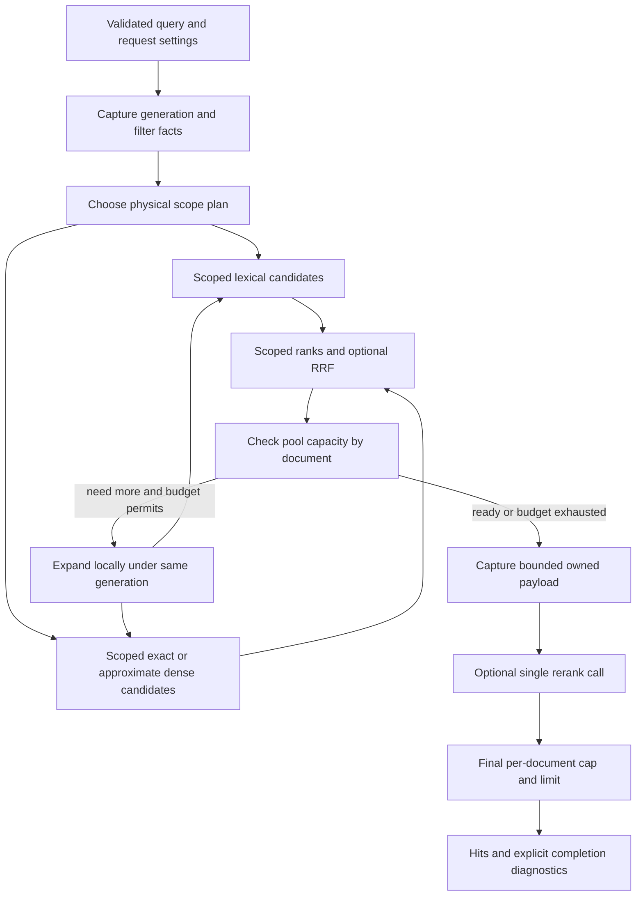

# Исследование scoped retrieval и разнообразия выдачи

Дата: 2026-11-11. Статус: исследование и предложение для #67/#68, **не принятая дельта требований и не реализованная возможность**.

GitHub tracker с полным текстом исследования, связями и воспроизводимым probe: [#117](https://github.com/punkhomov/docsbase-memory-mcp/issues/117).

Исходники проверены на `origin/main` = `498753ebd23ea0259a5c225ed5699912f32f654e` (PR #116). Зависимости из его lockfile: Tantivy 0.26.2, hnsw_rs 0.3.5. Ссылки на код ниже закреплены на этот commit. Текущая рабочая ветка не служила источником описания main.

Задача исследования: самостоятельно проверить вопросы, контрпримеры и альтернативы для [#67](https://github.com/punkhomov/docsbase-memory-mcp/issues/67) и [#68](https://github.com/punkhomov/docsbase-memory-mcp/issues/68). Приоритеты: корректность области и ранжирования, CPU/IO, задержка, удерживаемая память, конкурентные обновления и инвалидация. ACL/плагины сейчас не реализуем. Попадание текстов в remote provider не используется как аргумент выбора алгоритма. Платных запросов не выполнялось.

## Предлагаемое направление

1. **Один смысл запроса, несколько способов исполнения.** `path_prefix` и tags задают допустимую область. Lexical/exact dense должны выбирать top-k внутри неё. Где проверять принадлежность физически — при пересечении postings, перед вычислением distance или при продолжении упорядоченного поиска — зависит от стоимости. Проверка после уже усечённого top-k не даёт этой гарантии.
2. **Не требовать полного allowlist.** Представления «все», «никто», положительное/отрицательное множество и проверка кандидатов имеют разные цены. Маленький deny-набор не превращается автоматически в большой include-набор. Получить множество, преобразовать ID, скомпилировать запрос и построить кэш — тоже работа.
3. **Для ближайшего #67 опереться на текущие SQLite и indexed `doc_id`.** Проверить реализацию через `TermSetQuery` без смены схемы, сравнив её с ленивой проверкой и добором на характерных запросах. Не закладывать обязательный shared bitmap cache в первый PR. Его необходимость и конкретное представление должны следовать из замеров холодных и повторных запросов.
4. **RRF получает ранги внутри одной допустимой области.** Нельзя в зависимости от выбранного быстрого пути переключаться между scoped fusion и global fusion → filter: это разные ранжирования. BM25 statistics при этом остаются статистиками исходного индекса.
5. **#68 решает заполнение и группировку, MMR — другую задачу.** Для lexical сравнить сбор top-k с cap на документ и ограниченное расширение. Для RRF/rerank расширять пул до достаточной вместимости по документам либо до явного бюджета. Лучшие чанки выбираются после финального ранжирования. Reranker вызывается один раз на подготовленном пуле.
6. **ANN остаётся приблизительным.** Небольшую допустимую область можно считать точно, без прохода по полному графу. Имеющийся `search_filter` надо проверить на recall, работе и памяти; один параметр `ef` не является доказательством ограниченности всех ресурсов.
7. **Контекст и бюджеты принадлежат запросу.** Сохранить контракты #66: короткие фазы чтения, проверка generation/pending, bounded owned payload, без DB/lease через provider. Кэш не превращает изменяемые SQLite/Tantivy в атомарный snapshot.
8. **`limit` пока означает чанки.** При `n_per_doc=2`, `limit=10` не обещает десять страниц. Для сайта можно явно использовать cap=1; отдельный page/group API потребует отдельного публичного контракта.

Эти решения достаточны для подготовки реализации. Не выбраны без измерений: пороги exact/ANN, политика admission shared cache, конкретный быстрый lexical plan для широкого холодного фильтра и численные бюджеты расширения.

## Что действительно делает текущий код

| Участок | Факт и следствие |
|---|---|
| [`search_plan` и `prepare_search`][code-tools] | Lexical с filters/dedupe запрашивает `limit × 4`, RRF/rerank — `max(limit, window)`, с cap 1000. RRF усекается перед payload/rerank. Настоящего refill нет. |
| `PreparedSearch::finish` | Rerank → path/tag filter → per-doc cap → limit. За пределами подготовленного окна кандидатов нет. |
| Path/tags | `str::starts_with`, literal и case-sensitive; `docs` включает `docs-old`, `docs/` отличается. Tags — AND строк, garbage JSON означает отсутствие тегов. Числа в tags игнорируются. |
| Группировка | `dedupe=none` по умолчанию; `dedupe=path` считает по `doc_id`, default cap=2, maximum=10. `limit` считает chunk hits. |
| [`search_reader`][code-index] | Внутреннее widening исправляет порядок после long-chunk penalty, а не полноту path/tag/dedupe. Его остановка опирается на верхнюю границу raw BM25 score и multiplier ≤1. |
| Схема Tantivy | `doc_id`, `chunk_id`, `text_len` indexed/stored, **не FAST**. Path/tags отсутствуют. Обычный `FilterCollector` требует fast field; текущая схема для него не подходит. |
| [`dense::top_k`][code-dense] | Считает все строки, выделяет scored Vec и полностью сортирует. `top_k_iter` уже использует bounded heap; фильтр нужен до загрузки исключённых векторов, а не только перед heap. |
| ANN | Общий граф относится к проекту/generation/model/chunk-set. Обёртка использует обычный `search`; dependency уже предоставляет `search_filter`. Нельзя строить граф на каждого пользователя или комбинацию тегов. |
| Поколения | #66 защищает подготовку фазами чтения и проверками generation. Хранилище по-прежнему обновляется in place с pending/recovery; immutable published generations ещё не реализованы. |

Перенос фильтра без учёта этих деталей может убрать старую неполноту и одновременно добавить другой порядок RRF, IO на все векторы или дорогое сканирование Tantivy.

## Вопросы, на которые дизайн должен отвечать

Ответы ниже — предлагаемые решения либо конкретные проверки, а не вопросы, переданные пользователю.

### Семантика и полнота

| № | Вопрос | Ответ / проверка |
|---|---|---|
| Q01 | Что ограничивает `limit`: чанки, страницы или группы? | Сохраняем чанки. Cap=1 даёт не более одного чанка страницы; десять страниц возможны лишь при наличии достаточного числа найденных документов. |
| Q02 | Фильтр определяет область поиска или только формат готового ответа? | Для #67 — область. Финальная проверка допустима, но не заменяет поиск подходящих кандидатов. Это dated behavior delta к принятому bounded-window контракту. |
| Q03 | Должен ли scoped BM25 пересчитывать IDF на подкорпусе? | Нет: сохранить corpus-level statistics и boosts/penalty. Пересечение с областью не означает создание нового корпуса. |
| Q04 | Какая полнота возможна? | Lexical/exact dense: top-k внутри области при завершении точного поиска. ANN: измеряемая approximate recall. RRF/rerank: ранжирование объявленного ограниченного пула, не всего корпуса. |
| Q05 | Что значит короткая выдача? | Различать найденное исчерпание, approximate shortfall и остановку по candidate/work budget. Deadline/cancel остаются typed errors текущего контракта; не превращать их в успешное пустое множество. |
| Q06 | Сохраняются ли literal path и tolerant tags? | Да; oracle должен включать case, Unicode, `%`, `_`, `docs`/`docs/`, NULL/garbage/non-array/mixed-type tags. Нельзя подменить starts_with обычным LIKE. |

### Стоимость фильтра

| № | Вопрос | Ответ / проверка |
|---|---|---|
| Q07 | Нужно ли всегда получать все eligible IDs? | Нет. Нужна membership-семантика; enumeration — только один способ её исполнить. |
| Q08 | Выгоднее include или exclude? | Зависит от **получения** представления и проверки, а не только его итоговой длины. Предпочесть готовый deny20 перед вычислением allow19980; не искать deny20 полным сканированием только ради меньшего Vec. |
| Q09 | Когда дорогую проверку выгоднее делать после retrieval? | Когда query matches/candidates мало, а материализация области дорога. Проверять документы пачками и один раз на doc в запросе, продолжая источник до достаточного результата/бюджета. |
| Q10 | Нужен ли точный COUNT перед каждым поиском? | Нет. Бесплатные/дешёвые estimates и известные размеры полезны; отдельный полный COUNT может удвоить miss-работу. У неизвестной cardinality должен быть корректный путь исполнения. |
| Q11 | Можно ли estimate использовать для отсечения результатов? | Нет. Estimate выбирает план, не доказывает пустоту и не задаёт безопасный жёсткий cap. Особенно опасно складывать пересекающиеся exclusions, затем вычитать из N. |
| Q12 | Как комбинировать дешёвые и дорогие условия? | Для чистых AND: сначала дешёвые селективные проверки, затем дорогие; использовать short-circuit. В будущем callback должен иметь отдельный стабильный контракт, а не произвольные side effects. |

### Представления и холодный путь

| № | Вопрос | Ответ / проверка |
|---|---|---|
| Q13 | 20k файлов, 10k в папке: передавать 10k terms каждый раз? | Клиент передаёт prefix. На холодном серверном пути 10k IDs — допустимый проверяемый вариант, не обязательная архитектура. На повторном — reuse пригодного представления, если он окупается. Native filter fields — другая цена схемы/индекса. |
| Q14 | Достаточно ли сказать «bitmap занимает 2.5 KB»? | Нет: это только 20k плотных ordinal bits. Добавляются ID mapping, построение, chunks, сегменты, временные объекты и живые старые snapshots. |
| Q15 | Можно ли считать папку диапазоном doc_id? | Нет. IDs выдаются по истории индексации; документы папок могут чередоваться. Диапазон пути в B-tree не является диапазоном document IDs. |
| Q16 | Где маска невыгодна? | Одноразовые/случайные фильтры, частый sync, маленький query match set, дорогая компиляция в сегментные IDs. Начальный корректный путь обязан работать без cache hit. |
| Q17 | Нужен ли бит на каждый внешний chunk_id? | Нет. `doc_id << 32 | seq` разрежен. Membership по parent doc ID либо dense ordinals; полная bitmap по максимальному chunk ID недопустима. |
| Q18 | Одинаково ли число документов и векторов? | Нет. Порог exact/ANN и размер IO считать по eligible chunks/vectors и dimension, а не только по проценту документов. |

### Lexical, dense и fusion

| № | Вопрос | Ответ / проверка |
|---|---|---|
| Q19 | Можно ли обойтись существующей схемой Tantivy? | Да, для прототипа: indexed doc_id + TermSetQuery. TermSetQuery строит FST, это не обязательно 10k Boolean children. Не объявлять его быстрым без замера. |
| Q20 | Почему collector с membership не заведомо лучший? | Стандартный FilterCollector обходит специализированный pruning TopDocs. Даже query intersection может менять специализацию scorer. Сравнить работу и latency, не только allocations. |
| Q21 | Может ли фильтр изменить score? | Не должен. Для query composition проверить zero-score filter; constant=1 добавляет score и может изменить порядок после long-chunk penalty. Сравнить scores/порядок с exhaustive oracle. |
| Q22 | Когда exact dense дешевле ANN? | Когда немного eligible vectors и доступны их адреса; сравнить distance count + IO против graph traversal, включая холодный metadata/vector cache. Чужие процентные пороги не переносить. |
| Q23 | Достаточно ли фильтра перед dense heap? | Нет, если до этого прочитаны все исключённые векторы или на холодном miss загружен полный dense cache. Фильтр нужен до такого IO/инициализации. |
| Q24 | Можно ли filter перенести после RRF? | Нельзя при выбранном scoped-rank контракте. Фильтровать/набирать каждую ranked list до присвоения её scoped ranks, затем fusion. |
| Q25 | Можно ли склеивать independently reranked batches по score? | Trait обещает порядок внутри вызова; межвызовная сопоставимость не зафиксирована. Сформировать конечный bounded pool и ранжировать одним вызовом. |

### ANN и продолжение

| № | Вопрос | Ответ / проверка |
|---|---|---|
| Q26 | Достаточно ли выкидывать запрещённые узлы HNSW вместе с их рёбрами? | Нет: можно разорвать traversal. Filtered algorithms сохраняют проход через такие узлы либо используют специальные multi-hop/edges. |
| Q27 | Есть ли нужный API в hnsw_rs? | Есть `search_filter` и FilterT; это снимает вопрос наличия hook, но не вопросы recall, cancellation, памяти и стоимости. |
| Q28 | Ограничивает ли `ef` visited/work? | Не целиком: search_layer имеет отдельный visited HashMap. Нужен аудит worst-case и admission по реальному bound; иначе использовать bounded exact path/явный отказ. |
| Q29 | `search(k=50)`, затем `search(k=100)` — продолжение? | В нашей обёртке нет cursor: это новый обход; ANN-списки могут меняться. Не учитывать только новые 50 и не склеивать старые ранги как стабильный prefix. |
| Q30 | `k / selectivity` гарантирует достаточный пул? | Нет. Это estimate для initial fetch: filter может быть anti-correlated с query, а chunks по документам распределены неравномерно. Всегда cap и причина остановки. |
| Q31 | Нужен ли ANN graph на каждый scope? | Нет. Обычно один общий graph; exact scoped scan/filtered traversal выбираются на запрос. Partitioned indexes допустимы только для устойчивой структуры корпуса после отдельного анализа. |

### Разнообразие, ресурсы и состояние

| № | Вопрос | Ответ / проверка |
|---|---|---|
| Q32 | Почему не cap=2 ещё до rerank? | Третий по BM25 чанк может стать первым после rerank. Не выбрасывать базовый пул до финального ранжирования. |
| Q33 | Можно ли заранее узнать, хватит ли результатов после cap? | Да: для live candidate pool `capacity = Σ_doc min(count_doc, n_per_doc)`. Capacity не зависит от порядка rerank; выбор surviving chunks зависит. |
| Q34 | Решает ли MMR недостаток кандидатов? | Нет. Он переставляет/отбирает имеющиеся. Не найдёт другую страницу, если её нет в пуле. |
| Q35 | Заменяет ли MMR жёсткий cap? | Нет. Разные фрагменты одной страницы могут быть семантически непохожи, а разные страницы — похожи. Hard cap и semantic redundancy — отдельные правила. |
| Q36 | Можно ли гарантировать лучший после rerank чанк всего документа без его оценки? | Нет для произвольного reranker. Гарантия ограничивается подготовленным пулом; global best требует оценки всех конкурирующих фрагментов. |
| Q37 | Что происходит при sync между scope и payload? | Проверить expected generation и pending в следующей read phase; mismatch → действующий retryable error. Нельзя продолжать новый scope со старыми candidates. |
| Q38 | Инвалидирует ли merge Tantivy application ID set? | Сам по себе — нет. Но маска по segment-local DocId обязана учитывать exact segment identity и deletions; segment ordinal не является ключом. |
| Q39 | Что входит в ключ filter cache? | Canonical cache/project identity + metadata generation + filter semantics/version + canonical predicate; compiled mask дополнительно exact segment/deletion identity. Не один query hash. |
| Q40 | Надо ли инвалидировать query vector при смене tags/prefix/cap? | Нет: он зависит от текста и embedding recipe. Result/pool cache зависит от фильтра и ranking policy. Кэш результатов сейчас не требуется вводить. |
| Q41 | Защищает ли eviction от памяти старых запросов? | Нет: живые Arc/readers/builds остаются charged до последнего release. Резервировать build buffers до выделения; capacity/hash tables тоже стоят память. |
| Q42 | Как избежать stampede и stale publication? | Singleflight по полной identity, bounded wait/admission, не держать global lock через build/search; старый завершившийся build не подменяет current pointer новой generation. |
| Q43 | Может ли refill держать DB snapshot через remote? | Нет. До rerank завершить локальный добор, проверить generation, скопировать bounded owned payload, освободить DB/lease, затем один rerank call. Query embedding может потребоваться раньше, также без DB/lease через provider. |
| Q44 | Нужен ли ACL framework уже сейчас? | Нет. Не закрывать возможность позднего дорогого predicate, но не строить plugin API, policy cache и revocation protocol без отдельной задачи. |
| Q45 | Что понадобится гипотетической проверке прав? | Стабильная request policy revision, понятная ошибка/unknown, batch/membership возможности и цена include/exclude. Без snapshot/revision нельзя доказать согласованность решения при изменении прав. Это требование будущего дизайна, не реализация #67. |

## Что делают другие системы

Документация просмотрена 2026-11-11. Это инженерные референсы, **не наши benchmark results**. Термин pre-filter у разных продуктов может означать и предварительный allowlist, и проверку непосредственно в graph traversal.

| Система / источник | Полезный механизм | Что не переносим автоматически |
|---|---|---|
| [Vespa: ANN][vespa-ann], [schema settings][vespa-schema] | Выбор exact при узкой области, filtered ANN, post-filter при широкой; ограниченная поправка targetHits по estimate; учитывается цена filter-first. | Их пороги/defaults и обещания относятся к их реализации. Это аргумент за cost-based выбор, не за один универсальный pre/post путь. |
| [Elasticsearch/Lucene: filtered kNN][elastic-filter] | Exact fallback на сегменте по размеру eligible set и работе traversal. Selective filter может замедлить HNSW. ACORN меняет обход. | Нельзя приписать hnsw_rs автоматический fallback/ACORN по одному наличию FilterT. |
| [Qdrant: filtering planner][qdrant-filter] | Payload indexes дают membership/cardinality; exact или graph; дополнительные filter-aware edges и ACORN для сложных сочетаний. | Дополнительные edges имеют стоимость построения/памяти, существующий graph сам их не получает. |
| [Weaviate: filtering][weaviate-filter] | Inverted index рядом с HNSW, allowlist, flat cutoff; sweeping/ACORN/PathSeer — разные стратегии работы с соседями. | Заявления производителя о скорости не доказывают выигрыш на нашем корпусе. Нельзя считать любые 10k IDs бесплатными. |
| [Meilisearch: Arroy][meili-arroy] | Roaring document sets; автор отдельно разбирает, почему расширять doc IDs во все vector IDs дорого при широком exclude. В Arroy выбрана организация нескольких stores, где vector ID совпадает с doc ID. | Нам с variable chunks не следует копировать store-per-vector-position. Переносимый вывод — избегать массового doc→chunk expansion на каждом запросе. Статья описывает конкретную архитектуру 2023 года. |
| [Typesense: search][typesense] | `enable_lazy_filter`: применять filter постепенно, если query tokens совпадают с немногими документами. `group_by` + `group_limit`; размер страницы при grouping считает группы. | Смена смысла нашего `limit` потребовала бы явного API change. Lazy execution не освобождает от корректных границ/подсчётов. |
| [Lucene 10.3.1: caching policy][lucene-policy], [LRU cache][lucene-cache] | Admission учитывает reuse/cost; cache bounded по bytes/entries и связан с segment core lifecycle. Можно пропустить cache construction, если оно дороже ведущего query iterator. | «Кэшировать каждую маску на первом запросе» не является общим правилом. Их byte counters не доказывают bound нашей retained memory. |
| [pgvector 0.8.1: iterative scans][pgvector] | Реальное продолжение ANN index scan после post-filter с ordering/work/memory policy. | Повторить наш stateless `search` с большим k — другой механизм. Strict distance order не означает exact nearest-neighbor recall. |
| [Faiss: query parameters и ID selectors][faiss] | Range, Array, Batch, Bitmap, Not; стоимость зависит от layout и конкретного index implementation. Search parameters передаются per query. | Range оптимален только при подходящем размещении/ID; membership O(1) не означает sublinear scan. Глобально менять search parameters shared graph нельзя. |
| [Elasticsearch: collapse][elastic-collapse] | Grouping и inner hits имеют отдельные semantics/cost; rescore representatives не равен rerank всех chunks. | Grouping до rerank может убрать будущего победителя. Не копировать collapse API как эквивалент текущего cap. |
| [ripgrep GUIDE][ripgrep] | Include/exclude при обходе файлов позволяют не читать ненужный контент. Порядок/семантика правил задаются явно. | Это filesystem discovery, не ranked top-k и не ANN. Glob rules не заменяют наш literal prefix. |

### Альтернативные алгоритмы

| Подход | Где полезен | Причина выбора / отказа сейчас |
|---|---|---|
| Inverted query intersection / TermSet | Известные indexed metadata/doc IDs, особенно selective scopes. | Первый кандидат для #67 без миграции. Требуется измерить compile/postings/scorer cost на широких фильтрах. |
| Query-first lazy membership + continuation | Редкие query matches, дорогая широкая область или дешёвый deny predicate. | Сохранить как физический вариант. Без настоящего continuation приходится повторять поиск; работа повторов учитывается полностью. |
| Exact eligible scan + bounded heap | Небольшое число eligible vectors; streaming выше cache cap. | Точный oracle и безопасный fallback. `O(M·d + M log k)` времени, `O(k)` scored state; отдельно считать metadata/vector buffers. |
| Filtered HNSW | Достаточно большая область и уже готовый graph. | Проверить existing hnsw_rs hook; не выпускать как «полный scoped поиск» без recall/resource evidence. |
| [ACORN][acorn] / [PathSeer][pathseer] | Трудные filtered ANN workloads, слабая/отрицательная корреляция filter с vector neighborhood. | Изменяют работу graph traversal, а иногда и construction. У Weaviate адаптация PathSeer отличается от paper. Это возможное дальнейшее ANN-исследование, не скрытая перепись engine внутри #67. |
| Per-folder/per-user graph/index | Устойчивые крупные partition keys, изолированное обновление. | Не стартовый вариант: cross-folder prefix/tags, дублирование, много мелких indexes, сложные updates. На каждого пользователя — неприемлемое умножение state. |
| Group-aware top-k collector | Финальный lexical score известен, нужен hard cap. | Перспективнее неограниченного overscan; хранить только конкурирующие winners, сохранять score bounds. Проверить цену lookup doc_id/length и pruning. |
| Two-stage page-first → best chunks | Сайт, явный page-level contract. | Может экономить дальнейшую работу, но выбор pages по первому chunk способен потерять лучшую страницу после rerank. Требует собственного измерения/контракта. |
| [MMR][mmr], [xQuAD][xquad], DPP | Semantic/subtopic diversity внутри достаточно полного candidate pool. | MMR рассмотрен ниже; xQuAD требует aspect/subquery model, DPP — diversity kernel и более сложного отбора. Не решают scope/недостаток кандидатов; для #68 избыточны по сравнению с hard grouping/refill. |

## Модель стоимости для выбора плана

Оценивать весь путь: `T_eager = acquire_scope + compile/map + scoped_retrieval`, а `T_lazy = retrieval_with_repeats + checked_unique_docs × predicate_cost`. Для streaming dense учитывать чтение vectors отдельно от cosine. Для include/exclude сравнивать цену получения соответствующего набора; меньшее множество не всегда дешевле получить. Оценка `k/selectivity` не учитывает query correlation, repeated chunks и cap, поэтому пригодна лишь для начального fetch.

Дополнительная компиляция/cache build стоимостью B окупается за r повторений пригодной identity, если экономия `r × (T_uncached - T_cached)` превышает B и приемлемую цену памяти. Если фильтр не повторяется до следующей generation, этой амортизации нет. Часть build work может уже входить в uncached plan — при сравнении не считать её дважды.

Memory bound складывается из shared resident state, **всех ещё живых** старых значений, admitted concurrent builders и суммы request buffers/owned payload. Счётчика «entries находятся в LRU» недостаточно. Плотный bitset, sorted Vec, hash set и Roaring сравниваются вместе с mappings, peak construction и iteration locality; новая зависимость ради Roaring требует ADR.

## Конкретный путь исполнения



В lexical-only ветке dense/RRF отсутствуют. Для финального lexical scoring возможен более прямой group-aware collector. Поздний внешний predicate, если появится, включается в membership каждой ветки; не только в последний response retain.

### 1. Область запроса и представление

Логически область — `S(g, predicate)`: документы конкретного проекта, существующие в проверенной generation и проходящие literal prefix/tag-AND. Settings/stages фиксируются из контекста #66; менять правила посреди refill нельзя.

Представления `All`, `Empty`, `Include(set)`, `Exclude(set)`, `CandidatePredicate` здесь — **проектная классификация**, не требование немедленно вводить пять публичных Rust типов/новый plugin trait. Для ближайших path/tags достаточно минимального scope value и конкретного retrieval adapter.

Планировщик различает известный размер, estimate и unknown, а также цену получения membership. Числа документов и vectors не взаимозаменяемы. Empty допустим только по точным фактам; «estimate≈0» не доказывает пустоту. Exclude проверяется относительно живых документов проекта, включая удаления; старый universe нельзя дополнить новыми документами молча.

Для 10k/20k папки возможны три практических реализации:

- SQL range по path → 10k doc IDs → query intersection. Подходит для первой проверяемой версии без новой Tantivy schema; cold construction/IO оплачивается явно.
- Query-first retrieval → проверить только найденные doc IDs → продолжить поиск, если не хватило. Выгодность зависит от query match count и требуемого расширения. Верхний cap 1000 ответов не должен автоматически стать пределом того, насколько глубоко можно исследовать источник.
- Filter field/compiled membership в самом search index. Потребуются schema/version/recovery, дополнительный disk/RAM и тест metadata-only update. Это возможная последующая оптимизация под частые filters, а не бесплатная замена SQL.

**Клиент не передаёт 10k ID.** И внутри сервера не обязательно заново строить 10k query terms на каждом запросе. Но нельзя обещать отсутствие enumeration на холодном пути или считать reuse доказанно выгодным до замера.

### 2. SQLite и сохранение semantics

Уже есть `UNIQUE(project_id, rel_path)`. Для валидного UTF-8 и текущего BINARY collation literal prefix можно выразить диапазоном:

```sql
SELECT id FROM docs
WHERE project_id = ?1 AND rel_path >= ?2 AND rel_path < ?3;
```

`?3` — минимальный следующий prefix по Unicode scalar order; при отсутствии верхней границы используется только lower bound, пустой prefix — no-op. Это не произвольное `prefix || '\uffff'`: реальные имена могут содержать большие codepoints. Range не требует считать папку отдельной сущностью и точно сохраняет отличие `docs`/`docs/`.

Прототип ниже проверил 13 случаев. Это ещё не production implementation: Rust binding/encoding, property-based equivalence, настоящие данные и platform path representation должны быть проверены при реализации.

Tags сейчас находятся в JSON. Для первого #67 предпочтительнее переиспользовать точный predicate на page/batch metadata, ограничивая сначала path, чем вводить несовместимую SQL JSON semantics. Если использовать `json_each`, отдельно защитить malformed JSON, root/type, case и non-string values. Новая normalized tag relation/index ускорит повторные lookup, но потребует backfill/migration и стоимости updates; это не обязательно для первого PR.

Enumeration не должна копировать все frontmatter/text в вечный snapshot. Читать короткими ограниченными фазами, накапливать только admitted ID/predicate state, проверять generation и cancellation. Если фазы разделены, каждая проверяет ту же generation/pending; SQL keyset progress не спасает от смешения поколений.

### 3. Tantivy: корректность и цена двух планов

`TermSetQuery` может использовать существующий indexed `doc_id`. Для include — пересечение с исходным query, для готового exclude — исключение. Filter не должен добавлять relevance score: проверить композицию с `ConstScoreQuery(..., 0.0)` и исходные BM25 statistics/boosts. Совпадение IDs недостаточно: oracle сравнивает score и порядок после penalty.

В Tantivy 0.26.2 стандартный `FilterCollector` не переопределяет `collect_segment`, а TopDocs score collector использует `for_each_pruning`. Простая обёртка может потерять Block-WAND. Query intersection тоже может перевести boolean scorer в менее специализированный путь; **ни одному варианту здесь не приписывается измеренное превосходство**.

Если делать собственный collector, его pruning threshold должен опираться на accepted final scores и корректную raw upper bound. В текущей схеме получение doc_id/length из stored fields для каждого scored match может стать главным IO. FAST поля требуют явной схемы/recovery; segment-local lookup, построенный из postings, имеет собственную build/cache цену. Копировать metadata на каждый запрос без budget нельзя.

При lazy filtering текущую проверку «k-й final score ≥ raw boundary» нужно применять к **подходящим surviving hits**. Недостаток k hits не означает завершение; остановка допустима по истинному exhaustion или бюджету. Для равных scores oracle должен закрепить tie behavior. Если потребуется стабильный новый tie-break по chunk_id вместо текущего порядка равных lexical hits, оформить это явно, не прятать в оптимизации.

### 4. Exact dense и ANN

Exact path: eligible chunk identities → загрузка только их vectors → bounded top-k heap. Для ready in-memory rows можно отфильтровать по `chunk_id_parts(id).0` до cosine. Для streaming отфильтровать hashes **до** vector-cache read. На selective cold запросе не инициировать ради этого полный dense cache/ANN build автоматически. На request-ready path сначала проверить, не загружается ли уже shared graph/cache; не создавать две конкурирующие копии без admission.

Query vector `(model/recipe, query)` переиспользуется при смене scope. Список кандидатов/result cache от этого не становится независимым от scope.

ANN-план сравнивается с exact eligible oracle на random, correlated и anti-correlated filters. `search_filter` принимает external DataId; у нас это chunk identity, из которой получается parent doc. Не расширять широкие document sets во все chunk IDs ради этого callback. Неподходящие узлы могут участвовать в traversal; выкидывание их из результатов не должно разрывать граф.

Внутренний visited HashMap способен расти за пределы ef-sized heaps. До production adoption нужны подтверждённый bound/admission (включая worst-case graph size и concurrency) и понятная cancellation/deadline граница. Если API не позволяет ограничить нужную работу, первая безопасная scoped реализация использует streaming exact под действующими budgets либо явную resource/deadline ошибку. Не выдавать длину ANN-ответа меньше k за доказательство отсутствия других подходящих документов.

Post-filter ANN может быть эффективен для широкого/дешёвого predicate. Он допустим лишь с declared approximate contract, ограниченным расширением и измеренным recall. `k/selectivity` — начальная оценка, не гарантия. Filtered traversal и graph recipe не меняются глобальным mutable parameter на каждый request. Открытая [#109](https://github.com/punkhomov/docsbase-memory-mcp/issues/109) про существующую ANN recall остаётся отдельной задачей.

### 5. RRF и дорогой поздний predicate

Ранги считаются после scope membership внутри каждой source list. Логика одинакова для заранее известного set и проверяемого кандидата: получить достаточный prefix подходящей ranked list, затем присвоить ranks. Physical pre/post choice не может переключить смысл fusion.

Для точного упорядоченного lexical/dense source фильтрация с настоящим продолжением даёт тот же scoped prefix, что предварительное ограничение, если сохраняются corpus scores и ties. Для ANN равенство не обещается: другой traversal даёт другой approximate pool; проверяются recall/качество и явные ограничения.

RRF по truncated lists сам по себе остаётся bounded retrieval. Не обещать exact global RRF winner: присутствие кандидата глубже обеих границ может изменить результат. При расширении пересчитать fusion по окончательным спискам и их исходным scoped ranks. Нельзя cap документов внутри этих списков или исключать «уже заполненные» документы, а затем считать сжатые ranks обычным chunk-level RRF. Это был бы другой алгоритм.

Гипотетический дорогой внешний predicate: batch по новым doc IDs, request-local reuse, cheap conditions раньше expensive; unknown/error не становятся allow. Его snapshot/revision должны быть определены отдельно. Наличие такого будущего predicate не требует откладывать все сегодняшние дешёвые ограничения до готового top-k.

### 6. #68: заполнение без потери лучших чанков

Для **lexical без rerank/RRF** финальный score известен. Целевой вариант — top-k с hard per-document cap, bounded winner state и тем же long-chunk penalty. Для проверки/более простого начального исполнения допустимо геометрическое widening в одном Searcher, если оно явно bounded и считает повторную работу. Сравнить latency/IO с collector: уменьшение памяти результатов не гарантирует меньший CPU. Для exact dense аналогичный bounded group-aware heap возможен при сканировании eligible vectors.

Для **RRF и/или rerank** безопасный первый вариант:

1. Получить обычный scoped базовый пул, не отбрасывая его чанки по pre-rerank cap.
2. По живым identities проверить `capacity(P) = Σ min(chunks_in_P(doc), n_per_doc)`. Если capacity ≥ limit, любая перестановка этого пула сохранит достаточно hit slots после cap; какие именно чанки переживут cap, определит финальное ранжирование.
3. Если capacity мала, локально расширить ranked source lists и итоговый prefix пула в рамках отдельных limits на candidate work и provider payload. Для RRF пересчитать ranks/fusion, а не приклеивать следующие batches. Более крупный запрос к stateless источнику — повторная работа, она целиком включается в budget.
4. До provider зафиксировать окончательный bounded pool/payload. Один rerank call, затем hard cap и limit. Не сравнивать scores разных rerank batches и не подмешивать новое поколение после ответа провайдера.
5. Если один действительно релевантный документ исчерпывает область или budget, вернуть допустимое короткое множество с правильной причиной. Не добавлять произвольные нерелевантные документы ради численного заполнения.

Пул при расширении не должен автоматически сохранять неизменным маленький старый fused truncate: иначе найденные другие документы снова потеряются. При этом максимум текущего `OwnedPayload`/результата 1000 не повышается побочным эффектом; больший raw exploration не означает 1000+ provider texts. Численные лимиты pool/work/rerank принадлежат search settings по #78, проходят admission, имеют provenance; их initial values фиксируются реализационной дельтой после измерения. Deadline/cancel #66 переиспользуются, не вводится второй таймаут с неясным приоритетом.

Гарантии: hard cap; сохранение лучших chunks **внутри окончательного пула** после rerank; отсутствие прежней ложной пустоты из-за scope window в exact retrieval; заполнение до limit при достаточной capacity. Не гарантируются global best после произвольного reranker, exact global RRF и полное заполнение при исчерпанном budget. Для website cap=1 даёт page-oriented выдачу в существующем chunk API; отдельные group pagination/total counts не возникают автоматически.

### 7. Роль MMR

Оригинальный [MMR][mmr] выбирает следующий элемент по комбинации query relevance и максимального сходства с уже выбранными: `λ·relevance - (1-λ)·max_similarity`. Sim1 и Sim2 могут различаться; нейронные embeddings не обязательны.

MMR полезен, когда **разные** страницы повторяют один материал, а пользователь хочет покрытие разных аспектов. Hard doc cap полезен даже если фрагменты одного файла очень непохожи. Условия совместимы: проверять hard eligibility/cap, затем выбирать следующий MMR winner среди оставшихся. Но это новая ranking policy, а не техническая дедупликация.

Не включать MMR по умолчанию в #68: он не расширяет pool, может ухудшить полезное подтверждение ответа и требует согласовать шкалы relevance/similarity. Для отдельного эксперимента: сравнить relevance, page coverage, semantic redundancy и latency, включая кейс единственной полезной страницы. Реализация с incremental max-redundancy требует `O(C·k·d)` при vector similarity и `O(C)` дополнительных scores, не обязательной матрицы `C×C`. Стоимость vectors/similarity считается отдельно; lexical-only не должен скрытно включать модель.

## Согласованность и кэши

Базовый безопасный вариант #67 **работает без нового shared filter cache**. Request-local reuse достаточно для repeated chunks одного документа и повторных локальных фаз. Если shared reuse окупается, вводить его отдельно с такими зависимостями:

| Состояние | Identity / invalidation |
|---|---|
| Логическая область по document IDs | Canonical cache root/database/project identity, включая incarnation при reset/recovery с повторным использованием численных IDs, + metadata generation + canonical predicate и версия semantics. Сортировать/дедуплицировать tags для ключа можно, не меняя внешний args payload. |
| Compiled segment mask | Предыдущая identity + exact SegmentId/deletion state/index binding. Не segment ordinal и не numeric Searcher generation от заново открытого reader в одиночку. |
| Dense/ANN membership adapter | Связь с тем же project generation и chunk-set; stable doc predicate можно применять к внешнему chunk ID без expansion. |
| Query vector | Query text + semantic model/recipe. Prefix/tags/dedupe/reranker не являются причиной re-embed. |
| Result/pool cache, если когда-либо появится | Query mode/text + scope identity + data generation + ranking settings/stages/model recipe + candidate policy/cap/limit и relevant revision. Не вводить его ради этой задачи. |
| Future rights decisions | Субъект и policy revision/semantics нужны отдельно от metadata generation. В рамках #67 такой кэш не строится. |

При нынешней coarse generation metadata-only refresh инвалидирует весь scope conservatively. [Dependency matrix #78][config-deps] описывает будущую более точную инвалидацию: tags-only не требует re-embed/rebuild ANN при неизменных chunks. Не обещать этот reuse, пока фактические identities не разделены.

Для shared cache обязательны byte/entry admission, singleflight builds, cancellation и отсутствие global lock через SQL/Tantivy/provider. Учёт включает retained capacity, mappings и peak build buffers. Evicted value и старое поколение оплачиваются до final release. Маленький cache bound при unlimited active snapshots не является bound process memory. При недоступном cache budget выбрать uncached plan либо controlled admission error, а не неполную маску.

Поздний build generation g может завершить собственный запрос, если его контекст ещё пригоден, но не заменить current state g+1. Segment merge может произойти без прикладной metadata mutation: invalidate/recompile только segment-specific часть. Recovery/missing schema/generation mismatch не маскируются валидным-looking cached set. Не держать SQLite transaction/reader lease через remote retries; refill заканчивается до финальной payload capture и вызова reranker. Query embedding может потребоваться раньше для dense retrieval и также выполняется без DB/lease через provider.

## Сценарии проверки

| Кейс | Ожидаемое поведение / цена, которую проверяем |
|---|---|
| Нет фильтра, пустой prefix/tags | Сохраняется простой путь и качество; не строится universe/mask ради no-op. |
| Точно пустая область | Нет dense vector IO/rerank; query validation сохраняет текущий порядок ошибок. Empty устанавливается доказанно. |
| 20k docs, две папки по 10k, холодный запрос | Сравнить SQL+TermSet, lazy membership, возможную compiled representation; включить enumeration/compile/mapping cost, не только kernel search. |
| Та же область, разные queries, повторное обращение | Выделить настоящий reuse scope от query-vector cache; измерить break-even и cache admission. |
| Allow20 против deny20 | Не превращать дешёвый deny в дорогой include; same semantics, разные цены получения/lookup. |
| Дорогой predicate допускает 99.9%, keyword встречается в 3 docs | Query-first/batch может избежать полного enumeration; не проверять повторные chunks одного doc заново. |
| Дешёвый selective prefix, keyword встречается везде | До top-k scope должен исключить rank5/rank41/>1000 starvation. |
| Path+tags AND, Unicode/case/%/_ | Эквивалент текущего Rust predicate; никакого glob/LIKE case folding. |
| NULL/garbage JSON/root array/tags string/mixed strings+numbers | Точное соответствие `has_tags`, без JSON query ошибок и нового признания чисел тегами. |
| IDs папок чередуются; есть удаления/повторные sync | Path range не подменяется ID range; cache universe не включает удалённые/чужие docs. |
| Sparse external chunk IDs | Нет bitmap по max external ID; parent membership без all-chunk expansion. |
| 40 чанков одного doc + 10 иных | Для exact lexical cap2/limit10 при завершённом поиске получить 10 hits; при cap1 — 10 разных docs. Проверить реальные citations. |
| 1000+ чанков одного doc, остальные глубоко | Raw exploration отделён от output bound. При budget stop явно неполно; не выдавать 2 hits за «всё найдено». |
| Один действительно релевантный документ | Hard cap сохраняется, нерелевантные filler docs не добавляются. |
| Reranker поднимает 3-й/40-й чанк документа на первое место | Pre-rerank cap не уничтожает его в пределах объявленного пула; provider получает один правильный bounded pool. |
| RRF с сильными исключёнными fillers | Scoped ranks одинаковы у eager/lazy exact планов; fusion до filter не принимается как эквивалент. |
| ANN filters random/correlated/anti-correlated | Recall против exact eligible oracle, distance/visited/work/peak memory; не только returned count. |
| `k > eligible vectors`, incomplete embeddings | Не искать бесконечно k; различать live docs, vector coverage и approximate shortfall. Coverage не объявляется полным по doc count. |
| Long-chunk penalty и равные scores на границе | Filter/group collector сохраняет final-score bound и deliberate tie policy. |
| Sync между scope/lexical/dense/refill/payload | Ни одного mixed-generation ответа; deterministic gated interleavings, typed retryable outcome. |
| Reload во время локальной подготовки/provider | Request сохраняет coherent stages/settings; новое окно/budget не подмешивается по ходу запроса. |
| Segment merge/deletions между запросами | Stable scope пригоден по metadata identity; compiled segment DocIds не переиспользуются на новом layout. |
| 50 одинаковых cache misses, затем отмена части callers | Singleflight, ограниченные waiters/admission и отсутствие вечного lock; cancelled leader не оставляет зависшую entry. |
| Eviction/shrink при живых old requests; старый build завершился последним | Retained bytes не исчезают из accounting преждевременно; stale publisher не вытесняет новую generation. |
| Случайные комбинации tags, высокий churn | Бюджет cache bounded; измерить pollution и отсутствие выигрыша; корректный uncached plan не зависит от reuse. |

Эти сценарии переводятся в meaningful production-seam tests при реализации. Mock membership полезен для счётчика дорогих вызовов; он не заменяет настоящий SQLite/Tantivy/search_docs/IPC для scope и выдачи.

## Проведённые проверки и пределы доказательств

Выполнен standalone [исследовательский probe](research/filtering_probe.py); [сохранён результат](research/filtering_probe-result-2026-11-11.json). Это throwaway synthetic experiment, не production code, не latency gate и не сравнение движков.

Среда: Python 3.14.10, SQLite 3.46.1; in-memory warm DB, 20k документов с interleaved IDs и двумя равными папками, 11 повторов execute+fetch IDs. Реальная embedded SQLite/Rust сборка, холодный disk cache, Tantivy и concurrent requests в этом замере **не участвовали**.

| SQL способ | Строк | Median, ms | План |
|---|---:|---:|---|
| Literal range | 10 000 | 1.6839 | Covering index, project и обе path boundaries |
| `substr(...)=prefix` | 10 000 | 2.3745 | Covering index только по project, затем проверка строк |
| Default `LIKE 'docs/%'` | 10 000 | 2.2709 | Здесь также поиск только по project |

Вывод: текущий path index **способен** обслуживать literal range; расширение schema не является предпосылкой. Числа не доказывают, что SQL enumeration быстрее index-native filter, и не задают production SLO. На edge cases default LIKE также нашёл `Docs/a` для `docs/`, в отличие от нужного starts_with. Проверены 13 prefix equivalence случаев, включая non-BMP, combining characters и крайний Unicode scalar.

Проверен контрпример RRF с K=60. Lexical: `B`, 98 excluded fillers, `A`, `C`; dense: `A,C,B`. Global fusion → filter даёт `B > A > C` (0.032266458 / 0.022643443 / 0.022340212). Filter source lists → scoped fusion даёт `A > B > C` (0.032522475 / 0.032266458 / 0.032002048). Это математическое различие, не timing observation.

Проверена арифметика памяти: payload Vec из 10k u64 = 80 000 bytes, плотная document bitmap 20k ordinals = 2 500 bytes, bitmap по chunk ID документа 20k уже потребовала бы примерно 10.7 TB. Это **только полезная нагрузка**, без allocator/container/mapping/build/concurrency overhead. Ни memory win Roaring, ни скорость compiled mask у нас пока не измерены.

Дополнительно изучены исходники именно Tantivy 0.26.2 и hnsw_rs 0.3.5: TermSet/FST, collector pruning, SearcherGeneration, FilterT и visited state. Cargo dependencies/schema/baselines и production code не менялись. Настоящие search benchmarks, native CI и provider experiments этим исследованием не заменены.

## Что измерить до выбора физических оптимизаций

Матрица: unfiltered; 0/20/200/10k/19980 eligible docs из 20k; разные chunks/doc и dimensions; rare/common lexical query; random и anti-correlated filter; metadata-only update; cache cold/reused/churn. Для каждой точки сравнить end-to-end варианты, а не один membership kernel.

Собирать: p50/p95/p99 и throughput при concurrency 1/4/16; queue time/errors; SQL rows/JSON bytes; scope build/query compile time; postings/scored matches; повторную работу widening; vector reads/bytes/distances; graph visited, когда метрика доступна; retained/peak allocations и RSS отдельно; old-generation удержание; provider documents/bytes/calls без live billing. Search result equality для exact paths и recall@n для ANN против точного oracle — обязательны вместе с ресурсными метриками.

Проверять отдельно: cold logical scope; ready scope+новый query; ready graph; cold selective dense request; неудачная cache admission; update во время нагрузки. Нельзя объявлять warm-cache выигрыш общим результатом или изменять ranking, чтобы сделать вариант быстрее. Отсутствие нужных внутренних counters фиксируется как ограничение измерения, не заполняется оценкой.

Численные thresholds/budgets не копируются из Vespa/Qdrant/Weaviate. Сначала измерить crossover на нашей сборке MSRV 1.88, затем owner search config фиксирует значения/provenance по #78. Нужны устойчивый простой fallback и hysteresis/разумная детерминированность выбора, если адаптивный planner появится; не менять план многократно во время одного запроса на шумных estimates.

Для implementation PR: targeted real search tests → текущий no-regression gate/ru_morph diagnostic → fmt/clippy и required native CI по AGENTS. Baseline/snapshots не перегенерировать автоматически. Реальная приёмка website на 20k корпусе по #79 остаётся отдельной: синтетические SQL числа её не закрывают.

Отдельная обязательная часть dated delta — semantics `meta.window` и `meta.trimmed` (действующие FR-5/FR-14). Eager intersection и lazy continuation наблюдают разные отказы: `filtered_out` нельзя выдавать за число исключённых chunks всего корпуса или выдумывать для кандидатов, которые индекс не вернул. Отсутствующий документ по #62 по-прежнему не считается filter rejection. Повторные widening attempts не должны суммировать одни и те же отказы многократно: использовать определённый финальный observation window либо bounded учёт без повторного подсчёта, а операционную работу повторов измерять отдельно. Для `deduped` закрепить этап после финального ранжирования и до limit; расширение пула не должно скрытно менять смысл счётчика. Существующую JSON-форму, точные значения и budget-stop reason проверить через реальные CLI/MCP paths; новый публичный counter не является обязательной целью.

## Последовательность только нашего потока

1. **#67, отдельный PR.** Dated semantic delta + exact oracle/rank5/rank41/>1000; literal range/tag predicate; scoped lexical/exact dense/streaming; scoped RRF inputs; безопасное решение ANN path. Внутри задачи небольшой end-to-end prototype сравнивает существующий TermSet path и lazy plan. Без необязательного нового shared filter cache, MMR или engine migration. Если нужен новый формат/scope index — сначала явный migration/recovery design.
2. **#68, следующий PR.** Hard cap/fill contract, pool capacity, lexical grouping/widening и bounded hybrid expansion, один rerank call, completion diagnostics. Проверить лучшие surviving chunks и ru_morph; defaults `dedupe=none`, cap2 и chunk-limit не меняются скрытно.
3. **Только подтверждённые оптимизации.** По результатам — cache admission/compiled masks, normalized tag index/FAST fields, более эффективный group collector. Каждая с измеренным выигрышем, memory/state accounting и версионированием при необходимости. Не блокировать #67 всем этим заранее.
4. **Отдельное исследование semantic diversity/ANN algorithms**, если метрики покажут проблему: MMR и сложные filtered traversal не прицепляются к #68 как «почти готовый дедуп».

Границы координации: #66 уже задаёт reader/request contracts; #78 владеет settings/artifact dependencies; #79 использует наш chunk/page contract и нуждается в реальной приёмке; #81 меняет remote orchestration, а не смысл фильтров. Одновременно переписывать `search_docs_with` с другим владельцем нельзя. Перед кодом повторно проверить актуальный main/PR ownership; исследование не резервирует участок кода.

## Исправление прежних упрощений

- «Всегда делать cached bitmap» было преждевременным: build, mapping, admission, reuse и retained snapshots не были измерены. Предложение заменено условным reuse после доказанной окупаемости.
- «Всегда pre-filter»/«всегда post-filter» не описывает эффективный план: логический scope един, способы membership/retrieval отличаются. Наличие будущего позднего predicate не оправдывает усечение перед сегодняшним фильтром.
- «Refill просто увеличивает окно» недостаточно: нужны тот же generation, правильные source ranks, score bounds, учёт повторной работы и явная остановка. Provider batching требует отдельного score contract.
- «MMR уже включает дедупликацию» смешивает semantic novelty с hard document grouping и поиском отсутствующих кандидатов.

## Проверка документа

Fresh independent review: Spec compliance PASS, Quality APPROVED; Critical/Important нет. Единственное Minor о telemetry semantics внесено в обязательный состав implementation delta выше. Локальные проверки: исследовательский probe завершился успешно; repository docs hygiene и 6 CI-script regression tests прошли; все 33 внешних URL доступны, локальные ссылки/reference definitions и whitespace проверены. Native Rust CI, production benchmarks и корректность будущей реализации не заявляются проверенными этим документом.

## Источники

[code-tools]: https://github.com/punkhomov/docsbase-memory-mcp/blob/498753ebd23ea0259a5c225ed5699912f32f654e/src/daemon/tools.rs
[code-index]: https://github.com/punkhomov/docsbase-memory-mcp/blob/498753ebd23ea0259a5c225ed5699912f32f654e/src/index/tantivy_index.rs
[code-dense]: https://github.com/punkhomov/docsbase-memory-mcp/blob/498753ebd23ea0259a5c225ed5699912f32f654e/src/hybrid/dense.rs
[config-deps]: https://github.com/punkhomov/docsbase-memory-mcp/blob/498753ebd23ea0259a5c225ed5699912f32f654e/docs/specs/component-configuration/state-dependencies.md
[vespa-ann]: https://docs.vespa.ai/en/querying/approximate-nn-hnsw.html
[vespa-schema]: https://docs.vespa.ai/en/reference/schemas/schemas.html#rank-profile
[elastic-filter]: https://www.elastic.co/docs/solutions/search/vector/knn/filtered-knn-search
[qdrant-filter]: https://qdrant.tech/documentation/search-design/vector-search-filtering/
[weaviate-filter]: https://docs.weaviate.io/weaviate/concepts/filtering
[meili-arroy]: https://www.meilisearch.com/blog/arroy-filtered-disk-ann
[typesense]: https://typesense.org/docs/30.1/api/search.html
[lucene-policy]: https://github.com/apache/lucene/blob/releases/lucene/10.3.1/lucene/core/src/java/org/apache/lucene/search/UsageTrackingQueryCachingPolicy.java
[lucene-cache]: https://github.com/apache/lucene/blob/releases/lucene/10.3.1/lucene/core/src/java/org/apache/lucene/search/LRUQueryCache.java
[pgvector]: https://github.com/pgvector/pgvector/blob/v0.8.1/README.md#iterative-index-scans
[faiss]: https://github.com/facebookresearch/faiss/wiki/Setting-search-parameters-for-one-query
[elastic-collapse]: https://www.elastic.co/docs/reference/elasticsearch/rest-apis/collapse-search-results
[ripgrep]: https://github.com/BurntSushi/ripgrep/blob/master/GUIDE.md
[acorn]: https://arxiv.org/abs/2403.04871
[pathseer]: https://ruochunjin.github.io/publication/2026-pathseer-adaptive-neighbor-handling-filtered-ann-search
[mmr]: https://www.cs.cmu.edu/~jgc/publication/MMR_DiversityBased_Reranking_SIGIR_1998.pdf
[xquad]: https://terrierteam.dcs.gla.ac.uk/publications/ecir2010_rodrygo_div.pdf

Версионные исходники dependency, проверенные дополнительно:

- [Tantivy TermSetQuery](https://docs.rs/tantivy/0.26.2/src/tantivy/query/set_query.rs.html), [FilterCollector](https://docs.rs/tantivy/0.26.2/src/tantivy/collector/filter_collector_wrapper.rs.html), [score collector](https://docs.rs/tantivy/0.26.2/src/tantivy/collector/sort_key/sort_by_score.rs.html), [SearcherGeneration](https://docs.rs/tantivy/0.26.2/src/tantivy/core/searcher.rs.html).
- [hnsw_rs search/filter](https://docs.rs/hnsw_rs/0.3.5/src/hnsw_rs/hnsw.rs.html), [FilterT](https://docs.rs/hnsw_rs/0.3.5/src/hnsw_rs/filter.rs.html).
- [Reranker trait без cross-call score contract](https://github.com/punkhomov/docsbase-memory-mcp/blob/498753ebd23ea0259a5c225ed5699912f32f654e/src/hybrid/mod.rs), [bounded payload](https://github.com/punkhomov/docsbase-memory-mcp/blob/498753ebd23ea0259a5c225ed5699912f32f654e/src/search/payload.rs), [#66 design](https://github.com/punkhomov/docsbase-memory-mcp/blob/498753ebd23ea0259a5c225ed5699912f32f654e/docs/specs/search-concurrency/design.md).
